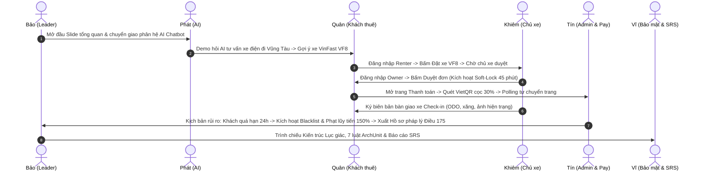

# 🚗 CẨM NANG TOÀN DIỆN BẢO VỆ ĐỒ ÁN TỐT NGHIỆP DRIVESHARE K4
> **Dự án**: Nền tảng chia sẻ và cho thuê xe trực tuyến (DriveShare)  
> **Kiến trúc**: Spring Boot 3.3.4 Hexagonal Modular (Ports & Adapters), PostgreSQL 16, Spring Security 6, JWT, Google Gemini 2.5 Flash, Langfuse LLMOps.  
> **Hội đồng bảo vệ**: Thầy Trương Thanh Bình (Giảng viên hướng dẫn & phản biện) & Chị Thư (Reviewer Doanh nghiệp).

---

## 📌 MỤC LỤC TỔNG HỢP
1. [Hệ Thống Trực Tuyến Live 24/7 & Bộ Tài Khoản Demo](#1-hệ-thống-trực-tuyến-live-247--bộ-tài-khoản-demo)
2. [Thông Số Kết Nối CSDL Thật (PostgreSQL 16)](#2-thông-số-kết-nối-csdl-thật-postgresql-16)
3. [Kịch Bản Trình Diễn Demo Phối Hợp 10 Phút](#3-kịch-bản-trình-diễn-demo-phối-hợp-10-phút)
4. [Sơ Đồ Trực Quan & Ma Trận Phân Chia 21 Bảng CSDL](#4-sơ-đồ-trực-quan--ma-trận-phân-chia-21-bảng-csdl)
5. [Ngân Hàng Câu Hỏi Phản Biện & SQL Thực Chiến Cho 6 Thành Viên](#5-ngân-hàng-câu-hỏi-phản-biện--sql-thực-chiến-cho-6-thành-viên)
   * [5.1 Nguyễn Duy Bảo (Team Lead & DB Architect)](#51-nguyễn-duy-bảo-team-lead--db-architect)
   * [5.2 Lộc Khiêm (Backend Core & State Machine)](#52-lộc-khiêm-backend-core--state-machine)
   * [5.3 Lâm Chí Vĩ (Backend Security & Auth)](#53-lâm-chí-vĩ-backend-security--auth)
   * [5.4 Đỗ Ngọc Phát (Backend AI & LLM Observability)](#54-đỗ-ngọc-phát-backend-ai--llm-observability)
   * [5.5 Nguyễn Duy Quân (Backend Quá Hạn & Pháp Lý 175 BLHS)](#55-nguyễn-duy-quân-backend-quá-hạn--pháp-lý-175-blhs)
   * [5.6 Chí Tín (Frontend Lead & Module Thanh Toán)](#56-chí-tín-frontend-lead--module-thanh-toán)

---

## 1. HỆ THỐNG TRỰC TUYẾN LIVE 24/7 & BỘ TÀI KHOẢN DEMO

### 🌐 Các Đường Link Quan Trọng:
* **Giao diện Website Người dùng (Frontend):**  
  👉 [https://driveshare-frontend-1guy.onrender.com](https://driveshare-frontend-1guy.onrender.com)
* **Backend REST API (Health Check):**  
  👉 [https://driveshare-backend-frug.onrender.com/api/v1/health](https://driveshare-backend-frug.onrender.com/api/v1/health) *(Trả về: `{"status":"UP","service":"DriveShare Backend"}`)*
* **Quản trị CSDL Adminer Online 24/7 (1-Click vào thẳng CSDL):**  
  👉 [https://driveshare-adminer.onrender.com/?pgsql=dpg-dbqt83dckfvc739r03ag-a&username=driveshare_user&db=driveshare_db_qgbj](https://driveshare-adminer.onrender.com/?pgsql=dpg-dbqt83dckfvc739r03ag-a&username=driveshare_user&db=driveshare_db_qgbj)  
  *(Mật khẩu: `tzCOgfeUdKvJEnapNEKhTNXIEwICoaWV` - chú ý chữ `O` hoa)*

---

### 👥 3 Tài Khoản Demo Chính Thức (Đã Kích Hoạt Sẵn Trạng Thái `ACTIVE`):

| Vai trò | Email đăng nhập | Mật khẩu | Họ và tên | Chức năng demo chính | Người phụ trách |
| :--- | :--- | :--- | :--- | :--- | :--- |
| **Khách thuê** *(Renter)* | `renter@driveshare.com` | `Renter123@` | Trần Văn B | Tìm xe AI Chatbot, đặt cọc 30% VietQR, ký biên bản giao nhận xe Check-in 2 chiều | **Quân** / **Phát** |
| **Chủ xe** *(Owner)* | `owner@driveshare.com` | `Owner123@` | Nguyễn Văn A | Duyệt đơn thuê, soft-lock 45p, quản lý xe (VF8, CX-5), xem doanh thu 90/10 | **Khiêm** |
| **Quản trị viên** *(Admin)* | `admin@driveshare.com` | `Admin123@` | System Admin | Dashboard sàn, giải quyết tranh chấp quá hạn, xuất 1-Click Hồ sơ pháp lý Điều 175 | **Tín** / **Bảo** |

---

## 2. THÔNG SỐ KẾT NỐI CSDL THẬT (POSTGRESQL 16)
Nếu Thầy cô hoặc thành viên muốn mở bằng công cụ chuyên dụng (**DBeaver / pgAdmin / TablePlus / Navicat**):

* **Host / Server:** `dpg-dbqt83dckfvc739r03ag-a.singapore-postgres.render.com`
* **Port:** `5432`
* **Database Name:** `driveshare_db_qgbj`
* **Username:** `driveshare_user`
* **Password:** `tzCOgfeUdKvJEnapNEKhTNXIEwICoaWV` *(chữ O hoa)*
* **SSL Mode:** Chọn **`Require`** *(bắt buộc để vượt qua firewall đám mây)*
* **Link xem tổng quan máy chủ trên Render Cloud:**  
  [https://dashboard.render.com/d/dpg-dbqt83dckfvc739r03ag-a](https://dashboard.render.com/d/dpg-dbqt83dckfvc739r03ag-a)

---

## 3. KỊCH BẢN TRÌNH DIỄN DEMO PHỐI HỢP 10 PHÚT



* **Phút 00:00 - 02:00 (Bảo):** Trình bày Slide mở đầu (Vấn đề thị trường thuê xe truyền thống, Mục tiêu giải pháp, Tổng quan Kiến trúc Lục giác Hexagonal).
* **Phút 02:00 - 03:30 (Phát):** Mở Website, click Widget Trợ lý AI hỏi: *"Tôi muốn tìm xe điện 5 chỗ đi Vũng Tàu cuối tuần"* $\rightarrow$ Bot bóc tách entity gợi ý ngay xe VinFast VF8 (`51K-12345`). Mở Dashboard Langfuse chỉ số Latency ~1.2s và Token usage.
* **Phút 03:30 - 05:30 (Quân & Khiêm - Happy Path):**  
  * Quân đăng nhập `renter@driveshare.com` $\rightarrow$ Đặt xe VF8.  
  * Khiêm đăng nhập `owner@driveshare.com` $\rightarrow$ Bấm Duyệt đơn (kích hoạt Soft-lock 45p).  
  * Quân mở màn hình thanh toán, demo mã VietQR động NAPAS247 $\rightarrow$ Tiền về, hệ thống tự động nhận diện và chuyển trang thành công.  
  * Hai bên xác nhận Biên bản giao xe 2 chiều (Check-in ODO, xăng, ảnh vết xước).
* **Phút 05:30 - 07:30 (Khiêm - Incident Flow):** Demo chủ xe hủy chuyến đột xuất $\rightarrow$ Hệ thống Escrow tự động hoàn cọc 100% cho khách và tự động khóa lịch xe đó trên lịch (`car_calendar_blocks`).
* **Phút 07:30 - 09:00 (Quân & Tín - Overdue & Legal Flow):** Demo đơn thuê quá hạn trả xe $\rightarrow$ Tính phạt trễ lũy tiến 150%/h $\rightarrow$ Quá 24h tự động khóa tài khoản đưa vào Blacklist $\rightarrow$ Admin Tín bấm **Xuất Hồ Sơ Pháp Lý 1-Click** trích xuất toàn bộ CCCD, GPLX B2, log cọc và ảnh biên bản để gửi công an theo Điều 175 BLHS.
* **Phút 09:00 - 10:00 (Vĩ & Bảo):** Báo cáo độ tin cậy mã nguồn (240 bài test xanh, 7 luật ArchUnit) và chuyển sang phần Hỏi - Đáp cùng Hội đồng.

---

## 4. SƠ ĐỒ TRỰC QUAN & MA TRẬN PHÂN CHIA 21 BẢNG CSDL

```mermaid
flowchart TD
    classDef bao fill:#e1f5fe,stroke:#0288d1,stroke-width:2px;
    classDef khiem fill:#e8f5e9,stroke:#388e3c,stroke-width:2px;
    classDef vi fill:#fff3e0,stroke:#f57c00,stroke-width:2px;
    classDef phat fill:#f3e5f5,stroke:#7b1fa2,stroke-width:2px;
    classDef quan fill:#ffebee,stroke:#d32f2f,stroke-width:2px;
    classDef tin fill:#ede7f6,stroke:#512da8,stroke-width:2px;

    subgraph SG_BAO["1. NGUYỄN DUY BẢO (Lead & DB Architect)"]
        direction TB
        B_CARS["cars (Kho xe sàn, trạng thái ACTIVE)"]:::bao
        B_IMG["car_images (Bộ ảnh xe)"]:::bao
        B_DOC["car_documents (Đăng kiểm, bảo hiểm xe)"]:::bao
        B_ROLE["roles & user_roles (Phân quyền RBAC)"]:::bao
        B_LOG["audit_logs (Nhật ký kiểm toán Admin)"]:::bao
    end

    subgraph SG_KHIEM["2. LỘC KHIÊM (Backend Core)"]
        direction TB
        K_RENT["rentals (Vòng đời đơn thuê, Soft-Lock 45p)"]:::khiem
        K_BLOCK["car_calendar_blocks (Chặn lịch xe bận)"]:::khiem
    end

    subgraph SG_VI["3. LÂM CHÍ VĨ (Security & Auth)"]
        direction TB
        V_USER["users (Token Versioning, Mật khẩu BCrypt)"]:::vi
        V_SESS["auth_sessions (Phiên đăng nhập JWT)"]:::vi
        V_OTP["email_otps (Mã OTP xác thực email)"]:::vi
        V_TOK["email_change_tokens & password_reset_tokens"]:::vi
    end

    subgraph SG_PHAT["4. ĐỖ NGỌC PHÁT (AI & Observability)"]
        direction TB
        P_CHAT["chat_memory (Lịch sử hội thoại AI)"]:::phat
        P_REV["reviews (Đánh giá sao & RAG Context)"]:::phat
    end

    subgraph SG_QUAN["5. NGUYỄN DUY QUÂN (Quá Hạn & Pháp Lý)"]
        direction TB
        Q_PROF["renter_profiles (CCCD & Bằng lái B2 eKYC)"]:::quan
        Q_INSP["rental_inspections (Bàn giao xe Check-in/out)"]:::quan
        Q_DISP["rental_disputes (Tranh chấp Điều 175 BLHS)"]:::quan
    end

    subgraph SG_TIN["6. CHÍ TÍN (Frontend & Thanh Toán)"]
        direction TB
        T_PAY["payments (Cọc VietQR 30%, Escrow 90/10)"]:::tin
        T_OWN["owner_profiles (STK ngân hàng giải ngân 90%)"]:::tin
        T_NOTI["notifications (Thông báo chuông Realtime)"]:::tin
    end

    %% Mối quan hệ khóa ngoại giữa các phân hệ
    V_USER -->|"1 - 1"| Q_PROF
    V_USER -->|"1 - 1"| T_OWN
    V_USER -->|"1 - n"| K_RENT
    B_CARS -->|"1 - n"| K_RENT
    B_CARS -->|"1 - n"| K_BLOCK
    B_CARS -->|"1 - n"| P_REV
    K_RENT -->|"1 - n"| T_PAY
    K_RENT -->|"1 - n"| Q_INSP
    K_RENT -->|"1 - n"| Q_DISP
    V_USER -->|"1 - n"| T_NOTI
```



### 📋 Ma Trận Phân Công Trách Nhiệm 21 Bảng:

| Thành viên | Trách nhiệm chính | Số bảng | Danh sách các bảng đảm nhận học sâu |
| :--- | :--- | :---: | :--- |
| **1. BẢO** | Kiến trúc CSDL, Kho xe, Phân quyền RBAC, Admin Audit | **6 bảng** | `cars`, `car_images`, `car_documents`, `roles`, `user_roles`, `audit_logs` |
| **2. KHIÊM** | Vòng đời đơn thuê (State Machine), Khóa bi quan, Lịch bận | **2 bảng** | `rentals`, `car_calendar_blocks` |
| **3. VĨ** | Tài khoản, JWT Stateless, Token Versioning, Mã OTP | **5 bảng** | `users`, `auth_sessions`, `email_otps`, `email_change_tokens`, `password_reset_tokens` |
| **4. PHÁT** | Trợ lý ảo AI, Lịch sử chat, Đánh giá xe (Dữ liệu RAG) | **2 bảng** | `chat_memory`, `reviews` *(kèm các cột tìm kiếm trong `cars`)* |
| **5. QUÂN** | eKYC khách thuê, Bàn giao xe 2 chiều, Hồ sơ pháp lý Điều 175 | **3 bảng** | `renter_profiles`, `rental_inspections`, `rental_disputes` |
| **6. TÍN** | Giao dịch cọc VietQR 30%, Escrow 90/10, STK chủ xe, Chuông thông báo | **3 bảng** | `payments`, `owner_profiles`, `notifications` |

---

## 5. NGÂN HÀNG CÂU HỎI PHẢN BIỆN & SQL THỰC CHIẾN CHO 6 THÀNH VIÊN

---

### 5.1 NGUYỄN DUY BẢO (Team Lead & DB Architect)
* **Bảng CSDL phụ trách:** `cars`, `car_images`, `car_documents`, `roles`, `user_roles`, `audit_logs`.

#### 🌟 CÂU HỎI CÔNG NGHỆ CỐT LÕI (BẢO):
* **❓ Câu B.1: "Tại sao dự án dùng Kiến trúc Lục giác (Hexagonal / Ports & Adapters) mà không dùng MVC 3 tầng truyền thống? 7 luật ArchUnit kiểm soát điều gì?"**
  * 👉 **Cách trả lời:** *"Kiến trúc MVC truyền thống thường bị 'rò rỉ framework' (Spring/JPA tràn vào logic nghiệp vụ), khiến code bị dính chặt vào công nghệ. Hexagonal tách biệt thành 3 tầng: **Domain Core (Pure Java)** hoàn toàn độc lập, giao tiếp với bên ngoài thông qua **Ports (Inbound/Outbound Interface)** và **Adapters (Web Controller / JPA Persistence)**. Nhóm em cài đặt 7 luật ArchUnit tự động quét trong unit test: cấm Domain import Spring/JPA, cấm Controller gọi thẳng Repository, và cấm 11 module gọi vòng chéo nhau."*

#### 💻 BỘ TRUY VẤN SQL THỰC CHIẾN (BẢO):

* **❓ Câu B.2: "Viết query Dashboard lấy ra 5 xe được BOOKING nhiều nhất toàn sàn?"**
  ```sql
  SELECT 
      c.car_id,
      c.brand,
      c.model,
      c.plate_number,
      c.price_per_day,
      COUNT(r.rental_id) AS tong_so_lan_dat
  FROM cars c
  LEFT JOIN rentals r ON c.car_id = r.car_id
  GROUP BY c.car_id, c.brand, c.model, c.plate_number, c.price_per_day
  ORDER BY tong_so_lan_dat DESC, c.car_id ASC
  LIMIT 5;
  ```
  👉 **Giải thích:** Dùng `LEFT JOIN` giữa `cars` và `rentals` theo `car_id`. Hàm `COUNT(r.rental_id)` gom nhóm theo xe (`GROUP BY`) và sắp xếp giảm dần `LIMIT 5`.

* **❓ Câu B.3: "Viết query Dashboard lấy ra 5 xe có DOANH THU cao nhất toàn sàn?"**
  ```sql
  SELECT 
      c.car_id,
      c.brand,
      c.model,
      c.plate_number,
      COUNT(r.rental_id) AS so_chuyen_thue,
      COALESCE(SUM(r.total_price), 0) AS tong_doanh_thu
  FROM cars c
  LEFT JOIN rentals r ON c.car_id = r.car_id 
      AND r.status IN ('COMPLETED', 'CONFIRMED', 'IN_PROGRESS')
  GROUP BY c.car_id, c.brand, c.model, c.plate_number
  ORDER BY tong_doanh_thu DESC
  LIMIT 5;
  ```
  👉 **Giải thích:** Khác với số lần đặt, doanh thu chỉ tính đơn hợp lệ (`COMPLETED`, `CONFIRMED`, `IN_PROGRESS`). `COALESCE(SUM(r.total_price), 0)` giúp xe chưa có đơn vẫn hiển thị 0đ.

* **❓ Câu B.4: "Viết query thống kê doanh thu toàn sàn theo từng THÁNG (Monthly Revenue)?"**
  ```sql
  SELECT 
      TO_CHAR(created_at, 'YYYY-MM') AS thang,
      COUNT(rental_id) AS tong_so_don,
      COALESCE(SUM(total_price), 0) AS doanh_thu_thang,
      COALESCE(SUM(total_price) * 0.10, 0) AS hoa_hong_san_10_phan_tram
  FROM rentals
  WHERE status IN ('COMPLETED', 'CONFIRMED', 'IN_PROGRESS')
  GROUP BY TO_CHAR(created_at, 'YYYY-MM')
  ORDER BY thang DESC;
  ```

* **❓ Câu B.5: "Viết query tìm Top 5 khách hàng chi tiêu nhiều tiền thuê xe nhất trên sàn?"**
  ```sql
  SELECT 
      u.user_id,
      u.full_name,
      u.email,
      u.phone,
      COUNT(r.rental_id) AS so_lan_thue,
      COALESCE(SUM(r.total_price), 0) AS tong_chi_tieu
  FROM users u
  JOIN rentals r ON u.user_id = r.renter_id
  WHERE r.status IN ('COMPLETED', 'CONFIRMED', 'IN_PROGRESS')
  GROUP BY u.user_id, u.full_name, u.email, u.phone
  ORDER BY tong_chi_tieu DESC
  LIMIT 5;
  ```

---

### 5.2 LỘC KHIÊM (Backend Core & State Machine)
* **Bảng CSDL phụ trách:** `rentals`, `car_calendar_blocks`.

#### 🌟 CÂU HỎI CÔNG NGHỆ CỐT LÕI (KHIÊM):
* **❓ Câu K.1: "Nếu 2 khách cùng bấm đặt 1 chiếc xe tại đúng 1 mili-giây, hệ thống giải quyết tranh chấp (Concurrency) bằng cơ chế nào? Tại sao không dùng Khóa lạc quan (@Version)?"**
  * 👉 **Cách trả lời:** *"Em áp dụng cơ chế **Khóa bi quan (@Lock PESSIMISTIC_WRITE)** tại tầng Repository. Khi giao dịch 1 đến, Spring Data JPA sinh câu lệnh `SELECT ... FOR UPDATE` lên hàng xe đó trong CSDL PostgreSQL. Hàng xe bị khóa ở cấp độ dòng (Row-level Lock). Giao dịch 2 bắt buộc phải chờ. Khi giao dịch 1 chuyển trạng thái xe sang giữ chỗ và commit xong, giao dịch 2 kiểm tra lại thấy xe đã bận nên từ chối ngay lập tức, triệt tiêu 100% lỗi Double Booking. Nhóm em không dùng Khóa lạc quan (@Version) vì giờ cao điểm sẽ quăng `OptimisticLockException` liên tục buộc khách thử lại gây trải nghiệm rất tệ."*

#### 💻 BỘ TRUY VẤN SQL THỰC CHIẾN (KHIÊM):

* **❓ Câu K.2: "Viết query tìm các đơn đang trong thời hạn Soft-Lock 45 phút giữ xe?"**
  ```sql
  SELECT rental_id, car_id, renter_id, deposit_amount, payment_expires_at, status
  FROM rentals
  WHERE status = 'PENDING' AND payment_expires_at > NOW();
  ```
  👉 **Giải thích:** Cột `payment_expires_at` lưu mốc hết hạn (`NOW() + 45 phút`). Nếu khách chưa thanh toán và thời gian còn lớn hơn `NOW()` thì xe bị khóa tạm, khách khác tìm xe sẽ thấy xe không khả dụng.

* **❓ Câu K.3: "Viết query mà Cronjob (RentalExpirationScheduler) chạy ngầm mỗi 1 phút để dọn dẹp đơn hết hạn cọc?"**
  ```sql
  SELECT rental_id, car_id, renter_id, payment_expires_at, status
  FROM rentals
  WHERE status = 'PENDING' AND payment_expires_at <= NOW();
  ```
  👉 **Giải thích:** Cronjob quét các đơn `payment_expires_at <= NOW()`, tự động đổi status sang `EXPIRED`/`CANCELLED` để mở lại xe về trạng thái trống.

* **❓ Câu K.4: "Viết query kiểm tra xe ID = 1 có bị trùng lịch từ ngày 20/11/2026 đến 25/11/2026 không?"**
  ```sql
  SELECT rental_id, car_id, start_date, end_date, status
  FROM rentals
  WHERE car_id = 1
  AND status IN ('CONFIRMED', 'IN_PROGRESS', 'PENDING')
  AND (start_date <= '2026-11-25' AND end_date >= '2026-11-20');
  ```
  👉 **Giải thích:** Thuật toán kiểm tra giao thoa khoảng thời gian `(start_date <= :endDate AND end_date >= :startDate)`.

* **❓ Câu K.5: "Thống kê số lượng đơn thuê phân bổ theo 5 trạng thái của State Machine?"**
  ```sql
  SELECT status, COUNT(*) AS so_luong_don
  FROM rentals
  GROUP BY status ORDER BY so_luong_don DESC;
  ```

---

### 5.3 LÂM CHÍ VĨ (Backend Security & Auth)
* **Bảng CSDL phụ trách:** `users`, `auth_sessions`, `email_otps`, `email_change_tokens`, `password_reset_tokens`.

#### 🌟 CÂU HỎI CÔNG NGHỆ CỐT LÕI (VĨ):
* **❓ Câu V.1: "JWT là Stateless (không lưu session), vậy khi người dùng bị lộ tài khoản hoặc đổi mật khẩu, làm sao thu hồi Token ngay lập tức mà không cần Redis?"**
  * 👉 **Cách trả lời:** *"Em áp dụng kỹ thuật **Token Versioning**. Trong bảng `users` em thêm cột `token_version (BIGINT)`. Khi cấp JWT, em nhúng version này vào Claim của Payload. Tại mỗi request, `JwtAuthenticationFilter` giải mã token và so khớp số version trong token với cột `token_version` dưới DB. Khi user đổi mật khẩu, em chỉ cần chạy `UPDATE users SET token_version = token_version + 1`. Ngay lập tức toàn bộ Token cũ lưu trên máy kẻ xấu đều bị vô hiệu hóa vì lệch version, giải quyết trọn vẹn điểm yếu lớn nhất của JWT mà **tiết kiệm hoàn toàn chi phí duy trì Redis Cluster**."*

#### 💻 BỘ TRUY VẤN SQL THỰC CHIẾN (VĨ):

* **❓ Câu V.2: "Viết query mô phỏng việc tăng `token_version` để thu hồi toàn bộ phiên đăng nhập?"**
  ```sql
  -- 1. Xem version hiện tại của tài khoản:
  SELECT user_id, email, token_version, status FROM users WHERE email = 'renter@driveshare.com';

  -- 2. Giả lập thu hồi token khi đổi mật khẩu:
  UPDATE users SET token_version = token_version + 1 WHERE email = 'renter@driveshare.com';
  ```

* **❓ Câu V.3: "Tìm các tài khoản đang bị khóa tạm thời do nhập sai mật khẩu quá 5 lần liên tiếp?"**
  ```sql
  SELECT user_id, email, full_name, failed_login_attempts, locked_until, status
  FROM users
  WHERE failed_login_attempts >= 5 OR locked_until > NOW();
  ```

* **❓ Câu V.4: "Thống kê số lượng người dùng đăng nhập bằng Google OAuth2 so với tài khoản thường?"**
  ```sql
  SELECT 
      COALESCE(auth_provider, 'LOCAL') AS phuong_thuc_dang_nhap,
      COUNT(*) AS so_luong_user
  FROM users
  GROUP BY auth_provider;
  ```

* **❓ Câu V.5: "Xem các mã OTP email đang còn hạn và chưa dùng trong bảng `email_otps`?"**
  ```sql
  SELECT id, email, purpose, attempts, expires_at, used
  FROM email_otps
  WHERE used = FALSE AND expires_at > NOW();
  ```

---

### 5.4 ĐỖ NGỌC PHÁT (Backend AI & LLM Observability)
* **Bảng CSDL phụ trách:** `chat_memory`, `reviews`, các cột tìm kiếm trong `cars`.

#### 🌟 CÂU HỎI CÔNG NGHỆ CỐT LÕI (PHÁT):
* **❓ Câu P.1: "Mô hình Langfuse Observability trong dự án theo dõi những chỉ số nào? Nếu mất mạng hoặc API Gemini bị lỗi thì hệ thống xử lý thế nào?"**
  * 👉 **Cách trả lời:** *"Dự án tích hợp SDK Langfuse để giám sát LLMOps thời gian thực:  
    1. **Latency Tracing:** Đo thời gian phản hồi của từng câu chat AI (trung bình ~1.2s).  
    2. **Token Usage:** Đếm số lượng Prompt Token và Completion Token để kiểm soát chi phí.  
    3. **System Prompt Versioning:** Quản lý phiên bản Prompt trên Langfuse Cloud, cập nhật luật tư vấn xe không cần build lại backend.  
    Khi mất kết nối Internet hoặc Gemini quá tải, lớp `CarAdvisorFallbackService` kích hoạt **Bộ lọc từ khóa dự phòng Regex** tự động bóc tách ngày thuê, khoảng giá và địa điểm để sinh câu query SQL trả về danh sách xe phù hợp, website không bao giờ bị đứng."*

#### 💻 BỘ TRUY VẤN SQL THỰC CHIẾN (PHÁT):

* **❓ Câu P.2: "Khi khách chat 'Tìm xe điện 5 chỗ ở TP.HCM dưới 1 triệu/ngày', câu SQL AI sinh ra là gì?"**
  ```sql
  SELECT car_id, brand, model, price_per_day, fuel_type, seats, province, features, rating
  FROM cars
  WHERE status = 'ACTIVE'
    AND fuel_type = 'ELECTRIC'
    AND seats = 5
    AND province LIKE '%Hồ Chí Minh%'
    AND price_per_day <= 1000000
  ORDER BY rating DESC;
  ```

* **❓ Câu P.3: "Tìm các xe có điểm đánh giá rating từ 4.5 sao trở lên kèm bình luận để làm tri thức RAG?"**
  ```sql
  SELECT c.car_id, c.brand, c.model, c.rating, c.rating_count, rw.rating AS sao_danh_gia, rw.comment
  FROM cars c
  JOIN reviews rw ON c.car_id = rw.car_id
  WHERE c.rating >= 4.5
  ORDER BY rw.created_at DESC LIMIT 5;
  ```

* **❓ Câu P.4: "Xem 5 phiên hội thoại gần đây nhất trong bảng `chat_memory`?"**
  ```sql
  SELECT id, session_id, user_email, message_count, first_message, last_message, updated_at
  FROM chat_memory
  ORDER BY updated_at DESC LIMIT 5;
  ```

* **❓ Câu P.5: "Tìm các xe có dịch vụ tài xế (has_driver_service) và phí tài xế dưới 500k/ngày?"**
  ```sql
  SELECT car_id, brand, model, driver_fee_per_day, rating, status
  FROM cars
  WHERE has_driver_service = TRUE AND driver_fee_per_day <= 500000;
  ```

---

### 5.5 NGUYỄN DUY QUÂN (Backend Quá Hạn & Pháp Lý 175 BLHS)
* **Bảng CSDL phụ trách:** `renter_profiles`, `rental_inspections`, `rental_disputes`, các cột phạt trong `rentals`.

#### 🌟 CÂU HỎI CÔNG NGHỆ CỐT LÕI (QUÂN):
* **❓ Câu Q.1: "Quy trình chế tài quá hạn trả xe hoạt động như thế nào? Căn cứ pháp lý Điều 175 BLHS được áp dụng ra sao?"**
  * 👉 **Cách trả lời:** *"Hệ thống chia làm 3 mốc chế tài nghiêm ngặt:  
    1. **Trễ từ 1 - 24 giờ:** Cronjob phát hiện quá `end_date` mà chưa Check-out, tự động chuyển đơn sang `OVERDUE` và phạt lũy tiến **150%/giờ** tính theo đơn giá ngày vào cột `penalty_fee`.  
    2. **Trễ quá 24 giờ:** Khách cố tình cắt liên lạc, hệ thống tự động bật cờ `is_blacklisted_triggered = TRUE`, khóa quyền thuê xe trên toàn hệ thống.  
    3. **Tính năng Xuất Hồ Sơ Pháp Lý 1-Click (/dossier):** Hệ thống kết xuất toàn bộ CCCD, Bằng lái B2 đã xác thực eKYC từ `renter_profiles`, mã giao dịch cọc ngân hàng từ `payments`, và biên bản ảnh chụp hiện trạng xe lúc giao từ `rental_inspections` thành file PDF hoàn chỉnh để chủ xe nộp cơ quan công an khởi tố theo **Điều 175 Bộ luật Hình sự (Tội lạm dụng tín nhiệm chiếm đoạt tài sản)**."*

#### 💻 BỘ TRUY VẤN SQL THỰC CHIẾN (QUÂN):

* **❓ Câu Q.2: "Viết query tìm toàn bộ đơn thuê đang bị QUÁ HẠN và số tiền phạt hiện tại?"**
  ```sql
  SELECT r.rental_id, r.car_id, r.renter_id, r.end_date, r.actual_return_time, 
         r.overdue_hours, r.penalty_fee, r.status
  FROM rentals r
  WHERE r.status = 'OVERDUE' OR r.overdue_hours > 0;
  ```

* **❓ Câu Q.3: "Viết query trích xuất thông tin định danh phục vụ 'Hồ Sơ Pháp Lý 1-Click' gửi công an theo Điều 175 BLHS?"**
  ```sql
  SELECT r.rental_id, u.full_name AS ten_khach_thue, u.phone AS so_dien_thoai, u.id_card_number AS cccd,
         rp.license_number AS gplx_b2, c.brand, c.model, c.plate_number AS bien_so,
         r.overdue_hours AS gio_chiem_doat, r.penalty_fee AS tien_phat
  FROM rentals r
  JOIN users u ON r.renter_id = u.user_id
  JOIN renter_profiles rp ON u.user_id = rp.user_id
  JOIN cars c ON r.car_id = c.car_id
  WHERE r.is_blacklisted_triggered = TRUE OR r.overdue_hours >= 24;
  ```

* **❓ Câu Q.4: "Xem biên bản giao nhận xe Check-in và Check-out (ODO, mức xăng, ảnh hiện trạng)?"**
  ```sql
  SELECT inspection_id, rental_id, inspection_type, odo_meter, fuel_level, extra_fee, extra_fee_reason, status
  FROM rental_inspections ORDER BY created_at DESC LIMIT 5;
  ```

* **❓ Câu Q.5: "Xem danh sách hồ sơ tranh chấp bùng cọc hoặc tai nạn đang chờ xử lý trong `rental_disputes`?"**
  ```sql
  SELECT id, rental_id, reporter_id, reason, penalty_amount, refund_amount, status, created_at
  FROM rental_disputes WHERE status = 'PENDING';
  ```

---

### 5.6 CHÍ TÍN (Frontend Lead & Module Thanh Toán)
* **Bảng CSDL phụ trách:** `payments`, `owner_profiles`, `notifications`.

#### 🌟 CÂU HỎI CÔNG NGHỆ CỐT LÕI (TÍN):
* **❓ Câu T.1: "Cơ chế thanh toán VietQR động chuẩn NAPAS247 và Client Polling 3s hoạt động ra sao? Tại sao dùng Polling mà không dùng WebSocket? Mô hình Escrow 90/10 bảo vệ dòng tiền thế nào?"**
  * 👉 **Cách trả lời:** *"Module thanh toán hoạt động theo 3 trụ cột:  
    1. **Mã QR động NAPAS247:** Nhúng sẵn số tiền cọc 30% và mã nội dung duy nhất `transaction_code = 'DSPAY...'`.  
    2. **Đồng hồ đếm ngược 45 phút:** Khớp realtime với `payment_expires_at` dưới DB.  
    3. **Client Polling 3 giây:** Cứ mỗi 3s, Frontend gửi request nhẹ gọi API `/check-status/{rentalId}`. Khi webhook ngân hàng báo tiền về, cột `status` trong `payments` chuyển sang `SUCCESS`, Frontend lập tức hủy timer và tự động chuyển trang. Nhóm em chọn **Short Polling 3s** thay vì WebSocket vì giao dịch chỉ diễn ra trong vài chục giây, Polling tiết kiệm tài nguyên connection TCP trên Render Cloud và tương thích 100% mạng 4G di động.  
    4. **Mô hình Escrow 90/10:** Tiền cọc 30% được giữ tại tài khoản trung gian Escrow của sàn. Khi khách nhận xe và hoàn tất chuyến đi, sàn mới giải ngân 90% cho chủ xe và giữ 10% phí dịch vụ. Nếu chủ xe bùng đơn, sàn hoàn 100% tự động cho khách."*

#### 💻 BỘ TRUY VẤN SQL THỰC CHIẾN (TÍN):

* **❓ Câu T.2: "Client Polling 3s gọi xuống CSDL kiểm tra cái gì?"**
  ```sql
  SELECT payment_id, rental_id, amount, payment_type, payment_method, status, transaction_code, paid_at
  FROM payments
  WHERE rental_id = 1 AND payment_type = 'DEPOSIT';
  ```

* **❓ Câu T.3: "Tính tổng số tiền cọc 30% đang được giữ an toàn trong tài khoản Escrow sàn DriveShare?"**
  ```sql
  SELECT COUNT(*) AS so_giao_dich_escrow, COALESCE(SUM(amount), 0) AS tong_tien_coc_dang_giu_ho
  FROM payments
  WHERE payment_type = 'DEPOSIT' AND status = 'SUCCESS';
  ```

* **❓ Câu T.4: "Lấy danh sách thông báo chưa đọc (is_read = FALSE) của một user để hiển thị chuông thông báo?"**
  ```sql
  SELECT notification_id, user_id, title, content, type, created_at
  FROM notifications
  WHERE user_id = 3 AND is_read = FALSE
  ORDER BY created_at DESC;
  ```

* **❓ Câu T.5: "Kiểm tra thông tin tài khoản ngân hàng đã xác thực (VERIFIED) của chủ xe để giải ngân 90%?"**
  ```sql
  SELECT user_id, bank_name, bank_account_number, verification_status, verified_at
  FROM owner_profiles
  WHERE verification_status = 'VERIFIED';
  ```
