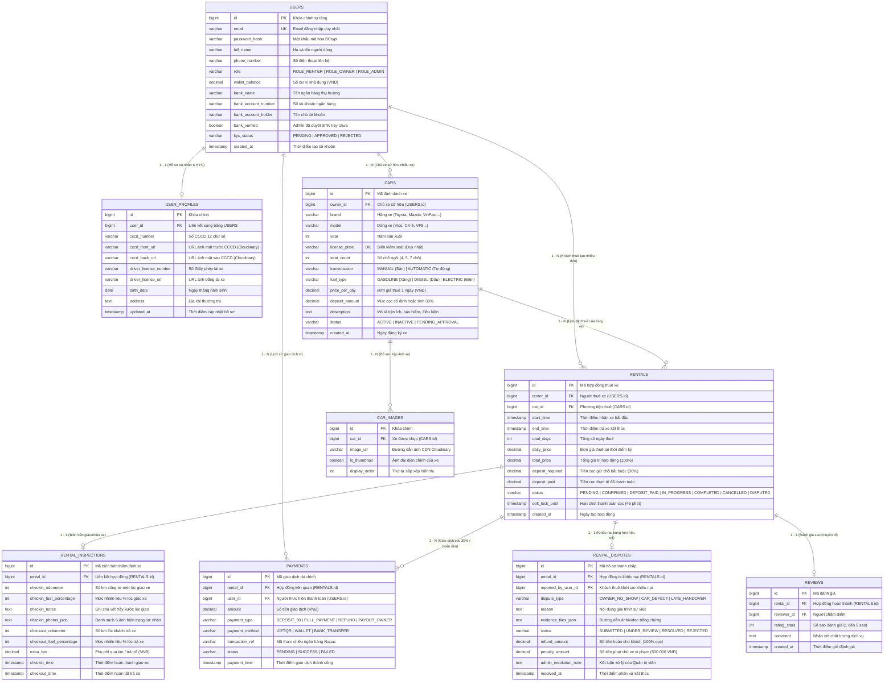
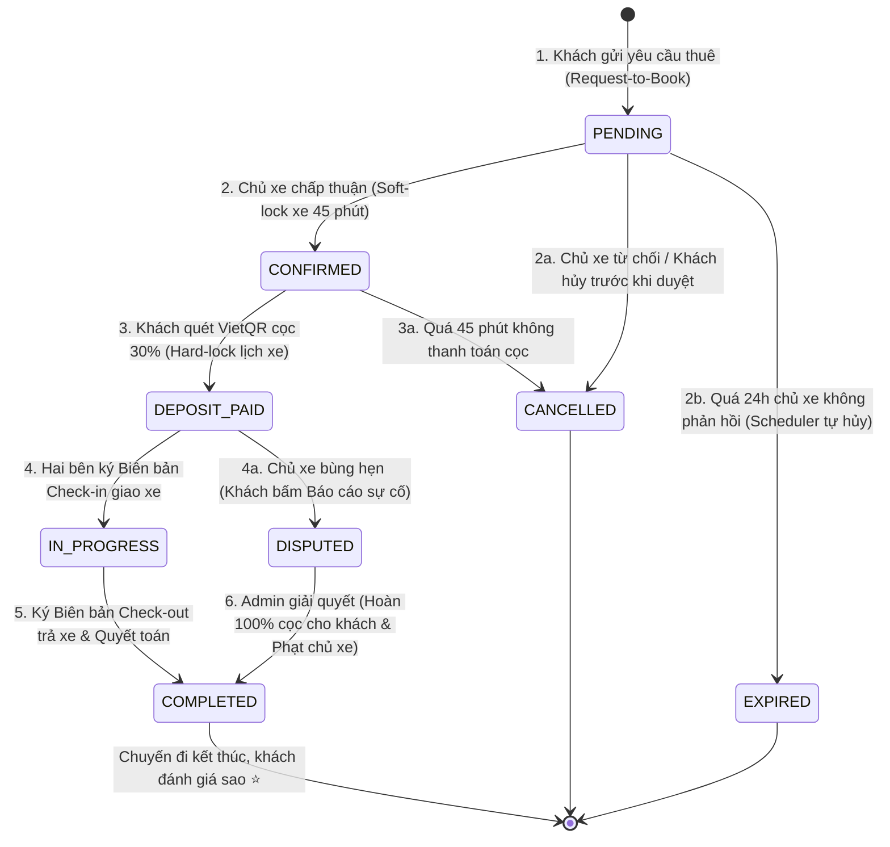

# 📐 SƠ ĐỒ USE CASE & CƠ SỞ DỮ LIỆU (DATABASE ERD) — DRIVESHARE
## PHỤC VỤ BÁO CÁO & BẢO VỆ ĐỒ ÁN / THỰC TẬP TỐT NGHIỆP (K4)

> **Dự án**: DriveShare — Nền tảng chia sẻ và cho thuê xe trực tuyến P2P  
> **Phiên bản kiến trúc**: v3.0 (Sprint 3 Enterprise Edition)  
> **Hệ quản trị CSDL**: PostgreSQL 16 (Render Cloud & Docker Local)  
> **Ngôn ngữ mô hình**: UML 2.5 / Mermaid Standard

---

## PHẦN 1: USE CASE DIAGRAM (SƠ ĐỒ TRƯỜNG HỢP SỬ DỤNG)

### 1.1 Sơ đồ Use Case Tổng Quát Toàn Hệ Thống

```mermaid
flowchart TD
    %% Actors
    Renter(("🧑 Khách thuê<br/>(Renter)"))
    Owner(("🚗 Chủ xe<br/>(Car Owner)"))
    Admin(("🛡️ Quản trị / Vận hành<br/>(Admin / Staff)"))
    VietQRSystem(("💳 Cổng VietQR<br/>(Napas 247)"))
    AiSystem(("🤖 Trợ lý AI<br/>(Gemini LLM)"))

    subgraph DriveShare_System ["HỆ THỐNG NỀN TẢNG DRIVESHARE"]
        
        subgraph Mod_Auth ["1. Xác Thực & Định Danh (Auth & eKYC)"]
            UC_Register["Đăng ký tài khoản (Renter / Owner)"]
            UC_Login["Đăng nhập (Password / Google OAuth2)"]
            UC_UploadKYC["Tải lên CCCD 2 mặt & Giấy phép lái xe"]
            UC_BankConfig["Khai báo STK Ngân hàng thụ hưởng"]
        end

        subgraph Mod_Car ["2. Quản Lý Phương Tiện (Car Management)"]
            UC_PostCar["Đăng tải thông tin & ảnh xe"]
            UC_ToggleStatus["Bật/Tắt trạng thái xe (ACTIVE/INACTIVE)"]
            UC_SearchCars["Tìm kiếm & Lọc xe đa tiêu chí"]
            UC_AiConsult["Tư vấn lộ trình & gợi ý xe qua Chatbot"]
        end

        subgraph Mod_Booking ["3. Đặt Xe & Ký Quỹ (Booking & Escrow)"]
            UC_CreateBooking["Tạo yêu cầu thuê xe (Request-to-Book)"]
            UC_ApproveBooking["Duyệt / Từ chối yêu cầu đặt xe"]
            UC_PayDeposit["Thanh toán tiền cọc 30% qua VietQR"]
            UC_HoldEscrow["Sàn khóa giữ chỗ (Escrow Holding)"]
        end

        subgraph Mod_Operation ["4. Bàn Giao & Vận Hành (Operation & Inspection)"]
            UC_HandoverCheckIn["Biên bản giao xe Check-in (Km, Xăng, Ảnh 6 góc)"]
            UC_HandoverCheckOut["Biên bản trả xe Check-out & Tính phụ phí"]
            UC_DisputeNoShow["Báo cáo sự cố chủ xe bùng hẹn (No-Show Dispute)"]
        end

        subgraph Mod_Admin ["5. Quản Trị & Quyết Toán (Admin Governance)"]
            UC_AdminReviewKYC["Phê duyệt hồ sơ CCCD & STK ngân hàng"]
            UC_AdminApproveCar["Kiểm duyệt xe mới trước khi xuất bản"]
            UC_AdminResolveDispute["Phân xử khiếu nại & Kích hoạt hoàn cọc"]
            UC_PayoutOwner["Quyết toán ví thu nhập 90% cho chủ xe"]
        end

    end

    %% Renter Interactions
    Renter --> UC_Register
    Renter --> UC_Login
    Renter --> UC_UploadKYC
    Renter --> UC_SearchCars
    Renter --> UC_AiConsult
    Renter --> UC_CreateBooking
    Renter --> UC_PayDeposit
    Renter --> UC_HandoverCheckIn
    Renter --> UC_HandoverCheckOut
    Renter --> UC_DisputeNoShow

    %% Owner Interactions
    Owner --> UC_Register
    Owner --> UC_Login
    Owner --> UC_BankConfig
    Owner --> UC_PostCar
    Owner --> UC_ToggleStatus
    Owner --> UC_ApproveBooking
    Owner --> UC_HandoverCheckIn
    Owner --> UC_HandoverCheckOut

    %% Admin Interactions
    Admin --> UC_Login
    Admin --> UC_AdminReviewKYC
    Admin --> UC_AdminApproveCar
    Admin --> UC_AdminResolveDispute
    Admin --> UC_PayoutOwner

    %% External Systems Interactions
    UC_PayDeposit -.->|Tạo mã QR & Xác nhận webhook| VietQRSystem
    UC_AiConsult -.->|Truy vấn đề xuất tự nhiên| AiSystem
    UC_PayDeposit -.->|Tự động kích hoạt| UC_HoldEscrow
```

---

## PHẦN 2: DATABASE DIAGRAM (ENTITY RELATIONSHIP DIAGRAM - ERD)

### 2.1 Sơ đồ Thực Thể Mối Quan Hệ Chi Tiết (Cơ sở dữ liệu PostgreSQL)

---

## PHẦN 3: ĐẶC TẢ LOGIC TRẠNG THÁI VÒNG ĐỜI HỢP ĐỒNG (STATE MACHINE)

---

## 🎯 HƯỚNG DẪN TRÌNH CHIẾU DÀNH CHO NHÓM TRONG BUỔI BÁO CÁO
1. **Khi chiếu slide:** Sử dụng sơ đồ Use Case (Phần 1) để chứng minh tính hoàn thiện của 5 module nghiệp vụ và tương tác giữa 5 Actors.
2. **Khi thầy hỏi về Database:** Sử dụng sơ đồ ERD (Phần 2) để chỉ rõ:
   - Cơ chế tách bảng `USERS` và `USER_PROFILES` để tối ưu bảo mật và thời gian truy vấn danh mục.
   - Cơ chế toàn vẹn dữ liệu: `RENTALS` giữ giá trị lịch sử `daily_price` để tránh biến động khi chủ xe đổi giá thuê sau này.
   - Bảng `RENTAL_DISPUTES` và `RENTAL_INSPECTIONS` là bằng chứng bảo vệ cả hai bên theo chuẩn các app Mioto/Zoomcar.
