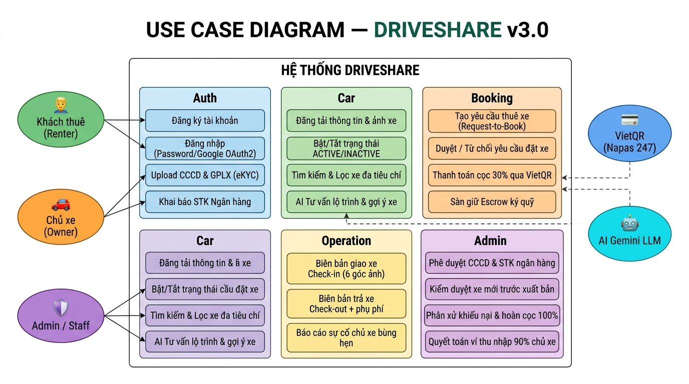
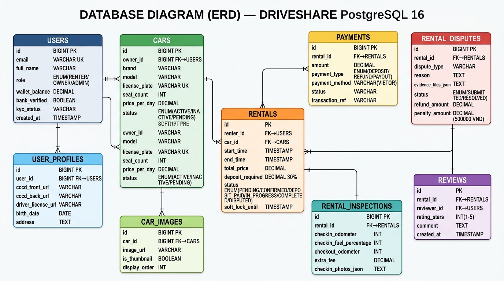
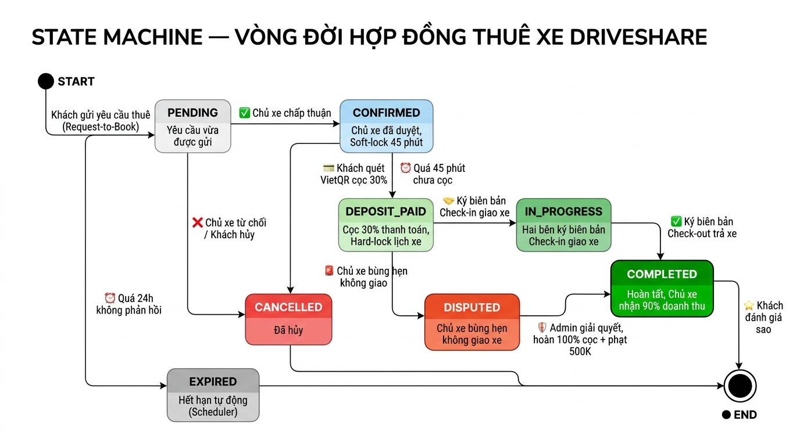

# 📐 SƠ ĐỒ USE CASE & CƠ SỞ DỮ LIỆU (DATABASE ERD) — DRIVESHARE
## PHỤC VỤ BÁO CÁO & BẢO VỆ ĐỒ ÁN / THỰC TẬP TỐT NGHIỆP (K4)

> **Dự án**: DriveShare — Nền tảng chia sẻ và cho thuê xe trực tuyến P2P  
> **Phiên bản kiến trúc**: v3.0 (Sprint 3 Enterprise Edition)  
> **Hệ quản trị CSDL**: PostgreSQL 16 (Render Cloud & Docker Local)  
> **Ngôn ngữ mô hình**: UML 2.5

---

## PHẦN 1: USE CASE DIAGRAM (SƠ ĐỒ TRƯỜNG HỢP SỬ DỤNG)

> 📌 **Hiển thị sơ đồ ảnh** tại file `docs/diagrams/01_use_case_diagram.jpg`  
> _(Mở bằng VS Code Preview hoặc in ra để chiếu lên slide)_

### Mô tả tóm tắt các Actor và Module:

| Actor | Vai trò | Module tương tác |
| :--- | :--- | :--- |
| 🧑 **Khách thuê (Renter)** | Tìm xe, đặt xe, thanh toán cọc, báo sự cố | Auth, Car Search, Booking, Operation |
| 🚗 **Chủ xe (Owner)** | Đăng xe, duyệt yêu cầu thuê, giao/nhận xe | Auth, Car Management, Booking, Operation |
| 🛡️ **Admin / Staff** | Duyệt hồ sơ, phân xử khiếu nại, giám sát tài chính | Admin Governance |
| 💳 **VietQR (Napas 247)** | Cổng thanh toán cọc 30% và hoàn tiền | Booking (Escrow Payment) |
| 🤖 **AI Gemini LLM** | Tư vấn gợi ý xe phù hợp theo lộ trình | Car (AI Chatbot) |

---

## PHẦN 2: DATABASE DIAGRAM — ERD (THỰC THỂ MỐI QUAN HỆ)

> 📌 **Hiển thị sơ đồ ảnh** tại file `docs/diagrams/02_erd_database.jpg`

### Tóm tắt 9 bảng cốt lõi và mối quan hệ:

| Bảng | Vai trò | Quan hệ chính |
| :--- | :--- | :--- |
| `USERS` | Lưu toàn bộ tài khoản (Renter, Owner, Admin) | 1:N → CARS, RENTALS |
| `USER_PROFILES` | Thông tin KYC: CCCD, GPLX, địa chỉ | 1:1 ← USERS |
| `CARS` | Thông tin xe, biển số, giá thuê, trạng thái | N:1 ← USERS (owner) |
| `CAR_IMAGES` | Bộ sưu tập ảnh xe, ảnh đại diện | N:1 ← CARS |
| `RENTALS` | **Bảng trung tâm** — Hợp đồng thuê xe, Escrow, State Machine | N:1 ← USERS & CARS |
| `PAYMENTS` | Lịch sử giao dịch: cọc 30%, hoàn tiền, quyết toán 90% | N:1 ← RENTALS |
| `RENTAL_INSPECTIONS` | Biên bản Check-in/Check-out, ảnh hiện trạng, km, xăng | 1:1 ← RENTALS |
| `RENTAL_DISPUTES` | Hồ sơ khiếu nại, bằng chứng, kết quả phân xử, mức phạt | 1:1 ← RENTALS |
| `REVIEWS` | Đánh giá sao sau chuyến đi | 1:1 ← RENTALS |

---

## PHẦN 3: STATE MACHINE — VÒNG ĐỜI HỢP ĐỒNG THUÊ XE

> 📌 **Hiển thị sơ đồ ảnh** tại file `docs/diagrams/03_state_machine.jpg`

### Tóm tắt các trạng thái chuyển đổi:

| Trạng thái | Ý nghĩa | Điều kiện chuyển tiếp |
| :--- | :--- | :--- |
| `PENDING` | Yêu cầu vừa được gửi | Chủ xe duyệt → `CONFIRMED` |
| `CONFIRMED` | Chủ xe đã duyệt, Soft-lock 45 phút | Khách cọc VietQR → `DEPOSIT_PAID` |
| `DEPOSIT_PAID` | Cọc 30% xác nhận, Hard-lock lịch xe | Ký Check-in → `IN_PROGRESS` |
| `IN_PROGRESS` | Đang sử dụng xe | Ký Check-out → `COMPLETED` |
| `COMPLETED` | Hoàn tất, chủ xe nhận 90% doanh thu | — |
| `DISPUTED` | Chủ xe bùng hẹn, khách báo sự cố | Admin giải quyết → `COMPLETED` + hoàn 100% cọc + phạt 500K |
| `CANCELLED` | Hủy (từ chối hoặc hết giờ cọc) | — |
| `EXPIRED` | Quá 24h chủ xe không phản hồi (Scheduler tự hủy) | — |

---

## 🎯 HƯỚNG DẪN TRÌNH CHIẾU TRONG BUỔI BÁO CÁO

1. **Slide 1 (phút 0-2)**: Chiếu sơ đồ Use Case — giải thích 5 Actor và 5 module nghiệp vụ.
2. **Slide 2 (khi thầy hỏi Database)**: Chiếu ERD — chỉ rõ bảng trung tâm `RENTALS` và cơ chế Escrow.
3. **Slide 3 (khi thầy hỏi logic)**: Chiếu State Machine — giải thích vòng đời hợp đồng từ PENDING → COMPLETED.
