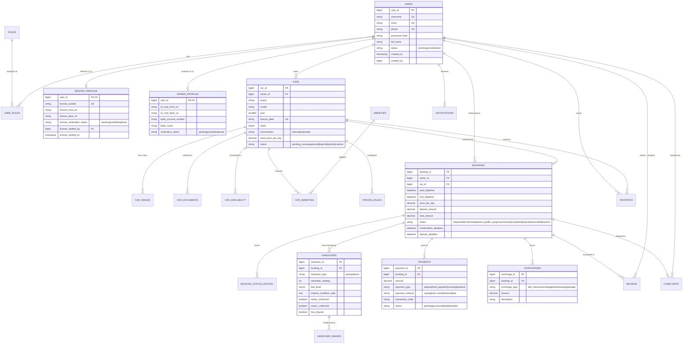

# 🎯 TÀI LIỆU CHUẨN BỊ DEMO & BẢO VỆ ĐỒ ÁN DRIVESHARE
*(Dành cho tất cả thành viên trong nhóm phục vụ buổi thuyết trình & vấn đáp)*

---

## PHẦN 1: KỊCH BẢN DEMO FULL LUỒNG CHÍNH (END-TO-END DEMO SCRIPT)

### 📌 Nguyên tắc Demo "Ăn điểm":
- Chuẩn bị sẵn 2-3 trình duyệt hoặc tab ẩn danh (Incognito) đại diện cho các vai trò:
  - **Tab 1:** Khách thuê (`renter`)
  - **Tab 2:** Chủ xe (`owner`)
  - **Tab 3:** Quản trị viên / Nhân viên (`admin` / `staff`)
- Mỗi bước click trên giao diện phải giải thích được: **"Hành động này tác động gì đến trạng thái đơn hàng và CSDL bên dưới?"**

---

### 🎬 Các bước Demo chi tiết theo kịch bản:

#### BƯỚC 1: Đăng ký & eKYC (Xác minh giấy tờ)
1. **Hành động (FE):**
   - Vào trang Đăng ký tài khoản: Tạo tài khoản Khách thuê (`an.nguyen@example.com`).
   - Vào trang Profile: Tải lên ảnh Căn cước công dân (CCCD 2 mặt) và Giấy phép lái xe (GPLX).
2. **Logic & DB (BE):**
   - Tạo dòng mới trong `users` và `renter_profiles`.
   - Trạng thái giấy tờ: `license_verification_status = 'pending'`.
3. **Phê duyệt bởi Staff/Admin:**
   - Đăng nhập tài khoản Staff/Admin (`admin@driveshare.com`).
   - Vào danh sách hồ sơ chờ duyệt → Bấm **"Phê duyệt GPLX"**.
   - DB cập nhật: `license_verification_status = 'verified'`, ghi nhận `license_verified_by`.

---

#### BƯỚC 2: Chủ xe đăng xe & Admin kiểm duyệt
1. **Hành động (FE - Owner):**
   - Đăng nhập tài khoản Chủ xe (`binh.tran@example.com`).
   - Vào mục **"Đăng xe mới"**: Nhập thông tin xe (Toyota Vios 2022, Biển số `51A-123.45`, số tự động, 5 chỗ, giá `800,000 VNĐ/ngày`).
   - Upload 3 ảnh xe, giấy đăng ký xe, bảo hiểm. Thiết lập lịch xe sẵn sàng (`car_availability`).
   - Bấm **"Gửi duyệt"** → Xe chuyển trạng thái `pending_review`.
2. **Hành động (FE - Admin):**
   - Admin vào trang quản lý xe chờ duyệt (`/admin/cars`).
   - Xem giấy tờ xe, ảnh chụp → Bấm **"Duyệt xe"**.
3. **Logic & DB (BE):**
   - Bảng `cars` cập nhật `status = 'approved'` (hoặc `active`).
   - Xe chính thức hiển thị trên bộ lọc tìm kiếm công khai.

---

#### BƯỚC 3: Khách tìm xe & Gửi yêu cầu thuê (Multi-Request)
1. **Hành động (FE - Renter):**
   - Khách thuê vào trang tìm kiếm, chọn ngày bắt đầu ($T_{start}$) và ngày kết thúc ($T_{end}$).
   - Chọn xe Toyota Vios vừa được duyệt → Bấm **"Đặt xe ngay"**.
2. **Logic & DB (BE):**
   - Backend kiểm tra điều kiện tiên quyết: `license_verification_status == 'verified'`.
   - Kiểm tra lịch trống trong bảng `bookings` và `car_availability`.
   - Tạo đơn trong bảng `bookings` với trạng thái `status = 'requested'` (hoặc `pending`).
   - Ghi nhật ký vào `booking_status_history`.
   - Bắn thông báo (Notification) tới Chủ xe.

---

#### BƯỚC 4: Chủ xe thẩm định & Kích hoạt "Soft Lock"
1. **Hành động (FE - Owner):**
   - Chủ xe nhận thông báo, mở chi tiết đơn đặt xe.
   - Xem thông tin khách, lịch trình → Bấm **"Xác nhận cho thuê"**.
2. **Logic & DB (BE):**
   - **Xử lý Race Condition:** Dùng Pessimistic Locking (`SELECT FOR UPDATE`) để đảm bảo không duyệt 2 khách trùng giờ.
   - Chuyển `bookings.status = 'confirmed'`.
   - Thiết lập `deposit_deadline = NOW() + 45 phút` (hoặc 2 giờ theo cấu hình).
   - **Kích hoạt Soft Lock:** Tạm thời ẩn khung giờ này của xe đối với các khách hàng khác đang tìm kiếm.

---

#### BƯỚC 5: Khách đặt cọc 30% & Kích hoạt "Hard Lock"
1. **Hành động (FE - Renter):**
   - Khách thấy đơn chuyển sang trạng thái "Đã xác nhận - Chờ đặt cọc".
   - Màn hình hiển thị mã **VietQR** hoặc cổng **VNPay Sandbox** với số tiền cọc (ví dụ: 30% = 480,000 VNĐ).
   - Khách bấm **"Thanh toán cọc"**.
2. **Logic & DB (BE):**
   - Webhook thanh toán nhận diện mã giao dịch và số tiền khớp `deposit_amount`.
   - Bảng `payments` ghi nhận: `status = 'success'`, `payment_type = 'deposit'`.
   - Chuyển `bookings.status = 'deposit_paid'`.
   - **Kích hoạt Hard Lock:** Đóng lịch xe vĩnh viễn trong khung thời gian này.
   - **Auto-rejection:** Tự động quét và từ chối các yêu cầu khác đang chờ cùng khung giờ.

---

#### BƯỚC 6: Bàn giao xe (Check-in Handover)
1. **Hành động (FE - Owner & Renter):**
   - Đến ngày nhận xe, Chủ xe mở trang quản lý chuyến đi → Chọn **"Lập biên bản giao xe"**.
   - Nhập số ODO ban đầu (ví dụ: 25,000 km), mức nhiên liệu (100%), ghi chú vết xước nhẹ ở cản trước, chụp 6 ảnh hiện trạng.
   - Chủ xe bấm **"Ký biên bản giao xe"**.
   - Khách thuê kiểm tra trên điện thoại → Bấm **"Đồng ý nhận xe"**.
2. **Logic & DB (BE):**
   - Tạo bản ghi trong bảng `handovers` với `handover_type = 'pickup'`, `odometer_reading = 25000`, `fuel_level = 100`.
   - Khi cả `owner_confirmed = true` và `renter_confirmed = true`:
   - Chuyển `bookings.status = 'in_progress'`.

---

#### BƯỚC 7: Trả xe, Nghiệm thu & Tính phụ phí (Check-out Handover)
1. **Hành động (FE - Renter & Owner):**
   - Đến giờ trả xe, hai bên gặp nhau lập biên bản trả xe.
   - Nhập chỉ số: ODO thực tế = 25,450 km (giới hạn 300 km/ngày, 2 ngày = 600 km → không vượt).
   - Nhiên liệu: 80% (hao hụt 20% so với ban đầu).
   - Giờ trả: Trễ 2 tiếng so với thỏa thuận ban đầu.
   - Hệ thống tự động tính phụ phí:
     - Phụ phí trả trễ: 2 giờ × 100,000 = 200,000 VNĐ.
     - Phụ phí bù nhiên liệu: 150,000 VNĐ.
   - Hai bên bấm **"Xác nhận trả xe"**.
2. **Logic & DB (BE):**
   - Tạo bản ghi `handovers` với `handover_type = 'return'`.
   - Tạo các dòng tương ứng trong bảng `surcharges`.
   - Chuyển `bookings.status = 'completed'`.
   - Sàn quyết toán tiền: Khấu trừ phụ phí từ cọc (nếu có), hoàn phần cọc còn lại cho khách, giải ngân doanh thu cho chủ xe.

---

#### BƯỚC 8: Đánh giá 2 chiều (Review & Rating)
1. **Hành động (FE):**
   - Khách thuê chấm 5 sao ⭐ kèm nhận xét xe chạy êm, chủ xe nhiệt tình.
   - Chủ xe chấm 5 sao ⭐ cho khách giữ xe sạch sẽ.
2. **Logic & DB (BE):**
   - Lưu vào bảng `reviews` với ràng buộc `UNIQUE(booking_id, reviewer_id)`.
   - Tự động cập nhật điểm rating trung bình của xe và chủ xe.

---

## PHẦN 2: SƠ ĐỒ USE CASE HỆ THỐNG (USE CASE DIAGRAM)

### 📌 Biểu đồ Use Case Diagram (Mermaid)

```mermaid
flowchart TD
    %% Actors
    Renter(("🧑 Khách thuê<br/>(Renter)"))
    Owner(("🚗 Chủ xe<br/>(Car Owner)"))
    Staff(("👨‍💼 Nhân viên<br/>(Staff)"))
    Admin(("🛡️ Quản trị viên<br/>(Admin)"))
    System(("⚙️ Hệ thống<br/>(System Cron)"))

    subgraph AUTH ["Phân hệ 1: Xác thực & Hồ sơ"]
        UC01["Đăng ký / Đăng nhập"]
        UC02["Xác thực GPLX / CCCD (eKYC)"]
        UC03["Quản lý thông tin cá nhân"]
    end

    subgraph CAR_MGMT ["Phân hệ 2: Quản lý Phương tiện"]
        UC04["Đăng xe mới & Giấy tờ"]
        UC05["Thiết lập giá & Lịch xe sẵn sàng"]
        UC06["Phê duyệt / Từ chối xe"]
        UC07["Tìm kiếm & Lọc xe đa tiêu chí"]
        UC08["Gợi ý xe bằng AI"]
    end

    subgraph BOOKING_LIFECYCLE ["Phân hệ 3: Đặt xe & Vòng đời Chuyến đi"]
        UC09["Gửi yêu cầu thuê xe"]
        UC10["Kiểm tra xung đột lịch"]
        UC11["Thẩm định & Duyệt yêu cầu thuê"]
        UC12["Thanh toán tiền đặt cọc (Escrow)"]
        UC13["Biên bản bàn giao xe (Check-in)"]
        UC14["Biên bản trả xe & Tính phụ phí (Check-out)"]
        UC15["Hủy chuyến & Hoàn tiền theo chính sách"]
    end

    subgraph POST_TRIP ["Phân hệ 4: Hậu giao dịch & Vận hành"]
        UC16["Đánh giá 2 chiều (Review & Rating)"]
        UC17["Khiếu nại & Báo cáo sự cố"]
        UC18["Xử lý tranh chấp & Đền bù"]
        UC19["Báo cáo thống kê & Doanh thu"]
        UC20["Tự động quét đơn hết hạn (Auto-Expire)"]
    end

    %% Renter Connections
    Renter --> UC01
    Renter --> UC02
    Renter --> UC03
    Renter --> UC07
    Renter --> UC08
    Renter --> UC09
    Renter --> UC12
    Renter --> UC13
    Renter --> UC14
    Renter --> UC15
    Renter --> UC16
    Renter --> UC17

    %% Owner Connections
    Owner --> UC01
    Owner --> UC03
    Owner --> UC04
    Owner --> UC05
    Owner --> UC11
    Owner --> UC13
    Owner --> UC14
    Owner --> UC16
    Owner --> UC17

    %% Staff Connections
    Staff --> UC02
    Staff --> UC06
    Staff --> UC18

    %% Admin Connections
    Admin --> UC01
    Admin --> UC06
    Admin --> UC18
    Admin --> UC19

    %% System Connections
    System --> UC10
    System --> UC20

    %% Includes & Extends
    UC09 -.->|"<<include>>"| UC10
    UC09 -.->|"<<include>>"| UC02
    UC11 -.->|"<<include>>"| UC10
    UC14 -.->|"<<extend>>"| UC17
    UC15 -.->|"<<extend>>"| UC09
```

---

## PHẦN 3: SƠ ĐỒ CƠ SỞ DỮ LIỆU (DATABASE ERD DIAGRAM)

### 📌 Biểu đồ ERD Quan hệ Thực thể (Mermaid ERD)

---

## PHẦN 4: BỘ CÂU HỎI VẤN ĐÁP BẢO VỆ CHO TOÀN BỘ THÀNH VIÊN

---

### 1. DÀNH CHO: BẢO (Project Lead & Database Architect)

> **Câu 1:** *Tại sao phiên bản trước (v1) lại tách 3 Database riêng, nhưng sang phiên bản v2 nhóm lại quyết định gộp về 1 Database duy nhất?*
- **Trả lời:** "Phiên bản v1 ban đầu nhóm chia thành 3 DB (Renter DB, Owner DB, Admin DB) theo hướng Microservices. Tuy nhiên, qua phản biện của Giảng viên và đánh giá thực tế, việc tách DB khi ứng dụng còn ở quy mô vừa gây ra các nhược điểm nghiêm trọng:
  1. Mất tính toàn vẹn tham chiếu (Foreign Key) giữa các bảng quan trọng (`bookings` - `cars` - `users`).
  2. Phải xử lý Distributed Transaction (Saga pattern hoặc Two-Phase Commit) khi tạo đơn đặt xe và cọc tiền, làm hệ thống quá phức tạp và dễ lỗi data không nhất quán.
  3. Không thể thực hiện JOIN bảng nhanh để tìm kiếm và báo cáo.
  Do đó, ở phiên bản v2, nhóm đã quy về 1 Database quan hệ chuẩn hóa 3NF, dùng ACID Transaction của MySQL để đảm bảo tính toàn vẹn tuyệt đối."

> **Câu 2:** *Tại sao bảng `users` lại dùng mô hình RBAC với bảng trung gian `user_roles` thay vì đặt 1 cột `role ENUM` ngay trong bảng `users`?*
- **Trả lời:** "Vì trong bài toán kinh tế chia sẻ P2P, một thực thể người dùng có thể đóng nhiều vai trò cùng lúc: vừa là **Khách thuê (Renter)** khi đi du lịch, vừa là **Chủ xe (Owner)** khi có xe nhàn rỗi. Thiết kế quan hệ nhiều-nhiều qua `user_roles` giúp một người dùng linh hoạt kích hoạt các vai trò mà không cần tạo 2 tài khoản riêng biệt. Đồng thời, bảng mở rộng `renter_profiles` và `owner_profiles` (quan hệ 1-1 với `users`) giúp lưu thông tin đặc thù của từng vai trò mà không làm bảng `users` bị nhiều cột NULL."

> **Câu 3:** *Chỉ mục (Indexes) được đánh như thế nào trong CSDL để tối ưu tìm kiếm và chống trùng lịch?*
- **Trả lời:** "Nhóm đã đánh Composite Index `idx_bookings_car_range` trên bộ 3 cột: `(car_id, start_datetime, end_datetime)`. Khi kiểm tra trùng lịch hoặc tìm xe trống, MySQL sẽ dùng B-Tree index này để scan theo range thời gian cực nhanh với độ phức tạp $O(\log N)$ thay vì Full Table Scan $O(N)$."

---

### 2. DÀNH CHO: LỘC KHIÊM (Backend Core — Booking, State Machine & Concurrency)

> **Câu 1:** *Giải thích toàn bộ State Machine (vòng đời trạng thái) của Booking? Làm sao ngăn chặn việc nhảy cóc trạng thái bất hợp pháp?*
- **Trả lời:** "Vòng đời Booking gồm 7 trạng thái chính:
  `requested` (Khách gửi) $\rightarrow$ `confirmed` (Chủ xe duyệt) $\rightarrow$ `deposit_paid` (Đã cọc 30%) $\rightarrow$ `in_progress` (Đã giao xe) $\rightarrow$ `returned` (Đã trả xe) $\rightarrow$ `completed` (Đã chốt phụ phí & thanh toán).
  Ngoài ra có các trạng thái rẽ nhánh: `rejected`, `cancelled`, `expired`, `disputed`.
  Để ngăn nhảy cóc trạng thái (ví dụ từ `requested` nhảy thẳng lên `in_progress`), nhóm cài đặt **State Pattern / Finite State Machine (FSM)** trong service. Mỗi khi cập nhật, hệ thống kiểm tra `old_status` có nằm trong danh sách chuyển đổi hợp lệ hay không, đồng thời ghi lịch sử vào bảng `booking_status_history` để audit trail."

> **Câu 2:** *Khi 2 khách hàng cùng bấm đặt 1 chiếc xe trong cùng một khung giờ, hoặc chủ xe double-click duyệt 2 khách trùng lịch, hệ thống xử lý bài toán Concurrency / Race Condition như thế nào?*
- **Trả lời:** "Nhóm áp dụng cơ chế **Khóa 2 giai đoạn (Two-phase Locking)**:
  - **Giai đoạn 1 (Multi-Request):** Hệ thống cho phép nhiều khách cùng gửi yêu cầu ở trạng thái `requested` vì chưa phát sinh cam kết tài chính.
  - **Giai đoạn 2 (Duyệt & Soft Lock):** Khi Chủ xe bấm duyệt một khách, hàm xử lý chạy trong một `@Transactional` của Spring Boot với cơ chế **Pessimistic Locking** (`SELECT ... FOR UPDATE` trên dòng xe trong bảng `cars`). Điều này khóa tạm thời chiếc xe, ngăn chặn double-click và kiểm tra xem đã có đơn nào khác được duyệt trong khung giờ đó chưa. Sau khi duyệt, đơn được giữ chỗ trong 45 phút (`payment_expires_at`).
  - **Khi cọc thành công (Hard Lock):** Hệ thống cập nhật `deposit_paid` và tự động kích hoạt query UPDATE hàng loạt các đơn trùng giờ còn lại sang `rejected`."

> **Câu 3:** *Cơ chế tự động hủy đơn khi quá hạn (Auto-Expire) hoạt động như thế nào?*
- **Trả lời:** "Nhóm sử dụng Spring `@Scheduled` chạy định kỳ mỗi 1 phút (hoặc 5 phút) để quét các đơn ở trạng thái `confirmed` có `deposit_deadline < NOW()`. Worker này sẽ tự động chuyển trạng thái đơn sang `expired`, giải phóng Soft Lock để xe mở lại trên công cụ tìm kiếm và thông báo cho Chủ xe chọn khách hàng khác."

---

### 3. DÀNH CHO: CHÍ VĨ (Backend Developer — Auth, Security & User)

> **Câu 1:** *Hệ thống bảo mật và phân quyền API như thế nào? Giải thích chu trình xác thực JWT?*
- **Trả lời:** "Hệ thống sử dụng **Spring Security 6** kết hợp **JWT (JSON Web Token)**:
  1. Khi người dùng đăng nhập bằng email/password hợp lệ, server mã hóa thông tin gồm `user_id`, `email`, danh sách `roles` vào chuỗi JWT Access Token (ký bằng thuật toán HMAC-SHA256 với Secret Key an toàn).
  2. Client lưu token và gửi kèm trong header `Authorization: Bearer <token>` ở mỗi request.
  3. Server qua lớp Filter `JwtAuthenticationFilter` giải mã token, nạp vào `SecurityContextHolder`.
  4. Tại các Controller, nhóm dùng annotation `@PreAuthorize("hasRole('ADMIN')")` hoặc `hasRole('OWNER')` để chặn quyền truy cập trái phép ở mức phương thức (Method Security)."

> **Câu 2:** *Mật khẩu người dùng được lưu trữ thế nào trong cơ sở dữ liệu? Có thể giải mã ngược lại được không?*
- **Trả lời:** "Mật khẩu tuyệt đối không lưu dạng plain-text mà được băm bằng thuật toán **BCrypt** (`BCryptPasswordEncoder` với work factor = 10). BCrypt là hàm băm một chiều (One-way hash function) tự động tạo chuỗi Salt ngẫu nhiên cho mỗi lần băm, giúp chống lại tấn công Rainbow Table. Do đó, ngay cả khi database bị lộ, kẻ tấn công cũng không thể dịch ngược được mật khẩu gốc."

> **Câu 3:** *Quy trình xác minh giấy tờ (eKYC) của Khách thuê hoạt động thế nào?*
- **Trả lời:** "Khách thuê tải lên ảnh CCCD và GPLX. Hệ thống lưu vào bảng `renter_profiles` với trạng thái `pending`. Nhân viên vận hành (Staff) có giao diện riêng kiểm tra tính hợp lệ của giấy tờ (hạn sử dụng, ảnh rõ nét, họ tên khớp). Khi Staff bấm 'Duyệt', hệ thống cập nhật `license_verification_status = 'verified'`. Khách hàng chỉ có thể bấm nút Đặt xe khi trường này đã là `verified`."

---

### 4. DÀNH CHO: PHÁT (Backend Developer — Car Search & AI)

> **Câu 1:** *Viết và giải thích câu điều kiện SQL để kiểm tra một xe có bị trùng lịch trong khoảng $[T_{start}, T_{end}]$ hay không?*
- **Trả lời:** "Hai khoảng thời gian $[A, B]$ và $[C, D]$ giao nhau khi: $A < D$ và $B > C$.
  Do đó, một chiếc xe được coi là **bị trùng lịch** nếu tồn tại một booking có:
  `start_datetime < :requested_end AND end_datetime > :requested_start`
  với trạng thái booking thuộc nhóm đang giữ chỗ/đang chạy:
  `status IN ('confirmed', 'deposit_paid', 'in_progress')`.
  Khi tìm kiếm xe trống, câu query sẽ phủ định điều kiện này:
  `WHERE car_id NOT IN (SELECT car_id FROM bookings WHERE start_datetime < :end AND end_datetime > :start AND status IN ('confirmed', 'deposit_paid', 'in_progress'))`."

> **Câu 2:** *Bộ lọc tìm kiếm xe đa tiêu chí (địa điểm, giá, số chỗ, loại hộp số) được triển khai kỹ thuật như thế nào?*
- **Trả lời:** "Nhóm sử dụng **Spring Data JPA Specification (Criteria API)** để xây dựng câu truy vấn động. Thay vì viết chuỗi SQL nối ghép dễ bị SQL Injection, Specification cho phép kiểm tra từng tham số: nếu client gửi `seats`, hệ thống append predicate `cb.equal(root.get("seats"), seats)`; nếu gửi khoảng giá, append `cb.between(root.get("basePricePerDay"), minPrice, maxPrice)`. Nhờ vậy code vừa an toàn vừa dễ mở rộng thêm các tiêu chí lọc."

> **Câu 3:** *Tính năng AI gợi ý xe tích hợp như thế nào?*
- **Trả lời:** "Hệ thống cung cấp một endpoint nhận mô tả nhu cầu của khách (ví dụ: *'Gia đình 4 người đi Vũng Tàu cuối tuần, muốn xe gầm cao số tự động tiết kiệm xăng'*). Backend sử dụng OpenRouter/Gemini API, truyền prompt kèm danh sách các xe đang `active` trong CSDL dưới dạng structured JSON. AI sẽ phân tích nhu cầu, chấm điểm độ phù hợp và trả về danh sách `car_id` gợi ý kèm lời giải thích lý do lựa chọn cho khách hàng."

---

### 5. DÀNH CHO: QUÂN (Backend Developer — Payment, Review & Notification)

> **Câu 1:** *Mô hình ký quỹ (Escrow) trong thanh toán tiền cọc được thiết kế thế nào? Dòng tiền đi ra sao?*
- **Trả lời:** "DriveShare hoạt động theo mô hình Sàn trung gian giữ tiền (Escrow Model):
  1. Khi đơn được duyệt, Khách thuê thanh toán 30% tiền cọc vào tài khoản của Sàn.
  2. Sàn giữ khoản tiền này trong suốt chuyến đi để đảm bảo cam kết của khách và quyền lợi của chủ xe.
  3. Sau khi kết thúc chuyến đi và hai bên xác nhận biên bản trả xe không có tranh chấp: Sàn giải ngân tiền thuê (Payout) về tài khoản ngân hàng của Chủ xe (sau khi trừ phí hoa hồng sàn 10-15%) và giải phóng/hoàn lại cọc thừa cho Khách."

> **Câu 2:** *Làm sao giải quyết vấn đề Idempotency (chống trùng lặp giao dịch) khi nhận Webhook từ cổng thanh toán?*
- **Trả lời:** "Webhook của cổng thanh toán có thể bị gửi lại nhiều lần (do mạng chập chờn hoặc retry). Để đảm bảo Idempotent:
  1. Mỗi giao dịch có một mã tham chiếu duy nhất `transaction_code`.
  2. Khi nhận Webhook, Backend kiểm tra trong bảng `payments`: nếu `transaction_code` đã tồn tại với trạng thái `success`, hệ thống lập tức trả về HTTP 200 OK mà không cộng tiền hay cập nhật lại trạng thái booking lần thứ hai.
  3. Toàn bộ thao tác cập nhật thanh toán được bọc trong một Transaction duy nhất."

> **Câu 3:** *Khi có sự cố hoặc tranh chấp (Dispute) phát sinh tại thời điểm trả xe, hệ thống xử lý ra sao?*
- **Trả lời:** "Nếu lúc trả xe hai bên không thống nhất về vết xước hoặc phụ phí, Chủ xe hoặc Khách bấm 'Báo cáo sự cố/Khiếu nại'.
  - Booking chuyển sang trạng thái `disputed`.
  - Tiền cọc bị đóng băng (không tự động hoàn hay payout).
  - Nhân viên Staff tiếp nhận vụ việc qua trang Admin, xem ảnh biên bản lúc giao (`pickup`) và lúc trả (`return`) để đối chiếu hiện trạng, sau đó đưa ra phán quyết phân chia tiền cọc trước khi đóng đơn."

---

### 6. DÀNH CHO: CHÍ TÍN (Frontend & QA Lead — UI, Payment Flow & Testing)

> **Câu 1:** *Kiến trúc Frontend được xây dựng như thế nào? Quản lý Token và phân quyền giao diện (Route Guard) ra sao?*
- **Trả lời:** "Frontend được tổ chức theo kiến trúc module hóa với Vanilla JS và CSS hiện đại:
  - `api.js`: Đóng gói các hàm gọi API tập trung (`fetch`), tự động gắn header `Authorization: Bearer <token>` và xử lý bắt lỗi toàn cục (HTTP 401 tự động chuyển về trang đăng nhập).
  - `auth.js`: Quản lý lưu trữ token và thông tin người dùng trong `localStorage`.
  - Phân quyền giao diện (Client-side Guard): Khi tải bất kỳ trang quản trị nào (`owner.html`, `admin.html`), script kiểm tra ngay role của user; nếu không đúng quyền, hệ thống sẽ ẩn các nút thao tác hoặc redirect về trang chủ để bảo vệ giao diện trước khi người dùng kịp tương tác."

> **Câu 2:** *Trải nghiệm người dùng (UX) ở phân hệ Thanh toán và Đặt cọc được thiết kế thế nào để tránh khách quên cọc?*
- **Trả lời:** "Tại màn hình thanh toán cọc:
  1. Giao diện hiển thị đồng hồ đếm ngược thời gian thực (Countdown Timer 45 phút) để tạo tính khẩn trương cho khách.
  2. Tự động sinh mã VietQR động theo chuẩn Napas 247 có sẵn số tiền cọc chính xác và cú pháp chuyển khoản `DRIVESHARE <booking_id>`. Khách chỉ cần mở app ngân hàng quét mã là xong, không cần nhập tay.
  3. Có cơ chế Polling (hoặc WebSocket) tự động kiểm tra trạng thái: ngay khi ngân hàng báo tiền về, màn hình thanh toán tự động chuyển sang trang 'Đặt xe thành công' kèm pháo hoa chúc mừng mà không cần khách bấm F5."

> **Câu 3:** *Nhóm QA đã thiết kế bộ Test Cases như thế nào để đảm bảo chất lượng luồng chính? Đã test những trường hợp biên (Edge Cases) nào?*
- **Trả lời:** "Nhóm đã xây dựng bộ Test Cases bao phủ toàn diện 15 User Stories, đặc biệt tập trung vào các kịch bản ngoại lệ (Negative & Edge Cases):
  1. *Test cọc trễ:* Khách để quá hạn 45 phút mới thanh toán → Hệ thống tự động báo lỗi đơn đã hủy (`expired`).
  2. *Test đặt xe trùng:* 2 tài khoản cùng mở 1 xe và gửi yêu cầu cùng giây → Hệ thống vẫn nhận 2 request nhưng khi chủ xe duyệt 1 người thì người kia không thể duyệt tiếp.
  3. *Test biên bản bàn giao:* Chủ xe chưa xác nhận mà khách đã bấm hoàn thành → Hệ thống chặn không cho đổi trạng thái chuyến đi.
  4. *Test phụ phí:* Trả xe muộn 3 tiếng và vượt 50km → Hệ thống tính chính xác tổng tiền phụ phí cộng dồn vào hóa đơn cuối cùng."
