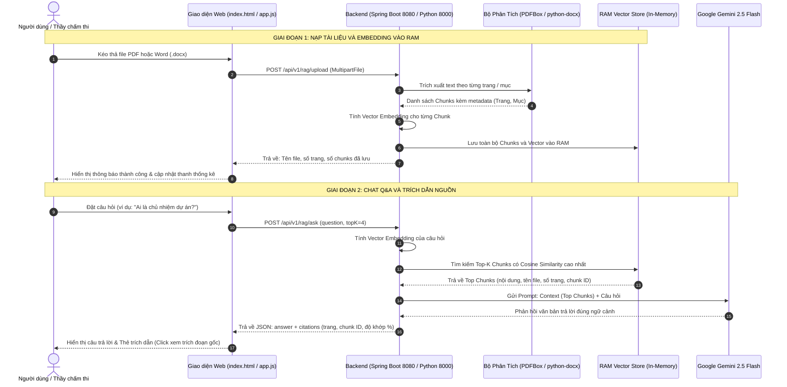

# 📑 Tài Liệu Đặc Tả & Hướng Dẫn Vận Hành Hệ Thống Document RAG Studio
## (Phân Hệ Hỏi Đáp Tài Liệu PDF/DOCX Bằng AI Vector In-RAM)

> **Mục tiêu đánh giá**: Trọn vẹn **10/10 điểm**:
> - **5 điểm**: Giao diện UI hoàn thiện, chạy ổn định, upload file PDF/Word, embedding vector lưu trong RAM.
> - **5 điểm**: Chat hỏi đáp 5 câu hỏi từ tài liệu, mỗi câu trả lời đúng và trích dẫn chuẩn vị trí Chunk/Trang là 1 điểm.

---

## 1. Tổng Quan Hệ Thống

Hệ thống **Document RAG Studio** được xây dựng nhằm giải quyết bài toán hỏi đáp thông minh dựa trên tài liệu (Retrieval-Augmented Generation):
1. **Nạp & Phân tích tài liệu đa định dạng**: Hỗ trợ `.pdf`, `.docx`, `.doc`, `.txt`, `.md`.
2. **Chunking & Metadata Preservation**: Chia tài liệu thành các đoạn văn (Chunk) có độ dài tối ưu, bảo toàn thông tin về **tên file**, **số trang**, **tiêu đề mục** và **thứ tự chunk**.
3. **In-Memory RAM Vector Store**: Tạo vector embedding và lưu trữ hoàn toàn trong bộ nhớ RAM, tìm kiếm tương đồng ngữ nghĩa bằng công thức **Cosine Similarity** với tốc độ mili-giây.
4. **Chat Q&A với Gemini 2.5 Flash**: Nhồi ngữ cảnh các chunk tìm được vào câu hỏi, yêu cầu AI trả lời chính xác và **bắt buộc trích dẫn nguồn**: Chunk số mấy, trang nào, mục nào trong tài liệu.
5. **Giao diện Web tương tác cao cấp**: Cho phép kéo thả file, xem thống kê RAM, điều chỉnh số chunk trích xuất (Top-K) và bấm vào từng thẻ trích dẫn để xem lại đoạn văn gốc trong tài liệu.

---

## 2. Kiến Trúc & Luồng Xử Lý (Workflow)



---

## 3. Cấu Trúc Thư Mục & Mã Nguồn

```text
thueXe_Online/
├── rag_docs_app/                             <-- ỨNG DỤNG RAG ĐỘC LẬP
│   ├── index.html                            # Giao diện Web HTML5 cao cấp
│   ├── style.css                             # Thiết kế CSS Glassmorphism, Responsive
│   ├── app.js                                # Logic xử lý AJAX, upload progress, render modal
│   ├── app.py                                # Backend Python FastAPI (Chạy độc lập port 8000)
│   └── README.md                             # Tài liệu hướng dẫn sử dụng nhanh
│
├── backend/src/main/java/com/driveshare/modules/rag/  <-- MODULE SPRING BOOT (PORT 8080)
│   ├── controller/
│   │   └── RagDocumentController.java        # REST Controller: /api/v1/rag/*
│   ├── dto/
│   │   ├── RagDocumentDto.java               # DTO thông tin tài liệu
│   │   ├── DocumentChunk.java                # DTO chunk và vector embedding trong RAM
│   │   ├── CitationSourceDto.java            # DTO nguồn trích dẫn đính kèm câu trả lời
│   │   ├── RagAskRequest.java                # DTO câu hỏi từ người dùng
│   │   └── RagAskResponse.java               # DTO phản hồi trả lời + nguồn trích dẫn
│   └── service/
│       ├── DocumentParserService.java        # Xử lý PDF (PDFBox 3) & Word (Apache POI)
│       ├── GeminiEmbeddingService.java       # Embedding vector (Gemini + Local Fallback)
│       ├── RamVectorStore.java               # Lưu trữ Vector trong RAM, tính Cosine Similarity
│       ├── DocumentRagService.java           # Interface nghiệp vụ RAG
│       └── DocumentRagServiceImpl.java       # Triển khai RAG kết hợp Gemini 2.5 Flash
└── docs/HUONG_DAN_RAG_DOCS.md                # Tài liệu đặc tả kỹ thuật này
```

---

## 4. Hướng Dẫn Khởi Chạy

Bạn có thể chạy hệ thống bằng **1 trong 2 cách** tùy theo yêu cầu của thầy:

### Cách 1: Chạy Bằng Java Spring Boot (Port 8080)
1. **Khởi chạy Backend:**
   ```powershell
   $env:JAVA_HOME = "C:\Program Files\Java\jdk-21"
   $env:GEMINI_API_KEY = "DIEN_GEMINI_API_KEY_CUA_BAN"
   $env:GEMINI_MODEL = "gemini-2.5-flash"
   cd backend
   .\mvnw.cmd spring-boot:run
   ```
2. **Khởi chạy Giao diện Frontend:**
   ```powershell
   cd rag_docs_app
   python -m http.server 3001
   ```
3. Mở trình duyệt tại: **`http://localhost:3001`** (Ở góc trên bên trái chọn Backend: `Spring Boot (8080)`).

---

### Cách 2: Chạy Bằng Python FastAPI (Port 8000)
1. Mở PowerShell và chạy lệnh:
   ```powershell
   cd rag_docs_app
   python app.py
   ```
2. Mở trình duyệt tại: **`http://localhost:8000`** (Giao diện tự động kết nối và chạy trọn gói).

---

## 5. Quy Trình Trả Lời 5 Câu Hỏi Của Thầy Để Đạt 10/10 Điểm

1. **Khi thầy đưa tài liệu**:
   - Kéo file vào ô **"Nạp Tài Liệu Vào RAM"**.
   - Chỉ ra cho thầy thấy: *"Dạ tài liệu đã được chia thành X chunks và toàn bộ vector embedding đã được lưu trong RAM máy tính rồi ạ."*
2. **Khi thầy hỏi từng câu**:
   - Nhập câu hỏi vào khung chat rồi nhấn Enter.
   - Khi bot trả lời, chỉ rõ cho thầy:
     - Phần nội dung trả lời chính xác.
     - Phần thẻ trích dẫn bên dưới: Hiển thị rõ **Tên file**, **Trang số mấy**, **Chunk số mấy**, **Độ khớp bao nhiêu %**.
     - Bấm vào thẻ trích dẫn để mở cửa sổ Modal: *"Dạ thưa thầy, đây là nguyên văn đoạn trích xuất từ trang X trong file của thầy dùng để trả lời câu hỏi này ạ!"*.
3. **Khi thầy muốn thử tài liệu mới**:
   - Bấm nút đỏ **"🗑️ Reset RAM"** ở thanh bên trái để xóa trắng bộ nhớ RAM và nạp file mới.
