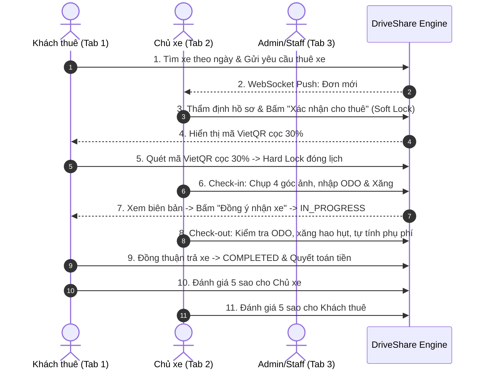

# 📋 TÀI LIỆU HƯỚNG DẪN KIỂM THỬ THỰC TẾ HỆ THỐNG DRIVESHARE
> **Dự án**: DriveShare - Nền tảng chia sẻ và cho thuê xe trực tuyến P2P  
> **Mục đích**: Hướng dẫn toàn diện kịch bản kiểm thử End-to-End từ luồng nghiệp vụ chính (Happy Path) đến các ca biên (Edge Cases / Concurrency / Dispute) cho toàn bộ thành viên nhóm và hội đồng nghiệm thu.

---

## 📌 PHẦN 1: CHUẨN BỊ MÔI TRƯỜNG & TÀI KHOẢN TEST

### 1.1 Địa chỉ truy cập hệ thống
* **Môi trường Cloud (Render Live)**:
  * Frontend: `https://driveshare-frontend-1guy.onrender.com`
  * Backend API Docs: `https://driveshare-backend-9ppk.onrender.com/swagger-ui.html`
* **Môi trường Cục bộ (Localhost)**:
  * Frontend: `http://localhost:3000`
  * Backend: `http://localhost:8080/swagger-ui.html`

### 1.2 Danh sách tài khoản kiểm thử mặc định (Đã nạp sẵn trong hệ thống)

| Vai trò (Role) | Email đăng nhập | Mật khẩu | Tên người dùng | Quyền hạn chính |
| :--- | :--- | :--- | :--- | :--- |
| **Khách thuê (Renter)** | `renter@driveshare.com` | `Renter123@` | Trần Văn B | Tìm xe, chat AI, cọc VietQR, ký nhận xe, đánh giá |
| **Chủ xe (Car Owner)** | `owner@driveshare.com` | `Owner123@` | Nguyễn Văn A | Đăng xe, duyệt đơn, lập biên bản giao/nhận xe, ví tiền |
| **Quản trị viên (Admin)** | `admin@driveshare.com` | `Admin123@` | System Admin | Duyệt GPLX, duyệt xe, phân xử khiếu nại, thống kê |

> [!TIP]
> **Mẹo test thực tế ăn điểm**:  
> Mở **3 cửa sổ trình duyệt ẩn danh (Incognito)** đặt cạnh nhau:
> - **Cửa sổ 1 (Trái)**: Đăng nhập Khách thuê (`renter@driveshare.com`).
> - **Cửa sổ 2 (Giữa)**: Đăng nhập Chủ xe (`owner@driveshare.com`).
> - **Cửa sổ 3 (Phải)**: Đăng nhập Quản trị viên (`admin@driveshare.com`).
> Nhờ đó bạn sẽ thấy ngay hệ thống bắn thông báo thời gian thực (WebSocket STOMP) nhảy chuông "ting-ting" giữa các tài khoản mà không cần bấm F5.

---

## 🎬 PHẦN 2: KỊCH BẢN TEST LUỒNG CHÍNH (END-TO-END HAPPY PATH)

---

### BƯỚC 1: Khách Tìm Xe & Gửi Yêu Cầu Thuê Xe
1. **Thao tác (Cửa sổ 1 - Khách thuê)**:
   * Vào trang chủ `index.html`.
   * Thử mở **Widget AI Chatbot** ở góc phải: Nhập *"Tư vấn cho tôi xe điện gia đình giá rẻ"* $\rightarrow$ AI đọc CSDL và gợi ý chiếc **VinFast VF8 (51K-12345)**.
   * Chọn ngày bắt đầu (ví dụ: ngày mai) và ngày kết thúc (3 ngày sau).
   * Bấm nút **"Thuê xe ngay"**.
2. **Kết quả mong đợi**:
   * Hệ thống kiểm tra điều kiện tiên quyết: GPLX của khách đã được duyệt (`VERIFIED`).
   * Tạo đơn thuê mới trong CSDL với trạng thái: `WAITING_APPROVAL` (hoặc `PENDING`).
   * Trên màn hình khách hiển thị: *"Đã gửi yêu cầu thuê xe, vui lòng chờ chủ xe phản hồi"*.

---

### BƯỚC 2: Chủ Xe Thẩm Định & Kích Hoạt "Soft Lock"
1. **Thao tác (Cửa sổ 2 - Chủ xe)**:
   * Đang mở trang `owner-cars.html` (Quản lý cho thuê).
   * Chuông thông báo trên thanh Navbar lập tức nhảy số đỏ `(1)` và pop-up Toast nảy lên: *"Bạn có yêu cầu thuê xe mới cho xe VinFast VF8"*.
   * Bấm vào tab **"Đơn chờ duyệt"** $\rightarrow$ Xem thông tin khách thuê Trần Văn B.
   * Bấm nút **"Xác nhận cho thuê"**.
2. **Kết quả mong đợi & Cơ chế Backend**:
   * Backend dùng **Pessimistic Locking** (`SELECT FOR UPDATE`) khóa bản ghi để đảm bảo không bị xung đột.
   * Đơn chuyển sang trạng thái: `WAITING_PAYMENT` (hoặc `CONFIRMED`).
   * **Kích hoạt Soft Lock**: Khung giờ này của xe tạm thời được ẩn khỏi danh sách tìm kiếm của các khách khác để khách này có **45 phút** giữ chỗ đặt cọc.

---

### BƯỚC 3: Khách Đặt Cọc 30% & Kích Hoạt "Hard Lock"
1. **Thao tác (Cửa sổ 1 - Khách thuê)**:
   * Màn hình của khách tự động cập nhật (hoặc vào mục *Chuyến đi của tôi*): Đơn chuyển sang *"Đã xác nhận - Chờ đặt cọc 30%"*.
   * Màn hình hiển thị mã **VietQR Napas 24/7** chứa chính xác số tiền cọc (30% tổng tiền thuê) kèm cú pháp nội bộ `DS{rental_id}`.
   * Bấm nút **"Xác nhận đã chuyển khoản cọc"** (hoặc Webhook tự động nhận diện).
2. **Kết quả mong đợi**:
   * Bảng `payments` ghi nhận giao dịch cọc thành công (`status = SUCCESS`).
   * Đơn chuyển sang trạng thái: `CONFIRMED` (Đã cọc - Chờ nhận xe).
   * **Kích hoạt Hard Lock**: Đóng lịch xe vĩnh viễn trong khung ngày này.
   * Cửa sổ Chủ xe nhận ngay thông báo: *"Khách thuê đã thanh toán tiền cọc 30%"*.

---

### BƯỚC 4: Bàn Giao Xe Xuất Phát (Check-in 2 Chiều)
1. **Thao tác (Cửa sổ 2 - Chủ xe)**:
   * Đến ngày nhận xe, Chủ xe mở chi tiết đơn $\rightarrow$ Bấm nút **"Lập biên bản Check-in"**.
   * Nhập số ODO thực tế: ví dụ `15,205` km.
   * Kéo thanh trượt nhiên liệu: `100%` (Đầy bình).
   * **Tải 4 ảnh ngoại quan xe**:
     * Thử tính năng **kéo thả ảnh (Drag & Drop)** từ máy tính vào 4 ô (Đầu xe, Đuôi xe, Sườn trái, Sườn phải).
     * Hoặc bấm **"📁 Chọn file"** để tải ảnh từ máy, hoặc bấm *"⚡ Chọn nhanh 4 ảnh mẫu"*.
   * Ghi chú: *"Xe rửa sạch bóng, nội thất mới, đầy đủ lốp dự phòng"*.
   * Bấm **"Xác nhận bàn giao xe"**.
2. **Thao tác Đồng thuận 2 chiều (Cửa sổ 1 - Khách thuê)**:
   * Trên màn hình Khách xuất hiện nút nổi bật: **"📋 Kiểm tra & Ký nhận bàn giao xe"**.
   * Modal mở ra hiển thị toàn bộ 4 ảnh phóng to, số ODO và lượng xăng mà chủ xe vừa khai báo.
   * Khách bấm nút **"✅ Đồng ý nhận xe"**.
3. **Kết quả mong đợi**:
   * Biên bản bàn giao mang trạng thái `CONFIRMED`.
   * Đơn thuê chính thức chuyển trạng thái: `IN_PROGRESS` (Chuyến đi chính thức bắt đầu).

---

### BƯỚC 5: Trả Xe & Tự Động Tính Phụ Phí (Check-out)
1. **Thao tác (Cửa sổ 2 - Chủ xe)**:
   * Khi kết thúc chuyến đi, Chủ xe bấm **"Check-out Nghiệm thu"**.
   * Nhập ODO lúc trả: `15,500` km (Chạy 295 km $\rightarrow$ Không vượt định mức 300km/ngày).
   * Nhập mức xăng lúc trả: `80%` (Hao hụt 20% so với ban đầu).
   * Tải ảnh đối chiếu 4 góc lúc trả xe.
2. **Kết quả tính toán phụ phí tự động của hệ thống**:
   * Hệ thống tự động so khớp và xuất bảng hóa đơn tổng kết:
     * *Tiền thuê còn lại (70%)*: Hiển thị chính xác số tiền.
     * *Phụ phí xăng*: Tự động tính tiền đền bù 20% xăng hao hụt.
     * *Phụ phí trả trễ (nếu có)*: Tự động nhân theo số giờ trễ thực tế.
   * Chủ xe bấm **"Xác nhận hoàn tất chuyến đi"**.
3. **Khách thuê xác nhận**:
   * Khách thuê kiểm tra bảng đối soát $\rightarrow$ Bấm đồng thuận.
   * Đơn chuyển sang: `COMPLETED`.
   * Tiền cọc được quyết toán: Khấu trừ phụ phí (nếu có), hoàn tiền cọc thừa cho khách, giải ngân tiền thuê cho chủ xe.

---

### BƯỚC 6: Đánh Giá 2 Chiều (Review & Rating)
1. **Thao tác**:
   * Khách thuê vào đơn đã hoàn tất $\rightarrow$ Chấm 5 sao ⭐ kèm bình luận: *"Xe VinFast VF8 chạy cực kỳ êm ái, chủ xe nhiệt tình!"*.
   * Chủ xe vào đơn $\rightarrow$ Chấm 5 sao ⭐: *"Khách giữ xe sạch sẽ, trả đúng hẹn."*.
2. **Kết quả mong đợi**:
   * CSDL ghi nhận bảng `reviews` với ràng buộc `UNIQUE(rental_id, reviewer_id)` (mỗi người chỉ được đánh giá 1 lần duy nhất).
   * Điểm trung bình của xe được tự động cập nhật lên `4.9` sao trên trang chủ.

---

## ⚡ PHẦN 3: KỊCH BẢN TEST CÁC CA BIÊN & NGOẠI LỆ (EDGE CASES)

### Test Case 1: Chống Trùng Lịch Đồng Thời (Concurrency Race Condition)
* **Kịch bản**: Khách A và Khách B cùng mở xe VinFast VF8 và cùng bấm đặt xe cho ngày 10/11 - 12/11.
* **Cách test**:
  1. Cả 2 gửi yêu cầu thuê xe.
  2. Chủ xe duyệt yêu cầu của Khách A $\rightarrow$ Khách A nhận mã cọc và Soft Lock kích hoạt.
  3. Khách A thanh toán cọc thành công (Hard Lock).
  4. **Kiểm tra**: Yêu cầu của Khách B tự động bị hệ thống từ chối (`status = REJECTED`) với lý do: *"Xe đã được khách hàng khác thuê trong khung giờ này"*.

---

### Test Case 2: Khiếu Nại Sai Lệch Lúc Bàn Giao Xe (Dispute Workflow)
* **Kịch bản**: Chủ xe khai gian mức xăng là 100% nhưng lúc giao xe thực tế chỉ có 40%.
* **Cách test**:
  1. Chủ xe lập Check-in khai xăng 100%.
  2. Khách mở modal kiểm tra bàn giao $\rightarrow$ Bấm nút **"⚠️ Khiếu nại sai lệch hiện trạng"**.
  3. Khách nhập lý do: *"Kim xăng thực tế chỉ có 40%, kính chắn gió có vết nứt dài"*, đính kèm ảnh chụp đối chứng $\rightarrow$ Bấm **Gửi khiếu nại**.
* **Kết quả mong đợi**:
  * Đơn lập tức chuyển sang trạng thái: `DISPUTED`.
  * Tự động tạo bản ghi trong bảng `rental_disputes` (`status = PENDING`).
  * Cửa sổ Admin (Tab 3) nhận thông báo có tranh chấp mới để can thiệp hòa giải.

---

### Test Case 3: Quá Hạn Đặt Cọc (Auto-Expire Scheduler)
* **Kịch bản**: Chủ xe đã duyệt yêu cầu, nhưng khách thuê không chịu thanh toán cọc trong 45 phút.
* **Kết quả mong đợi**:
  * Cron Job Scheduler chạy ngầm phát hiện đơn `WAITING_PAYMENT` có `deposit_deadline < NOW()`.
  * Đơn tự động bị hủy (`CANCELLED_BY_SYSTEM`), giải phóng lịch xe để chủ xe đón khách khác.

---

## 📊 BẢNG CHECKLIST NGHIỆM THU TEST TRƯỚC HỘI ĐỒNG

| STT | Hạng mục kiểm tra | Tiêu chuẩn ĐẠT (PASS) | Trạng thái |
| :---: | :--- | :--- | :---: |
| **01** | Tìm kiếm xe & Lọc theo ngày | Xe đã có lịch bận không xuất hiện trong kết quả tìm kiếm | [ ] |
| **02** | Trợ lý ảo AI Chatbot | Chỉ gợi ý xe có trong DB DriveShare, không nói xe ngoài sàn | [ ] |
| **03** | Thông báo WebSocket đẩy tức thì | Nhảy số quả chuông và Toast nảy lên < 1 giây khi có đơn | [ ] |
| **04** | Sinh mã VietQR động | Mã QR chuẩn VietQR chứa đúng số tiền 30% và mã đơn | [ ] |
| **05** | Tải ảnh Check-in/Check-out | Kéo thả ảnh trực tiếp hoặc bấm tải từ máy cá nhân mượt mà | [ ] |
| **06** | Cơ chế bàn giao 2 chiều | Chuyến đi chỉ bắt đầu khi khách bấm "Đồng ý nhận xe" | [ ] |
| **07** | Tự động tính phụ phí | So khớp ODO, xăng, trễ giờ và ra số tiền chính xác | [ ] |
| **08** | Khóa đánh giá 2 chiều | Mỗi bên chỉ được chấm sao 1 lần duy nhất sau chuyến đi | [ ] |
| **09** | F12 Console trình duyệt | Sạch sẽ 100%, không có lỗi đỏ (0 Error) | [ ] |
| **10** | Backend Automated Tests | Lệnh `.\mvnw.cmd test` đạt 207/207 bài test Xanh | [ ] |
