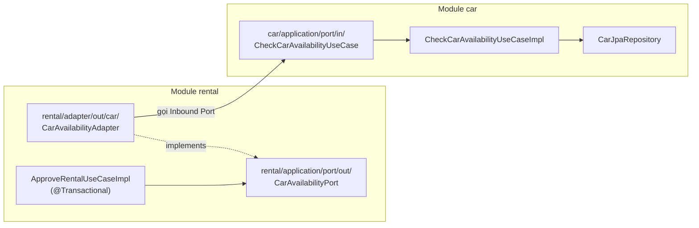
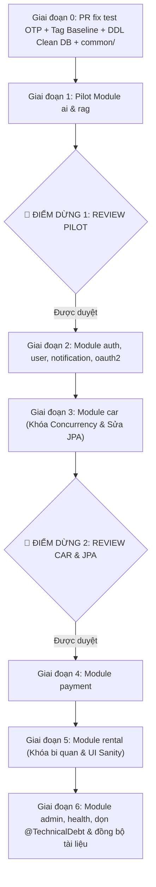

# 🏛️ Kế Hoạch Chuyển Đổi DriveShare Sang Hexagonal Architecture (Bản Chuẩn Hóa V2.3)

> **Tài liệu quy chuẩn kiến trúc**: Dành cho đội ngũ phát triển và AI Coding Agent trong dự án **DriveShare** (`Spring_ThucTap_k4`).  
> **Quy chuẩn ưu tiên cao nhất**: Tuân thủ nghiêm ngặt quy trình Git, Pull Request, và phân quyền trong [AGENTS.md](../AGENTS.md).  
> **Phiên bản kế hoạch**: V2.3 — Cập nhật toàn diện: Áp dụng Hexagonal ĐẦY ĐỦ 11/11 module, tái cấu trúc thứ tự giai đoạn, kiểm kê quan hệ JPA chéo module, hoàn thiện luật ArchUnit Slices và quy trình DDL pg_dump trên Clean DB.

---

## 📑 MỤC LỤC
1. [Mục A: Kết quả kiểm tra thực tế (Facts & Baseline)](#1-mục-a-kết-quả-kiểm-tra-thực-tế-facts--baseline)
2. [Mục B: Thiết kế kiến trúc 3 tầng chuẩn Hexagonal](#2-mục-b-thiết-kế-kiến-trúc-3-tầng-chuẩn-hexagonal)
3. [Mục C: Ranh giới giao tiếp & Chiến lược chuyển tiếp 2 chiều](#3-mục-c-ranh-giới-giao-tiếp--chiến-lược-chuyển-tiếp-2-chiều)
4. [Mục D: Quy tắc JPA, Schema Verification bằng Clean DB & Khóa Concurrency](#4-mục-d-quy-tắc-jpa-schema-verification-bằng-clean-db--khóa-concurrency)
5. [Mục E: Kiểm soát kiến trúc tự động bằng ArchUnit (Slices & Isolation Rules)](#5-mục-e-kiểm-soát-kiến-trúc-tự-động-bằng-archunit-slices--isolation-rules)
6. [Mục F: Quy định phạm vi 11/11 Module đầy đủ](#6-mục-f-quy-định-phạm-vi-1111-module-đầy-đủ)
7. [Mục G: Lộ trình triển khai 6 giai đoạn và 2 điểm dừng Review](#7-mục-g-lộ-trình-triển-khai-6-giai-đoạn-và-2-điểm-dừng-review)
8. [Mục H: Quy trình Git, API Contract Testing & Tiêu chí nghiệm thu](#8-mục-h-quy-trình-git-api-contract-testing--tiêu-chí-nghiệm-thu)
9. [Mục I: Nội dung bảo vệ đồ án trước Hội đồng phản biện](#9-mục-i-nội-dung-bảo-vệ-đồ-án-trước-hội-đồng-phản-biện)
10. [Mục J: Ước tính tiến độ thực tế (16–20 ngày làm việc)](#10-mục-j-ước-tính-tiến-độ-thực-tế-1620-ngày-làm-việc)
11. [Mục K: Nhật ký thay đổi so với các bản cũ (V2.1 $\rightarrow$ V2.2 $\rightarrow$ V2.3)](#11-mục-k-nhật-ký-thay-đổi-so-với-các-bản-cũ-v21--v22--v23)

---

## 1. MỤC A: KẾT QUẢ KIỂM TRA THỰC TẾ (FACTS & BASELINE)

Dưới đây là các dữ liệu đo đạc thực tế từ repository bằng lệnh, không suy đoán:

### A1. Số lượng kiểm thử thật (Test Baseline)
* **Lệnh đo**: `cd backend; .\mvnw.cmd test`
* **Kết quả thực tế đo đạc**:
  * **Tổng số tests**: **232 tests** tại thời điểm đo.
  * **Skipped**: **1** (`CloudinaryLiveTest` do không chạy integration test mạng).
  * **Errors**: **0**
  * **Failures**: **1 test fail** tại:
    ```text
    OtpServiceImplTest.sendOtp_Success_GeneratesMaskedFormatAndSaves:58 
    expected: <120> but was: <300>
    ```
* **Nguyên nhân**: Commit `8d04b37` tăng TTL OTP từ 120s lên 300s trong `OtpServiceImpl.java`, nhưng chưa cập nhật assert ở `OtpServiceImplTest.java#L58`.
* **Quy tắc sửa theo Git flow chuẩn**: Tạo nhánh `fix/otp-test-baseline`, ghi cứng giá trị `assertEquals(300, response.getTtlSeconds())` (không dùng hằng số để tránh tự khẳng định chính nó), mở PR vào `develop`, merge xong mới gắn tag trên `develop`.

### A2. Danh sách module thật
Quét thư mục `backend/src/main/java/com/driveshare/modules/` xác nhận dự án có **11 modules thực tế**:
1. `admin` (Quản trị, duyệt xe/hồ sơ, Dispute Center, Article 175)
2. `ai` (Chatbot tư vấn Gemini 2.5 Flash + Fallback Heuristic Regex, Chat Memory)
3. `auth` (Đăng ký, xác thực JWT, OTP email, Refresh token)
4. `car` (Quản lý xe, bộ lọc tìm kiếm, blackout calendar, quản lý ảnh)
5. `health` (Healthcheck endpoint)
6. `notification` (Hệ thống chuông thông báo)
7. `oauth2` (Đăng nhập Google OAuth2)
8. `payment` (Ký quỹ Escrow 30%, VietQR NAPAS, ví thu nhập chủ xe)
9. `rag` (Trích xuất văn bản PDFBox/POI, Gemini embedding, Vector store)
10. `rental` (Đặt xe, duyệt đơn, bàn giao ODO 2 chiều, Dispute, State Machine)
11. `user` (Hồ sơ cá nhân, eKYC upload CCCD/GPLX, tài khoản ngân hàng)

### A3. Hiện trạng luồng Đặt xe & Duyệt xe trên Frontend
* `frontend/js/booking.js` (L538–L615): Gọi API thật `POST /api/v1/rentals` qua `RentalAPI.createRental(payload)`. Nếu server lỗi (L714–L725), hệ thống hiện thông báo lỗi `toast.error`, **hoàn toàn không giả lập thành công bằng LocalStorage**.
* `frontend/js/owner.js` (L97, L2395, L2418): Gọi API thật `GET /api/v1/owner/rentals`, `PUT /api/v1/owner/rentals/{id}/approve` và `PUT /api/v1/owner/rentals/{id}/reject`.
* `frontend/js/payment.js` (L33): Gọi API thật `POST /api/v1/rentals/{id}/payment`.
* **Sanity Check Baseline Bắt Buộc**: Thực hiện test đặt xe ngay trên baseline trước khi refactor để chứng minh luồng đặt xe ghi nhận dòng thật vào bảng `rentals` PostgreSQL.

### A4. Cấu hình JPA và Cảnh báo Render Production
* `application-dev.yml` và cả **`application-prod.yml` (L10)** đều đang dùng:
  ```yaml
  spring.jpa.hibernate.ddl-auto: update
  ```
* `backend/pom.xml`: **Không có dependency Flyway**. Các script `db/migration/V2..V9` mang tính chất tham khảo.
* **Cảnh Báo Cực Kỳ Nghiêm Trọng**: Vì Render dùng `ddl-auto: update`, nếu đổi tên entity mà không chỉ định `@Table(name = "...")` khớp chính xác tên cũ, **Hibernate sẽ lặng lẽ sinh thêm bảng mới trên PostgreSQL Production mà không hề báo lỗi build hay lỗi runtime**. Dữ liệu cũ sẽ bị bỏ rơi!

### A5. Ma trận phụ thuộc chéo hiện tại & Kiểm kê quan hệ JPA (Chi tiết Mục Q2)
Qua quét mã nguồn thực tế, các điểm phụ thuộc chéo nặng và quan hệ JPA ngoại lai giữa các module gồm:
1. **`Car.java`** $\rightarrow$ `User owner` (`@ManyToOne` trỏ sang module `user`).
2. **`CarSpecification.java`** $\rightarrow$ Subquery `Rental.class` (module `rental`) để lọc xe bận lịch.
3. **`admin/CarSpecification.java`** $\rightarrow$ `Join<Car, User> ownerJoin` để tìm kiếm tên chủ xe.
4. **`Notification.java`** $\rightarrow$ `User user` (`@ManyToOne` trỏ sang module `user`).
5. **`Payment.java`** $\rightarrow$ `Rental rental` và `User user` (`@ManyToOne`).
6. **`Rental.java`** $\rightarrow$ `Car car` và `User renter` (`@ManyToOne`).
7. **`RentalDispute.java`** $\rightarrow$ `User reporter` và `User resolver` (`@ManyToOne`).
8. **`RentalInspection.java`** $\rightarrow$ `User performer` (`@ManyToOne`).
9. **`Review.java`** $\rightarrow$ `Car car` và `User renter` (`@ManyToOne`).

---

## 2. MỤC B: THIẾT KẾ KIẾN TRÚC 3 TẦNG CHUẨN HEXAGONAL

Cả 11 module đều được tổ chức thành 3 tầng phân định rạch ròi:

```text
com.driveshare.modules.<module_name>/
│
├── domain/                                ← TẦNG 1: CORE DOMAIN (Java thuần 100%)
│   ├── model/                             (Entities thuần: Car, Rental... Không JPA)
│   ├── vo/                                (Value Objects: Money, RentalStatus, DateRange...)
│   ├── policy/                            (Quy tắc nghiệp vụ: PenaltyPolicy, AdvisorPolicy...)
│   └── exception/                         (RentalDomainException... Kế thừa RuntimeException)
│
├── application/                           ← TẦNG 2: APPLICATION / USE CASES
│   ├── port/
│   │   ├── in/                            (Inbound Ports: CreateRentalUseCase, ApproveRentalUseCase...)
│   │   └── out/                           (Outbound Ports: RentalRepositoryPort, CarLockingPort...)
│   ├── usecase/                           (Cài đặt UseCase: @Service, @Transactional)
│   └── command/ & result/                 (Command DTOs, Result DTOs nội bộ tầng app)
│
└── adapter/                               ← TẦNG 3: ADAPTERS (Hạ tầng & Ngoại vi)
    ├── in/
    │   └── web/                           (RestController, Request/Response DTOs, WebMapper)
    └── out/
        ├── persistence/                   (JpaEntity, JpaRepository, RepositoryAdapter, EntityMapper)
        ├── ai/                            (GeminiLlmAdapter, LangfuseAdapter...)
        └── storage/                       (CloudinaryStorageAdapter...)
```

### Nguyên tắc chiều phụ thuộc (Dependency Rule)
```
[adapter] ──> [application] ──> [domain]
   │                 │               ▲
   │                 └───────────────┘
   └────────────────────────────────── (Adapter có thể thấy Domain, nhưng Domain KHÔNG thấy ai)
```
1. **Tầng `domain/`**:
   * CẤM tiệt mọi import từ `org.springframework..`, `jakarta.persistence..`, `jakarta.validation..`.
   * CẤM tham chiếu đến `Command`, `Result` hay bất kỳ class nào thuộc `application/` hoặc `adapter/`.
   * Khởi tạo Domain Model thông qua constructor hoặc Factory method nhận tham số nguyên thủy / Value Object: `Rental.create(carId, renterId, dateRange, basePrice)`. Việc bóc tách `Command` $\rightarrow$ tham số thuần nằm tại `UseCaseImpl`.
   * Bắn lỗi `*DomainException`. Bộ lọc `GlobalExceptionHandler` tại tầng web sẽ bắt và ánh xạ thành `ApiResponse.error(code, message)`.
2. **Tầng `application/`**:
   * Được phép dùng các annotation điều phối của Spring: `@Service`, `@Transactional`, `@RequiredArgsConstructor`.
   * CẤM sử dụng các annotation của JPA (`@Entity`, `@Table`, `@Column`, `@Id`) và Spring Data (`org.springframework.data..`). Tầng này chỉ biết các interface Outbound Ports.
   * `AiChatServiceImpl` trước đây được chuyển thành `application/usecase/AskAdvisorUseCaseImpl.java`, tuyệt đối không để trong `domain/`.
3. **Tầng `adapter/`**:
   * Tầng duy nhất được import JPA, Hibernate, Spring Web MVC, Cloudinary SDK, Google HttpClient.
   * Chuyển đổi dữ liệu 2 chiều thông qua `Mapper` rõ ràng.

---

## 3. MỤC C: RANH GIỚI GIAO TIẾP & CHIẾN LƯỢC CHUYỂN TIẾP 2 CHIỀU

### C1. Nguyên Tắc Chiều Port Giữa Các Module
Module A tuyệt đối không được gọi Repository hay Entity của Module B:



### C2. Chiến Lược Chuyển Tiếp 2 Chiều & Khử Nợ Kỹ Thuật (Q1 & Q3)

#### Chiều 1: Module Mới gọi Module Cũ (Ví dụ: `ai` gọi `car` ở Giai đoạn 1)
1. Module `ai` định nghĩa Outbound Port: `ai/application/port/out/CarDataQueryPort`.
2. **Đích gọi chuẩn xác (Q1)**: `CarDataQueryPort` phục vụ tìm kiếm dữ liệu hiển thị xe cho AI, do đó đích gọi chuẩn của nó ở `car` sau này là `car/application/port/in/QueryCarSummariesUseCase` (trả về `CarSummaryResult` trong `car.application.result`), **KHÔNG gọi `CheckCarAvailabilityUseCase`** (vì port này chỉ kiểm tra tính khả dụng lịch).
3. Trong Giai đoạn 1 (khi `car` chưa refactor), `ai` tạo class `CarDataQueryLegacyAdapter` tạm thời inject `CarRepository` cũ và ánh xạ sang `CarSummaryResult` (tránh rò rỉ `Car` entity).
4. Đánh dấu chú thích: `// @TechnicalDebt: Tạm thời gọi CarRepository cũ do module car chưa refactor.`

#### Chiều 2: Module Cũ gọi Module Mới (Ví dụ: `rental`, `payment`, `admin` cũ gọi `car` mới ở Giai đoạn 3 - Q3)
Khi `car` hoàn thành refactor ở Giai đoạn 3:
1. `car` tạo `CarJpaRepository` và `CarJpaEntity` trong `car/adapter/out/persistence/`.
2. Để các module chưa refactor (`rental`, `payment`, `admin`) không bị gãy compile, ta **duy trì một `LegacyCarRepositoryBridge`** hoặc adapter chuyển tiếp đóng vai trò tương thích ngược.
3. Khi đến giai đoạn refactor của `rental`, `payment`, `admin`, các lệnh gọi cũ sẽ được cắt đứt và chuyển sang gọi qua Inbound Ports chuẩn của `car`.
4. **Cổng Nghiệm Thu Cuối (Giai đoạn 6)**: Quét grep toàn bộ repo: kết quả phải có **0 chú thích `// @TechnicalDebt`**.

### C3. Phá Bỏ Vòng Lặp Phụ Thuộc (Acyclic Dependencies: `car` $\leftrightarrow$ `rental` & `rental` $\leftrightarrow$ `payment`)

#### (a) Cặp `car` $\leftrightarrow$ `rental`:
* Đồ án duy trì đồ thị phụ thuộc giữa các Bean là phi chu trình (Acyclic Dependency Graph): các use case truy vấn độc lập chỉ phụ thuộc vào Persistence Port của chính nó, không gọi ngược sang module kia:
  * **Chiều `rental` $\rightarrow$ `car`**:
    * `car` cung cấp: Inbound Port `CheckCarAvailabilityUseCase` và `LockCarForBookingUseCase`.
    * `rental` có: Outbound Port `CarAvailabilityPort` và `CarLockingPort`.
  * **Chiều `car` $\rightarrow$ `rental`**:
    * `rental` cung cấp: Inbound Port `QueryActiveRentalsForCarUseCase`.
    * `car` có: Outbound Port `RentalScheduleQueryPort`.
* Thêm bài test `@SpringBootTest` nạp `ApplicationContext` ở mỗi giai đoạn để chứng minh 0 lỗi `BeanCurrentlyInCreationException`.

#### (b) Cặp `rental` $\leftrightarrow$ `payment`:
* **Chiều `payment` $\rightarrow$ `rental` (Giai đoạn 4 làm trước Giai đoạn 5)**:
  * `payment` cần cập nhật trạng thái đơn thuê khi cọc 30% thành công.
  * `payment` định nghĩa Outbound Port: `payment/application/port/out/RentalBookingPort`.
  * Ở Giai đoạn 4, adapter `RentalBookingLegacyAdapter` tạm thời inject `RentalRepository` cũ (đánh dấu `// @TechnicalDebt`).
  * Sang Giai đoạn 5, chuyển adapter này gọi Inbound Port `ConfirmRentalDepositUseCase` của `rental`.
* **Chiều `rental` $\rightarrow$ `payment` (Giai đoạn 5)**:
  * `rental` định nghĩa Outbound Port: `rental/application/port/out/PaymentInitiationPort`.
  * Adapter `PaymentInitiationAdapter` gọi Inbound Port `InitiateDepositUseCase` của `payment`.

### C4. Xử Lý Quan Hệ JPA & JOIN Chéo Module (Chi Tiết Q2)
Dựa trên kết quả kiểm kê ở Mục A5, dự án áp dụng chiến lược xử lý triệt để cho từng quan hệ JPA:

| Thực thể gốc | Quan hệ cũ | Module bị phụ thuộc | Hướng xử lý chuẩn Hexagonal |
| :--- | :--- | :--- | :--- |
| `Car` | `@ManyToOne User owner` | `user` | **Tham chiếu bằng ID**: Đổi thành `ownerId: Long` thuần túy. Xóa trường `User owner` khỏi Domain model. Trong `CarJpaEntity`, nếu cần phục vụ query của admin, giữ `@ManyToOne` ở tầng Adapter persistence hoặc viết query lấy thông tin User qua `user` Inbound Port. |
| `CarSpecification` | Subquery `Rental.class` | `rental` | **Khử Subquery chéo**: `CarSpecification` nhận danh sách `List<Long> busyCarIds` từ Inbound Port `QueryActiveRentalCarIdsUseCase` của `rental`, sau đó dùng `cb.not(root.get("carId").in(busyCarIds))` $\rightarrow$ Triệt tiêu 100% việc import `Rental.class` trong module `car`! |
| `Admin CarSpec` | `Join<Car, User> ownerJoin` | `user` | **Truy vấn qua Inbound Port**: Tìm kiếm user IDs theo keyword trước qua `SearchUsersByKeywordUseCase` của `user`, sau đó query xe theo `ownerId IN (:userIds)`. |
| `Notification` | `@ManyToOne User user` | `user` | **Tham chiếu bằng ID**: Chỉ lưu `userId: Long`. Bỏ `@ManyToOne User user`. |
| `Payment` | `@ManyToOne Rental rental`, `User user` | `rental`, `user` | **Tham chiếu bằng ID**: Chỉ lưu `rentalId: Long` và `userId: Long`. Khi cần dữ liệu hiển thị, gọi qua Port tương ứng. |
| `Rental` | `@ManyToOne Car car`, `User renter` | `car`, `user` | **Tham chiếu bằng ID**: Chỉ lưu `carId: Long` và `renterId: Long`. |
| `RentalDispute` | `@ManyToOne User reporter`, `User resolver` | `user` | **Tham chiếu bằng ID**: Chỉ lưu `reporterId: Long` và `resolverId: Long`. |
| `RentalInspection`| `@ManyToOne User performer` | `user` | **Tham chiếu bằng ID**: Chỉ lưu `performerId: Long`. |
| `Review` | `@ManyToOne Car car`, `User renter` | `car`, `user` | **Tham chiếu bằng ID**: Chỉ lưu `carId: Long` và `renterId: Long`. |

---

## 4. MỤC D: QUY TẮC JPA, SCHEMA VERIFICATION BẰNG CLEAN DB & KHÓA CONCURRENCY

### D1. Bảo Toàn Schema & Quy Trình Kiểm Chứng Bằng Clean DB (P1 & P2)
Vì dự án dùng `ddl-auto: update`, ta kiểm chứng schema qua quy trình snapshot trên database rỗng:
1. **Khởi Tạo Baseline Schema Trên Clean DB (P1)**:
   * Chạy container Docker PostgreSQL: `driveshare-postgres` với database rỗng mới `driveshare_db_baseline`.
   * Khởi động ứng dụng từ tag `v1.0.0-layered-baseline` để Hibernate tự sinh schema nguyên bản.
   * Chạy lệnh dump DDL loại bỏ nhiễu:
     ```powershell
     docker exec driveshare-postgres pg_dump -U postgres -d driveshare_db_baseline --schema-only --no-owner --no-privileges > docs/schema_baseline.sql
     ```
   * Chụp snapshot OpenAPI baseline:
     ```powershell
     Invoke-WebRequest -Uri "http://localhost:8080/v3/api-docs" -OutFile docs/openapi_baseline.json
     python -c "import json; d=json.load(open('docs/openapi_baseline.json')); json.dump(d, open('docs/openapi_baseline.json','w'), indent=2, sort_keys=True)"
     ```
   * **Quản lý file baseline (P2)**: Mở PR riêng `chore/baseline-snapshots` đưa 2 file baseline này vào `develop` để làm mốc so sánh cho toàn bộ các giai đoạn sau.
2. **Khai báo bảo vệ bắt buộc trên Entity**:
   ```java
   @Entity(name = "Rental")            // Giữ nguyên Entity name để các câu lệnh JPQL "from Rental r" không gãy
   @Table(name = "rentals")            // Khớp 100% với tên bảng hiện tại trong PostgreSQL
   public class RentalJpaEntity extends BaseJpaEntity { ... }
   ```
3. **Thực Hiện So Sánh 2 Lần**:
   * **Lần (a) - Bắt lỗi cột bị thiếu (Clean DB Diff)**: Khởi động code mới trên một database rỗng tạm thời, dump schema và so sánh diff với `docs/schema_baseline.sql`. Bắt buộc **0 cột bị thiếu, 0 bảng bị lệch**.
   * **Lần (b) - Kiểm tra tương thích dữ liệu cũ (Dirty DB Diff)**: Khởi động code mới trên database hiện tại đã có dữ liệu, dump schema và xác nhận **0 bảng mới** bị Hibernate tự sinh thêm.

### D2. Quy Tắc Adapter `save()` Cập Nhật Thực Thể Quản Lý (Managed Entity)
```java
@Component
@RequiredArgsConstructor
public class RentalRepositoryAdapter implements RentalRepositoryPort {
    private final RentalJpaRepository jpaRepository;
    private final RentalPersistenceMapper mapper;

    @Override
    public Rental save(Rental rental) {
        RentalJpaEntity entity = jpaRepository.findById(rental.getId())
                .map(existing -> {
                    mapper.copyToEntity(rental, existing);
                    return existing;
                })
                .orElseGet(() -> mapper.toNewEntity(rental));
        return mapper.toDomain(jpaRepository.save(entity));
    }
}
```

### D3. Chiều Port Chuẩn Xác Cho Khóa Bi Quan Concurrency (`PESSIMISTIC_WRITE`)
* **Tránh Rò Rỉ Domain Model**:
  * Inbound Port của `car`:
    ```java
    package com.driveshare.modules.car.application.port.in;
    import com.driveshare.modules.car.application.result.LockedCarResult;

    public interface LockCarForBookingUseCase {
        LockedCarResult lockCar(Long carId);
    }
    ```
    *Trả về `LockedCarResult` (DTO tầng application), tuyệt đối không trả về `Car` domain model*.
  * Module `rental` định nghĩa Outbound Port: `CarLockingPort`.
  * `rental/adapter/out/car/CarLockingAdapter` inject và gọi `LockCarForBookingUseCase`.
* **Cơ chế khóa trong `car` Persistence Adapter**:
  ```java
  @Lock(LockModeType.PESSIMISTIC_WRITE)
  @Query("SELECT c FROM Car c WHERE c.carId = :carId AND c.deletedAt IS NULL")
  Optional<CarJpaEntity> findCarForUpdate(@Param("carId") Long carId);
  ```
* **Quy tắc Transaction Propagation**:
  * `ApproveRentalUseCaseImpl` trong `rental` mở `@Transactional`.
  * `LockCarForBookingUseCaseImpl` trong `car` sử dụng `@Transactional(propagation = Propagation.REQUIRED)` (mặc định).
  * **CẤM tiệt dùng `REQUIRES_NEW`**: Để đảm bảo khóa trên dòng `Car` được giữ liên tục cho đến khi giao dịch của `rental` hoàn tất commit.
* **Kiểm chứng**: Bắt buộc chạy `ConcurrencyBookingOverlapTest` ở **cuối Giai đoạn 3 (`car`)** và **cuối Giai đoạn 5 (`rental`)**.

---

## 5. MỤC E: KIỂM SOÁT KIẾN TRÚC TỰ ĐỘNG BẰNG ARCHUNIT (SLICES & ISOLATION RULES)

Thêm dependency vào `backend/pom.xml` (scope test):
```xml
<dependency>
    <groupId>com.tngtech.archunit</groupId>
    <artifactId>archunit-junit5</artifactId>
    <version>1.3.0</version>
    <scope>test</scope>
</dependency>
```

Tạo test kiểm soát kiến trúc tại `backend/src/test/java/com/driveshare/architecture/ArchitectureRulesTest.java` (áp dụng triệt để các bổ sung P3 & Q4):
```java
package com.driveshare.architecture;

import com.tngtech.archunit.core.domain.JavaClass;
import com.tngtech.archunit.core.importer.ImportOption;
import com.tngtech.archunit.junit.AnalyzeClasses;
import com.tngtech.archunit.junit.ArchTest;
import com.tngtech.archunit.lang.ArchCondition;
import com.tngtech.archunit.lang.ArchRule;
import com.tngtech.archunit.lang.ConditionEvents;
import com.tngtech.archunit.lang.SimpleConditionEvent;

import static com.tngtech.archunit.lang.syntax.ArchRuleDefinition.classes;
import static com.tngtech.archunit.lang.syntax.ArchRuleDefinition.noClasses;
import static com.tngtech.archunit.library.dependencies.SlicesRuleDefinition.slices;

@AnalyzeClasses(packages = "com.driveshare", importOptions = ImportOption.DoNotIncludeTests.class)
public class ArchitectureRulesTest {

    // 1. Domain không phụ thuộc Framework (Spring, JPA, Hibernate)
    @ArchTest
    static final ArchRule domain_khong_phu_thuoc_framework =
        noClasses().that().resideInAPackage("..modules..domain..")
            .should().dependOnClassesThat().resideInAnyPackage(
                "org.springframework..", "jakarta.persistence..", "jakarta.validation..")
            .allowEmptyShould(true);

    // 2. Domain không phụ thuộc Application, Adapter hay Common Persistence/Adapter (P3)
    @ArchTest
    static final ArchRule domain_khong_phu_thuoc_application_hay_adapter =
        noClasses().that().resideInAPackage("..modules..domain..")
            .should().dependOnClassesThat().resideInAnyPackage(
                "..modules..application..", "..modules..adapter..", 
                "..common.adapter..", "..common.persistence..")
            .allowEmptyShould(true);

    // 3. Application không phụ thuộc Adapter hay Common Persistence/Adapter (P3)
    @ArchTest
    static final ArchRule application_khong_phu_thuoc_adapter =
        noClasses().that().resideInAPackage("..modules..application..")
            .should().dependOnClassesThat().resideInAnyPackage(
                "..modules..adapter..", "..common.adapter..", "..common.persistence..")
            .allowEmptyShould(true);

    // 4. Application không phụ thuộc JPA / Hibernate / Spring Data
    @ArchTest
    static final ArchRule application_khong_phu_thuoc_jpa =
        noClasses().that().resideInAPackage("..modules..application..")
            .should().dependOnClassesThat().resideInAnyPackage(
                "jakarta.persistence..", "org.springframework.data..")
            .allowEmptyShould(true);

    // 5. Controller Web tuyệt đối không gọi trực tiếp Persistence
    @ArchTest
    static final ArchRule controller_khong_goi_persistence =
        noClasses().that().resideInAPackage("..adapter.in.web..")
            .should().dependOnClassesThat().resideInAnyPackage("..adapter.out.persistence..")
            .allowEmptyShould(true);

    // 6. Slices Rule: Tầng Application của các module KHÔNG phụ thuộc trực tiếp vào nhau (Q4)
    @ArchTest
    static final ArchRule application_cac_module_khong_phu_thuoc_nhau =
        slices().matching("..modules.(*).application..")
            .should().notDependOnEachOther()
            .allowEmptyShould(true);

    // 7. Quy tắc cách ly module tổng quát (Q4): Module X chỉ giao tiếp với Module Y qua port.in, command, result
    @ArchTest
    static final ArchRule module_giao_tiep_qua_inbound_port =
        classes().that().resideInAPackage("..modules..")
            .should(tuanThuGiaoTiepModule())
            .allowEmptyShould(true);

    private static ArchCondition<JavaClass> tuanThuGiaoTiepModule() {
        return new ArchCondition<JavaClass>("chỉ được phụ thuộc module khác qua inbound ports, command, result") {
            @Override
            public void check(JavaClass item, ConditionEvents events) {
                String pkg = item.getPackageName();
                // Bỏ qua các legacy adapter chưa đến giai đoạn refactor
                if (item.getSimpleName().endsWith("LegacyAdapter")) {
                    return;
                }
                item.getDirectDependenciesFromSelf().forEach(dep -> {
                    String targetPkg = dep.getTargetClass().getPackageName();
                    if (targetPkg.contains(".modules.") && !targetPkg.startsWith(extractModulePackage(pkg))) {
                        boolean validPortAccess = targetPkg.contains(".application.port.in")
                                || targetPkg.contains(".application.command")
                                || targetPkg.contains(".application.result");
                        if (!validPortAccess) {
                            String message = String.format("Vi phạm ranh giới: %s phụ thuộc trái phép vào %s",
                                    item.getName(), dep.getTargetClass().getName());
                            events.add(SimpleConditionEvent.violated(item, message));
                        }
                    }
                });
            }

            private String extractModulePackage(String fullPkg) {
                int idx = fullPkg.indexOf(".modules.");
                if (idx == -1) return fullPkg;
                int nextDot = fullPkg.indexOf('.', idx + 9);
                return nextDot == -1 ? fullPkg : fullPkg.substring(0, nextDot);
            }
        };
    }
}
```

---

## 6. MỤC F: QUY ĐỊNH PHẠM VI 11/11 MODULE ĐẦY ĐỦ

Chủ dự án đã phê duyệt áp dụng **Hexagonal Architecture ĐẦY ĐỦ cho toàn bộ 11/11 module**. Không còn khái niệm module "Light":

### 6.1 Định nghĩa "Đầy Đủ" cho từng nhóm module (Tránh Code Rác)
1. **Mọi module đều tuân thủ 3 tầng `domain / application / adapter`**:
   * Có Inbound Ports (`application/port/in/`) và Outbound Ports (`application/port/out/`).
   * Tầng web controller là `adapter/in/web`, chỉ gọi Inbound Ports.
   * Chịu sự kiểm soát 100% của toàn bộ 7 luật ArchUnit ở Mục E.
2. **Quy định tầng `domain/` thực chất (Không tạo class giả)**:
   * Thư mục `domain/` chỉ chứa những khái niệm thật sự có nghiệp vụ hoặc trạng thái: Model, Value Object, Policy, Domain Exception.
   * Với module không có logic nghiệp vụ nội tại như **`health`**: Thư mục `domain/` được phép rỗng hoặc không tạo class giả. Lý do kỹ thuật: `health` là phân hệ kiểm tra trạng thái hạ tầng (liveness/readiness), không đại diện cho thực thể kinh doanh. Cấm tạo POJO giả chỉ để cho đủ cấu trúc.
3. **Mọi module có CSDL**:
   * Có `*JpaEntity` riêng trong `adapter/out/persistence/` tuân thủ D1 (`@Table`, `@Entity(name)`).
   * Có `*PersistenceMapper` và `*RepositoryAdapter` tuân thủ D2 (mẫu `save()` cập nhật managed entity).
4. **Module tương tác dịch vụ ngoài**:
   * `oauth2`: có Outbound Port `GoogleIdentityPort` và Adapter gọi Google API.
   * `health`: có Outbound Port `DatabaseHealthPort` và Adapter kiểm tra kết nối Postgres.

### 6.2 Phân Rã Toàn Diện Inbound Ports Cho Module `admin` (Mục 1.3)
Vì `admin` là module quản trị đọc/ghi trên hầu hết hệ thống, các module khác phải mở sẵn các **Inbound Ports chuyên trách cho admin**:

| Module cung cấp | Inbound Port chuyên trách cho Admin | Chức năng nghiệp vụ |
| :--- | :--- | :--- |
| **`car`** | `ListCarsForAdminUseCase`<br>`GetCarDetailForAdminUseCase`<br>`ApproveCarUseCase`<br>`RejectCarUseCase`<br>`ApproveCarDocumentUseCase`<br>`GetCarStatsForAdminUseCase` | Duyệt xe mới, từ chối xe, duyệt cavet/đăng kiểm, thống kê số lượng xe chờ duyệt |
| **`user`** | `ListUsersForAdminUseCase`<br>`GetUserDetailForAdminUseCase`<br>`VerifyUserCccdUseCase`<br>`ApproveUserLicenseUseCase`<br>`ApproveOwnerRoleUseCase`<br>`UpdateUserStatusUseCase`<br>`GetUserStatsForAdminUseCase` | Duyệt eKYC CCCD, duyệt bằng lái GPLX, nâng cấp tài khoản chủ xe, khóa/mở tài khoản, thống kê người dùng |
| **`rental`** | `ListRentalsForAdminUseCase`<br>`GetOverdueRentalsForAdminUseCase`<br>`GetRentalViolationDossierUseCase`<br>`GetAllDisputesForAdminUseCase`<br>`ResolveDisputeForAdminUseCase`<br>`GetRentalStatsForAdminUseCase` | Xem toàn bộ đơn thuê, danh sách đơn trễ hạn, hồ sơ vi phạm Điều 175, phân xử khiếu nại hoàn cọc, thống kê đơn |
| **`payment`**| `GetPaymentByRentalIdUseCase` | Tra cứu lịch sử dòng tiền cọc/hoàn cọc của đơn thuê |
| **`ai`**     | `GetChatSessionsForAdminUseCase`<br>`GetChatTranscriptForAdminUseCase` | Giám sát lịch sử tư vấn AI và chất lượng hội thoại |

`admin` định nghĩa các Outbound Ports tương ứng trong `admin/application/port/out/` và Adapter gọi các Inbound Port trên. **Tuyệt đối cấm `admin` inject Repository hay Entity của module khác**.

---

## 7. MỤC G: LỘ TRÌNH TRIỂN KHAI 6 GIAI ĐOẠN VÀ 2 ĐIỂM DỪNG REVIEW

Thứ tự giai đoạn được tái sắp xếp tối ưu: **Đưa `user`, `notification`, `oauth2` lên Giai đoạn 2 (trước `rental` và `payment`)** để giảm tối đa số lượng adapter chuyển tiếp và nợ kỹ thuật:



### Bước Tiên Quyết: Sửa Test OTP, Sanity Check UI & Gắn Tag Baseline
1. **Kiểm tra giao diện Baseline (Sanity Check)**: Mở web đặt thử 1 đơn xe, query `SELECT rental_id, status FROM rentals ORDER BY rental_id DESC LIMIT 1;` xác nhận luồng đặt xe ghi nhận dữ liệu thật.
2. Tạo nhánh: `git checkout develop && git pull origin develop && git checkout -b fix/otp-test-baseline`.
3. Sửa file `backend/src/test/java/com/driveshare/modules/auth/service/OtpServiceImplTest.java` dòng 58:
   ```java
   assertEquals(300, response.getTtlSeconds()); // Ghi cứng 300
   ```
4. Chạy kiểm thử: `cd backend; .\mvnw.cmd test` $\rightarrow$ Xác nhận **231 tests pass (1 skipped)**.
5. Mở PR vào `develop`, Tech Lead duyệt và Squash & Merge.
6. Về `develop`, pull code mới nhất và gắn tag:
   ```bash
   git checkout develop && git pull origin develop
   git tag -a v1.0.0-layered-baseline -m "Baseline sau khi fix OTP: 231 passed, 1 skipped"
   git push origin v1.0.0-layered-baseline
   ```
7. Khởi động ứng dụng từ tag baseline trên DB rỗng `driveshare_db_baseline`, chụp baseline:
   * Chụp DDL: `docker exec driveshare-postgres pg_dump -U postgres -d driveshare_db_baseline --schema-only --no-owner --no-privileges > docs/schema_baseline.sql`
   * Chụp OpenAPI: Lưu nguyên văn qua `Invoke-WebRequest` và sort keys bằng Python vào `docs/openapi_baseline.json`.
   * Mở PR riêng `chore/baseline-snapshots` lưu 2 file này vào repo.

### Giai đoạn 0: Tái cấu trúc `common/` & Tạo `ImageStoragePort` (Nhánh: `feature/hex-00-common`)
* Tạo `common/application/port/out/ImageStoragePort.java` (nhận `byte[]` hoặc `InputStream`, trả về URL).
* Tạo `common/adapter/out/storage/CloudinaryStorageAdapter.java` (implements `ImageStoragePort`).
* Tạo `common/persistence/BaseJpaEntity.java` (giữ nguyên `@MappedSuperclass`).
* Giữ nguyên `BaseEntity.java` (kế thừa `BaseJpaEntity`) để các module chưa refactor không bị gãy.
* Chạy test xác nhận không giảm test. Mở PR vào `develop`.

### Giai đoạn 1: PILOT Module `ai` & `rag` (Nhánh: `feature/hex-01-ai-rag`)
1. Tạo cấu trúc 3 tầng: `domain`, `application`, `adapter`.
2. Chuyển logic Heuristic Regex sang `domain/policy/CarAdvisorPolicy.java`.
3. Định nghĩa Inbound Ports (`AskAdvisorUseCase`, `GetChatHistoryUseCase`) và Outbound Ports (`LlmClientPort`, `ChatMemoryPort`, `CarDataQueryPort`).
4. `CarDataQueryPort` trả về `CarSummaryResult` (không rò rỉ entity).
5. Tại `adapter/out/car/`, tạo `CarDataQueryLegacyAdapter` tạm thời gọi `CarRepository` cũ (đánh dấu `// @TechnicalDebt`).
6. Tạo `application/usecase/AskAdvisorUseCaseImpl.java`.
7. Tạo Adapters: `GeminiLlmAdapter`, `ChatMemoryJpaAdapter` (`@Table(name = "chat_memory")`), `ChatController`.
8. Sửa toàn bộ test của module `ai` & `rag`.
9. Bổ sung `ArchitectureRulesTest.java` (ArchUnit) và chứng minh test đỏ khi cố tình vi phạm import.
10. **🛑 ĐIỂM DỪNG REVIEW 1 — MỞ PULL REQUEST VÀ BÁO CÁO CON NGƯỜI DUYỆT.**

### Giai đoạn 2: Module `auth`, `user`, `notification`, `oauth2` (Nhánh: `feature/hex-02-auth-user`)
* Refactor 4 module nền tảng trước để sẵn sàng phục vụ `rental` và `payment`:
  * `auth`: Token, OTP, User authentication ports.
  * `user`: Profile, eKYC verification ports. Chuyển sang `ImageStoragePort`.
  * `notification`: Notification dispatching ports.
  * `oauth2`: `GoogleIdentityPort` và adapter Google OAuth2 client.
* Sửa các bài test tương ứng: `AuthServiceTest`, `OtpServiceImplTest`, `UserProfileControllerTest`, `UserProfileServiceTest`.

### Giai đoạn 3: Module `car` (Nhánh: `feature/hex-03-car`)
* Tách `car` thành 3 tầng. Khử Subquery `Rental` trong `CarSpecification` (nhận `busyCarIds` từ rental qua port).
* Tạo Inbound Port `QueryCarSummariesUseCase` $\rightarrow$ Xóa `// @TechnicalDebt` ở `CarDataQueryLegacyAdapter` của `ai`.
* Cài đặt `findCarForUpdate` trong `CarJpaRepository` và mở Inbound Port `LockCarForBookingUseCase` (trả về `LockedCarResult`).
* **Bắt buộc chạy**: `ConcurrencyBookingOverlapTest.java` để chứng minh di chuyển `findCarForUpdate` không làm mất khóa.
* **🛑 ĐIỂM DỪNG REVIEW 2 — REVIEW CAR, KHÓA BI QUAN & QUAN HỆ JPA.**

### Giai đoạn 4: Module `payment` (Nhánh: `feature/hex-04-payment`)
* Tách `payment` thành 3 tầng. Inbound Ports: `InitiateDepositUseCase`, `ConfirmPaymentUseCase`, `GetOwnerEarningsUseCase`.
* Outbound Port: `RentalBookingPort` (tạm thời dùng `RentalBookingLegacyAdapter` gọi `RentalRepository` cũ, đánh dấu `// @TechnicalDebt`).
* Sửa test: `PaymentControllerTest`, `PaymentServiceTest`.

### Giai đoạn 5: Module `rental` (Nhánh: `feature/hex-05-rental`)
* Tách `rental` thành 3 tầng. Cài đặt State Machine 18 trạng thái trong UseCase.
* Sử dụng `CarLockingPort` gọi sang `LockCarForBookingUseCase` với `@Transactional(propagation = Propagation.REQUIRED)`.
* Chuyển `RentalBookingLegacyAdapter` của `payment` sang gọi Inbound Port `ConfirmRentalDepositUseCase`.
* Sửa toàn bộ 13 file test của rental, dispute, inspection, review.
* **Bắt buộc chạy**: `ConcurrencyBookingOverlapTest.java` và `ConcurrencyDisputeRefundTest.java`.
* Thực hiện kiểm tra giao diện Sanity Check đặt xe xuống CSDL.

### Giai đoạn 6: Module `admin`, `health`, Dọn Nợ Kỹ Thuật & Đồng Bộ Tài Liệu (Nhánh: `feature/hex-06-admin-finish`)
* Refactor `admin`: Chuyển toàn bộ các lệnh gọi trực tiếp Repository sang gọi Inbound Ports chuyên trách (Mục 6.2).
* Refactor `health`: Tách `DatabaseHealthPort` và web adapter.
* **Cổng Nghiệm Thu Cuối**: Quét toàn bộ repo không còn bất kỳ dòng `// @TechnicalDebt` nào!
* Đồng bộ tài liệu:
  * `AGENTS.md`: Cập nhật cấu trúc Hexagonal, cập nhật số lượng test thực tế tại thời điểm đo.
  * `.github/workflows/ci.yml`: Bỏ hard-code số test, chuyển sang câu lệnh verify toàn bộ test pass.
  * `.agents/skills/springboot-patterns`: Cập nhật toàn diện hướng dẫn Ports & Adapters.

---

## 8. MỤC H: QUY TRÌNH GIT, API CONTRACT TESTING & TIÊU CHÍ NGHIỆM THU

### H1. Kiểm Tra Hợp Đồng API Tự Động (API Contract Testing via OpenAPI)
Trước và sau mỗi module, thực hiện chụp và so sánh OpenAPI Specification:
```powershell
# Chụp sau refactor
Invoke-WebRequest -Uri "http://localhost:8080/v3/api-docs" -OutFile docs/openapi_current.json
python -c "import json; d=json.load(open('docs/openapi_current.json')); json.dump(d, open('docs/openapi_current.json','w'), indent=2, sort_keys=True)"

# So sánh diff với file baseline
git diff --no-index docs/openapi_baseline.json docs/openapi_current.json
```
**Yêu cầu**: 0 breaking changes về endpoint URL, HTTP method, parameters, status codes và schema models.

### H2. Kiểm Tra Thực Tế Giao Diện (Manual UI Sanity Check)
Thực hiện tại 2 thời điểm: (1) Trước khi refactor trên baseline; (2) Sau Giai đoạn 5 (`rental`):
1. Mở giao diện `frontend/index.html`, đăng nhập tài khoản khách.
2. Thực hiện đặt 1 chiếc xe.
3. Mở PostgreSQL (hoặc Adminer `http://localhost:8088`), chạy câu lệnh:
   ```sql
   SELECT rental_id, car_id, renter_id, status, created_at FROM rentals ORDER BY rental_id DESC LIMIT 1;
   ```
4. Xác nhận đơn mới xuất hiện trong DB với trạng thái `PENDING` hoặc `PENDING_APPROVAL`.

### H3. Tiêu Chí Nghiệm Thu Từng Giai Đoạn (Quality Gate):
* [ ] **Không giảm test**: Toàn bộ bài test phải pass (không test nào bị xóa hoặc `@Disabled`).
* [ ] **ArchUnit Pass**: Cả 7 quy tắc kiến trúc đều xanh, không có vi phạm ranh giới.
* [ ] **Schema Diff Zero**: So sánh `pg_dump` Clean DB và Dirty DB khẳng định 0 bảng mới, 0 cột mới, 0 cột bị thiếu.
* [ ] **API Contract Zero Diff**: So sánh OpenAPI trước/sau không có breaking change.
* [ ] **ContextLoads Pass**: Test `@SpringBootTest` nạp thành công ApplicationContext, không lỗi bean cyclic.

---

## 9. MỤC I: NỘI DUNG BẢO VỆ ĐỒ ÁN TRƯỚC HỘI ĐỒNG PHẢN BIỆN

> [!TIP]
> **Câu trả lời chuẩn kỹ thuật khi Thầy Cô hỏi về tính linh hoạt của Hexagonal:**  
> *"Dạ thưa Thầy/Cô, giá trị lớn nhất của Hexagonal Architecture trong DriveShare là **sự độc lập giữa Nghiệp vụ cốt lõi và Hạ tầng công nghệ**:*  
> 1. *Tại phân hệ AI Chatbot, toàn bộ logic tư vấn xe và quản lý ngữ cảnh nằm độc lập trong `domain` và `application`. Khi muốn chuyển đổi từ Google Gemini sang Claude hay OpenAI GPT-4, nhóm chỉ cần tạo một Adapter mới cài đặt `LlmClientPort` mà không cần sửa một dòng code nghiệp vụ nào.*  
> 2. *Tương tự tại phân hệ Quản lý ảnh xe và avatar người dùng, việc chuyển đổi kho lưu trữ từ Cloudinary sang AWS S3 hoặc MinIO chỉ đòi hỏi thay thế cài đặt của `ImageStoragePort` trong tầng common.*  
> *Đồng thời, toàn bộ 11/11 module đều tuân thủ kiến trúc 3 tầng và giao tiếp qua Port. Với các module hạ tầng không chứa thực thể kinh doanh như `health`, nhóm không tạo domain model giả mà tập trung vào Outbound Port kiểm tra CSDL, thể hiện tư duy thiết kế phần mềm thực tế và chuẩn mực."*

---

## 10. MỤC J: ƯỚC TÍNH TIẾN ĐỘ THỰC TẾ (16–20 NGÀY LÀM VIỆC)

Dưới đây là bảng phân bổ tiến độ chi tiết cho phạm vi **11/11 module đầy đủ**, bao gồm thời gian refactor code, xử lý quan hệ JPA, viết/sửa test và xử lý xung đột (chưa tính thời gian con người review PR):

| Giai đoạn | Module thực hiện | Số file tác động dự kiến | Thời gian ước tính |
| :--- | :--- | :---: | :---: |
| **Giai đoạn 0** | Sửa test OTP, baseline tag, Clean DB DDL dump, `common/` & `ImageStoragePort` | ~8 files | 1 ngày |
| **Giai đoạn 1** | Pilot module `ai` & `rag`, tích hợp ArchUnit | ~16 files | 2 ngày |
| **Review Pilot**| Chạy thử nghiệm, đánh giá kết quả, duyệt PR Pilot | 0 files | 0.5 ngày |
| **Giai đoạn 2** | Module `auth`, `user`, `notification`, `oauth2` | ~28 files | 3 ngày |
| **Giai đoạn 3** | Module `car` (Search, Calendar, Khóa bi quan, xử lý JPA chéo) | ~26 files | 3 ngày |
| **Review Car**  | Kiểm tra Concurrency lock, kiểm tra DDL schema, duyệt PR Car | 0 files | 0.5 ngày |
| **Giai đoạn 4** | Module `payment` (VietQR, Escrow, Ví chủ xe, Transition Adapter) | ~16 files | 2 ngày |
| **Giai đoạn 5** | Module `rental` (State Machine 18 trạng thái, Khóa bi quan, UI Sanity) | ~32 files | 3.5 ngày |
| **Giai đoạn 6** | Module `admin`, `health`, dọn `@TechnicalDebt`, đồng bộ tài liệu | ~24 files | 2.5 ngày |
| **Tổng cộng**   | **Toàn bộ 11/11 modules đầy đủ** | **~150 files** | **~17.5 – 19.5 ngày làm việc** |

---

## 11. MỤC K: NHẬT KÝ THAY ĐỔI SO VỚI CÁC BẢN CŨ (V2.1 $\rightarrow$ V2.2 $\rightarrow$ V2.3)

Dưới đây là bảng đối soát chi tiết việc tiếp thu toàn bộ chỉ thị V2.3 vào bản kế hoạch:

| Nhóm chỉ thị | Nội dung yêu cầu trong Chỉ thị V2.3 | Cách giải quyết trong Kế hoạch V2.3 | Vị trí trong tài liệu |
| :---: | :--- | :--- | :--- |
| **1.1 & 1.2** | Phạm vi 11/11 module đầy đủ, xóa nhóm Light. Định nghĩa rõ "đầy đủ" (không tạo domain giả cho `health`). | Sửa toàn diện Mục F. Quy định 11 module qua 3 tầng, module không có nghiệp vụ như health được để domain rỗng. | [Mục 6 (Mục F)](#6-mục-f-quy-định-phạm-vi-1111-module-đầy-đủ) |
| **1.3** | Bóc tách toàn diện các Inbound Ports của các module khác dành cho `admin`. | Liệt kê chi tiết 22 Inbound Ports từ `car`, `user`, `rental`, `payment`, `ai` cho `admin`. | [Mục 6 (Mục 6.2)](#62-phân-rã-toàn-diện-inbound-ports-cho-module-admin-mục-13) |
| **1.4** | Sắp xếp lại thứ tự giai đoạn: chuyển `user`, `notification`, `oauth2` lên Giai đoạn 2. Thêm Điểm Dừng Review 2. | Sắp xếp thứ tự: 0 $\rightarrow$ 1 (Pilot) $\rightarrow$ Review 1 $\rightarrow$ 2 (`auth/user/notif/oauth2`) $\rightarrow$ 3 (`car`) $\rightarrow$ Review 2 $\rightarrow$ 4 $\rightarrow$ 5 $\rightarrow$ 6. | [Mục 7 (Mục G)](#7-mục-g-lộ-trình-triển-khai-6-giai-đoạn-và-2-điểm-dừng-review) |
| **1.5** | Cập nhật ArchUnit 11 module, nội dung bảo vệ và tính lại tiến độ 16–20 ngày làm việc. | Cập nhật Mục E, I, J với thời gian ước tính 17.5–19.5 ngày. | [Mục 5, 9, 10](#10-mục-j-ước-tính-tiến-độ-thực-tế-1620-ngày-làm-việc) |
| **P1** | Baseline DDL tạo bằng code cũ trên Clean DB rỗng (`driveshare_db_baseline`), thêm `--no-owner --no-privileges`. | Bổ sung quy trình dump Clean DB và diff 2 lần (Clean DB diff & Dirty DB diff). | [Mục 4 (D1)](#d1-bảo-toàn-schema--quy-trình-kiểm-chứng-bằng-clean-db-p1--p2) & [Mục 7](#bước-tiên-quyết-sửa-test-otp-sanity-check-ui--gắn-tag-baseline) |
| **P2** | Quản lý file baseline qua PR riêng `chore/baseline-snapshots`. | Quy định mở PR riêng đưa `openapi_baseline.json` và `schema_baseline.sql` vào `develop`. | [Mục 4 (D1)](#d1-bảo-toàn-schema--quy-trình-kiểm-chứng-bằng-clean-db-p1--p2) & [Mục 7](#bước-tiên-quyết-sửa-test-otp-sanity-check-ui--gắn-tag-baseline) |
| **P3** | Bổ sung `..common.adapter..` và `..common.persistence..` vào package cấm của Domain (luật 2) và Application (luật 3). | Cập nhật đầy đủ trong class `ArchitectureRulesTest.java`. | [Mục 5 (Mục E)](#5-mục-e-kiểm-soát-kiến-trúc-tự-động-bằng-archunit-slices--isolation-rules) |
| **Q1** | Sửa đích gọi của `CarDataQueryPort` sang `QueryCarSummariesUseCase` (không gọi `CheckCarAvailabilityUseCase`). | Sửa chuẩn xác trong Mục C2 và Giai đoạn 3. | [Mục 3 (C2)](#c2-chiến-lược-chuyển-tiếp-2-chiều--khử-nợ-kỹ-thuật-q1--q3) & [Mục 7 (Giai đoạn 3)](#giai-đoạn-3-module-car-nhánh-featurehex-03-car) |
| **Q2** | Kiểm kê toàn diện quan hệ JPA chéo module và giải pháp tham chiếu bằng ID / khử Subquery chéo. | Lập bảng chi tiết 9 quan hệ JPA chéo module từ code thật và phương án khử quan hệ chéo. | [Mục 1 (A5)](#a5-ma-trận-phụ-thuộc-chéo-hiện-tại--kiểm-kê-quan-hệ-jpa-chi-tiết-mục-q2) & [Mục 3 (C4)](#c4-xử-lý-quan-hệ-jpa--join-chéo-module-chi-tiết-q2) |
| **Q3** | Quy định chiều chuyển tiếp ngược (module cũ gọi module đã refactor `car`). | Tạo `LegacyCarRepositoryBridge` tương thích ngược cho đến khi các module cũ được refactor. | [Mục 3 (C2 - Chiều 2)](#chiều-2-module-cũ-gọi-module-mới-ví-dụ-rental-payment-admin-cũ-gọi-car-mới-ở-giai-đoạn-3---q3) |
| **Q4** | Tổng quát hóa luật cách ly module bằng `ArchCondition`: chỉ phụ thuộc qua `port.in`, `command`, `result`. | Viết custom `ArchCondition` trong Rule số 7 với cơ chế miễn trừ `*LegacyAdapter`. | [Mục 5 (Mục E - Rule 7)](#5-mục-e-kiểm-soát-kiến-trúc-tự-động-bằng-archunit-slices--isolation-rules) |
