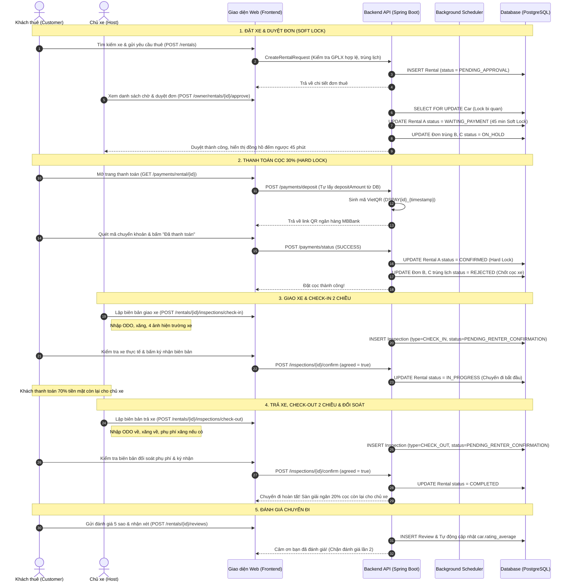

# KẾ HOẠCH KIỂM THỬ LUỒNG HOẠT ĐỘNG CHÍNH (HAPPY PATH & ĐỐI SOÁT TÀI CHÍNH)
## DỰ ÁN NỀN TẢNG THUÊ XE DRIVESHARE

---

## 1. Mục Đích & Phạm Vi Nghiệm Thu

Tài liệu này xác lập quy trình kiểm thử chi tiết, chính xác 100% theo mã nguồn thực tế của hệ thống DriveShare (Spring Boot 3 Hexagonal Architecture + PostgreSQL 16 + Web Frontend + AI Assistant). Kế hoạch giải quyết trọn vẹn toàn bộ các kịch bản tương tranh, cơ chế bảo mật thanh toán, đối soát dòng tiền và quy trình bàn giao 2 chiều.

### Phân Đợt Kiểm Thử Dự Án:
- **Đợt 1 (Ưu tiên số 1 - Khởi động ngay)**: Kiểm thử toàn diện Luồng chính E2E (Happy Path), Soft-Lock 45 phút, Bàn giao Check-in/Check-out 2 chiều, Đối soát tài chính 90/10, và 4 ca tương tranh Concurrency quan trọng.
- **Đợt 2 (Chạy song song sau Đợt 1)**: Kiểm thử Luồng xử phạt (Overdue trễ hạn, Khóa Blacklist BLOCKED, Xuất hồ sơ Dossier pháp lý, No-show, và Giải quyết tranh chấp DISPUTED).

---

## 2. Giải Đáp Thiết Kế Kỹ Thuật & Khắc Phục Các Lỗ Hổng Nghiệp Vụ

### 2.1. Kiểm thử tương tranh (Concurrency Testing): Thay JMeter bằng JUnit 4 ca thực tế
Không sử dụng JMeter để mô phỏng 100 khách cùng cọc 1 mã VietQR (vì mỗi đơn thuê có `transactionCode` và mã QR định danh riêng `DSPAY{rentalId}_{timestamp}`). Thay vào đó, kiểm thử tải và tương tranh được thực hiện qua **4 ca JUnit song song (`ExecutorService` / `@RepeatedTest`)**:
1. **Ca 1 - Double Approval**: Chủ xe bấm duyệt song song 2 đơn trùng lịch (hoặc mở 2 tab duyệt cùng lúc) $\rightarrow$ Hệ thống sử dụng khóa bi quan (`findCarForUpdate`) và kiểm tra `hasDateConflict`, đảm bảo **đúng 1 đơn** chuyển sang `WAITING_PAYMENT`, đơn còn lại bị chặn với lỗi `CAR_ALREADY_RENTED` (409 Conflict).
2. **Ca 2 - Idempotent Payment**: Khách bấm thanh toán hoặc Webhook gọi `POST /payments/deposit` song song 2 lần $\rightarrow$ Cơ chế Idempotency kiểm tra `findByRentalId` và trạng thái `SUCCESS`, đảm bảo **không bao giờ sinh giao dịch kép hoặc cộng ví 2 lần**.
3. **Ca 3 - Race Condition 44:59 (Cọc vs Scheduler Expire)**: Khách cọc tiền đúng giây 44:59 trong khi Scheduler `autoExpireWaitingPaymentSoftLocks()` đang quét $\rightarrow$ Giao dịch DB nguyên tử (ACID `@Transactional`) đảm bảo đơn chỉ rơi vào 1 trong 2 trạng thái: **hoặc `CONFIRMED`** (nếu cọc hoàn tất trước) **hoặc `EXPIRED`** (nếu quá hạn trước), tuyệt đối **không tồn tại trạng thái lai** (đã trừ tiền nhưng đơn bị hết hạn).
4. **Ca 4 - Competing Bookings**: 100 khách tạo đơn cùng một xe trong cùng khung giờ $\rightarrow$ Database và usecase cho phép lưu các đơn `PENDING_APPROVAL`, nhưng khi chủ xe duyệt 1 đơn, đúng 1 đơn thắng chuyển `WAITING_PAYMENT`, 99 đơn còn lại chuyển sang `ON_HOLD`.

### 2.2. Xử lý Token hết hạn khi đang lập biên bản bàn giao Check-in / Check-out
- **Cơ chế chính (Silent Refresh)**: Tầng HTTP Client / Interceptor (`frontend/js/api.js`) tự động bắt lỗi `401 Unauthorized`, âm thầm gọi `POST /auth/refresh-token` với `refreshToken`, lấy lại `accessToken` mới, đưa các request đang chờ vào hàng đợi và thực thi lại request ban đầu mà người dùng không bị gián đoạn.
- **Cơ chế dự phòng (Draft Persistence)**: Nếu cả Refresh Token cũng hết hạn (hết phiên đăng nhập hoàn toàn):
  1. Frontend tự động serialize toàn bộ dữ liệu form hiện tại (Số ODO, mức xăng, ghi chú, danh sách link 4 ảnh hiện trường đã upload thành công) vào `sessionStorage` với key `driveshare_inspection_draft_{rentalId}`.
  2. Hiển thị thông báo: *"Phiên làm việc đã hết hạn. Dữ liệu biên bản đã được lưu tạm, vui lòng đăng nhập lại để tiếp tục."*
  3. Chuyển hướng sang `login.html`. Sau khi đăng nhập thành công, tự động điều hướng quay lại trang bàn giao và khôi phục nguyên vẹn 100% dữ liệu form cùng ảnh chụp.

### 2.3. Minh bạch Dòng tiền, Luồng 70% còn lại và Công thức chia Doanh thu 90/10
Mô hình đối soát tài chính của DriveShare hoạt động tương tự chuẩn quốc tế của các sàn P2P Car Rental (như Turo, Mioto):
- **Khoản Cọc 30% (`depositAmount`)**: Khách thanh toán trực tuyến qua VietQR vào tài khoản sàn DriveShare để kích hoạt đơn và khóa giữ xe (Hard Lock).
- **Khoản 70% còn lại (`remainingBalance`)**: Khách thuê **thanh toán tiền mặt trực tiếp (hoặc chuyển khoản ngân hàng trực tiếp) cho chủ xe** tại thời điểm giao nhận xe (Check-in).
- **Công thức đối soát 90/10 & Phụ phí (`extraFee`)**:
  - **Doanh thu cho thuê thuần (GMV)** = `totalPrice`.
  - **Phí hoa hồng sàn (Platform Commission 10%)** = $\text{totalPrice} \times 10\%$. Sàn chỉ thu phí trên tiền thuê xe.
  - **Thu nhập chủ xe (Owner Earnings 90%)** = $\text{totalPrice} \times 90\%$.
  - **Đối soát quỹ cọc khi hoàn tất (`COMPLETED`)**: Sàn khấu trừ 10% hoa hồng từ khoản cọc 30% đang giữ, và giải ngân $20\%$ còn lại cho chủ xe qua tài khoản ngân hàng. (Chủ xe nhận: $70\%$ tiền mặt lúc giao xe $+ 20\%$ sàn giải ngân $= 90\%$ tổng tiền thuê).
  - **Phụ phí xăng xe / ODO vượt mức (`extraFee`)**: Do chủ xe nhập khi Check-out và **thuộc về chủ xe 100%** (sàn không thu phí hoa hồng trên khoản phụ phí bồi hoàn nhiên liệu của chủ xe). Khách thanh toán trực tiếp cho chủ xe khi trả xe.

### 2.4. Bảo mật API Đặt cọc `/payments/deposit`
- Backend **hoàn toàn không tin cậy `amount` từ client gửi lên**.
- Khi client gọi `POST /payments/deposit`:
  1. Server tự truy vấn `Rental` từ Database và lấy `rental.getDepositAmount()` (đã được tính toán chuẩn $30\%$ lúc tạo đơn).
  2. Kiểm tra `rental.getRenterId().equals(currentUserId)`: Chặn đứng hành vi cọc thay hoặc cọc trộm đơn của tài khoản khác (ném `403 Forbidden`).
  3. Kiểm tra trạng thái đơn: Bắt buộc là `APPROVED` hoặc `WAITING_PAYMENT`. Nếu đơn đã `EXPIRED`, `CONFIRMED` hoặc `REJECTED`, lập tức từ chối và ném lỗi nghiệp vụ.

### 2.5. Vòng đời 3 nhánh của các đơn bị tạm hoãn (`ON_HOLD`)
Khi đơn A được chủ xe duyệt sang `WAITING_PAYMENT` (kích hoạt Soft-Lock 45 phút), tất cả các đơn B, C trùng lịch chuyển sang `ON_HOLD`. Số phận của các đơn `ON_HOLD` tuân theo 3 nhánh rẽ:
- **Nhánh 1 (A cọc thành công $\rightarrow$ CONFIRMED)**: Toàn bộ các đơn B, C đang `ON_HOLD` lập tức chuyển sang `REJECTED` với lý do: *"Xe đã được chốt cọc bởi khách hàng khác."*
- **Nhánh 2 (Chủ xe chủ động từ chối đơn A $\rightarrow$ REJECTED)**: Toàn bộ các đơn `ON_HOLD` lập tức được giải phóng Soft-Lock, **hồi sinh về trạng thái `PENDING_APPROVAL`** (lý do từ chối được xóa sạch về `null`) để chủ xe có thể duyệt tiếp khách khác.
- **Nhánh 3 (A hết hạn 45 phút giữ chỗ $\rightarrow$ EXPIRED)**: Scheduler `autoExpireWaitingPaymentSoftLocks()` chuyển A sang `EXPIRED`, đồng thời **hồi sinh toàn bộ các đơn `ON_HOLD` về `PENDING_APPROVAL`**.

### 2.6. Quy trình Bàn giao 2 Chiều (Two-Way Inspection Protocol)
Cả Check-in và Check-out đều bắt buộc sự đồng thuận 2 chiều giữa Chủ xe và Khách thuê:
1. **Giao nhận xe (Check-in)**:
   - Chủ xe lập biên bản: `POST /rentals/{id}/inspections/check-in` (nhập ODO, xăng, 4 ảnh) $\rightarrow$ Biên bản ở trạng thái `PENDING_RENTER_CONFIRMATION`.
   - Khách thuê kiểm tra xe thực tế và xác nhận: `POST /rentals/{id}/inspections/{inspectionId}/confirm` với `agreed: true` $\rightarrow$ Đơn thuê chính thức kích hoạt sang `IN_PROGRESS`. (Nếu khách không đồng ý, chọn `agreed: false` $\rightarrow$ Đơn chuyển sang `DISPUTED`).
2. **Thu hồi xe (Check-out)**:
   - Chủ xe lập biên bản: `POST /rentals/{id}/inspections/check-out` (nhập ODO về, mức xăng về, phụ phí xăng nếu có) $\rightarrow$ Biên bản ở trạng thái `PENDING_RENTER_CONFIRMATION`.
   - Khách thuê xác nhận: `POST /rentals/{id}/inspections/{inspectionId}/confirm` với `agreed: true` $\rightarrow$ Đơn thuê hoàn tất chuyển sang `COMPLETED`, lưu `actualReturnTime`.

### 2.7. Trạng thái kết thúc & Chặn đánh giá lặp lại
- Sau khi Check-out thành công, đơn thuê ở trạng thái cuối cùng là **`COMPLETED`**.
- Khách thuê gọi `POST /rentals/{id}/reviews` để đánh giá từ 1 đến 5 sao:
  - Hệ thống tự động tính lại điểm trung bình xe (`car.ratingAverage = AVG(rating)`).
  - Khách chỉ được đánh giá duy nhất 1 lần cho mỗi chuyến đi; nếu gọi lại lần 2, hệ thống chặn bằng lỗi `ErrorCode.REVIEW_ALREADY_EXISTS` (400 Bad Request).

---

## 3. Sơ Đồ Tuần Tự Luồng Chính (End-to-End Sequence Diagram)



---

## 4. Ma Trận Test Case Chi Tiết (Đợt 1: Luồng Chính & Concurrency)

| Mã Test Case | Phân hệ | Tên Kịch Bản Kiểm Thử | Dữ liệu Đầu vào & Thao tác | Kết Quả Mong Đợi (Acceptance Criteria) | Người Phụ Trách |
| :--- | :--- | :--- | :--- | :--- | :--- |
| **TC-CONCUR-01** | **Concurrency** | **Double Approval (Chủ xe duyệt 2 đơn cùng lúc)** | 2 request duyệt song song 2 đơn trùng lịch qua 2 luồng ExecutorService | Đúng 1 đơn sang `WAITING_PAYMENT`, đơn kia trả về lỗi `409 Conflict (CAR_ALREADY_RENTED)`. Không bao giờ có 2 đơn giữ xe cùng lúc | **Vĩ (`VL`)** |
| **TC-CONCUR-02** | **Concurrency** | **Idempotent Deposit (Cọc 2 lần song song)** | Gửi 2 request `POST /payments/deposit` song song cho cùng 1 đơn | Chỉ 1 mã giao dịch được lưu, đơn sang `CONFIRMED`, không trừ tiền hoặc tạo giao dịch kép | **Tín (`CN`)** |
| **TC-CONCUR-03** | **Concurrency** | **Race Condition giây 44:59 (Cọc vs Scheduler)** | Khách cọc tiền đúng giây 44:59 lúc Scheduler chạy `autoExpireWaitingPaymentSoftLocks()` | Kết quả DB nguyên tử: Đơn hoặc `CONFIRMED` hoặc `EXPIRED`. Tuyệt đối không ở trạng thái lai (mất tiền nhưng đơn hết hạn) | **Vĩ (`VL`)** |
| **TC-CONCUR-04** | **Concurrency** | **Competing Bookings (Nhiều khách đặt cùng xe)** | Khách A và Khách B cùng tạo đơn thuê trùng ngày cho Xe 1 | Cả 2 đơn lưu `PENDING_APPROVAL`. Khi chủ duyệt đơn A, đơn B tự động chuyển sang `ON_HOLD` | **Tín (`CN`)** |
| **TC-RENTAL-01** | **Rental** | **Happy Path E2E (Tạo đơn $\rightarrow$ Hoàn tất)** | Tạo đơn thuê 2 ngày, duyệt, cọc 30%, Check-in 2 chiều, Check-out 2 chiều, Review | Trạng thái chuyển chuẩn: `PENDING_APPROVAL` $\rightarrow$ `WAITING_PAYMENT` $\rightarrow$ `CONFIRMED` $\rightarrow$ `IN_PROGRESS` $\rightarrow$ `COMPLETED` | **Vĩ (`VL`)** |
| **TC-RENTAL-02** | **Rental** | **Quy tắc GPLX (Tự lái vs Có tài xế)** | Khách có GPLX bị REJECTED tạo đơn tự lái; Khách tương tự tạo đơn `withDriver = true` | Đơn tự lái bị chặn `400 KYC_NOT_VERIFIED`; Đơn có tài xế tạo thành công (miễn GPLX) | **Vĩ (`VL`)** |
| **TC-RENTAL-03** | **Rental** | **Hồi sinh đơn ON_HOLD khi Chủ xe từ chối** | Đơn A đang `WAITING_PAYMENT`, đơn B `ON_HOLD`. Chủ xe từ chối đơn A với lý do cụ thể | Đơn A sang `REJECTED`, đơn B tự động hồi sinh về `PENDING_APPROVAL`, xóa bỏ `rejectReason` | **Vĩ (`VL`)** |
| **TC-RENTAL-04** | **Rental** | **Hồi sinh đơn ON_HOLD khi hết hạn 45 phút** | Đơn A quá hạn 45 phút không cọc, đơn B `ON_HOLD`. Scheduler quét expire | Đơn A sang `EXPIRED`, đơn B tự động hồi sinh về `PENDING_APPROVAL` | **Vĩ (`VL`)** |
| **TC-PAY-01** | **Payment** | **Tính cọc 30% Server-side an toàn** | Khách gửi request `POST /payments/deposit` với `amount = 1000` (cố tình hạ tiền) | Server bỏ qua `amount` client gửi, tự lấy `depositAmount` trong DB (chuẩn 30% giá thuê), sinh QR đúng số tiền | **Tín (`CN`)** |
| **TC-PAY-02** | **Payment** | **Chặn cọc trộm đơn người khác** | Khách B cố tình gọi API cọc cho `rentalId` của Khách A | Server ném lỗi `403 UNAUTHORIZED`, không sinh QR thanh toán | **Tín (`CN`)** |
| **TC-PAY-03** | **Payment** | **Chặn cọc đơn đã EXPIRED hoặc REJECTED** | Khách gọi cọc cho đơn đã bị hết hạn 45 phút | Server ném lỗi `400 RENTAL_NOT_APPROVED`, từ chối thanh toán | **Tín (`CN`)** |
| **TC-PAY-04** | **Payment** | **Đối soát Doanh thu 90/10 & Phụ phí 100%** | Đơn hoàn tất 2,000,000đ, phụ phí xăng 150,000đ. Xem trang doanh thu chủ xe | Chủ xe nhận đủ: 1,800,000đ (90% tiền thuê) + 150,000đ (100% phụ phí). Sàn thu đúng 200,000đ (10% hoa hồng) | **Vĩ (`VL`)** |
| **TC-INSPECT-01** | **Inspection** | **Check-in 2 chiều đầy đủ bằng chứng** | Chủ xe gửi biên bản (ODO 10,000km, xăng 100%, 4 ảnh); Khách gọi confirm `agreed: true` | Đơn chính thức sang `IN_PROGRESS`. Chặn sửa đổi sau khi đã ký nhận | **Vĩ (`VL`)** |
| **TC-INSPECT-02** | **Inspection** | **Check-out 2 chiều & Phụ phí xăng** | Chủ xe gửi biên bản trả xe (xăng thiếu 20%, phụ phí 150,000đ); Khách confirm `agreed: true` | Đơn chính thức sang `COMPLETED`, lưu `actualReturnTime`. Ghi nhận phụ phí | **Vĩ (`VL`)** |
| **TC-INSPECT-03** | **Inspection** | **Khôi phục nháp biên bản khi hết phiên token** | Giảm token TTL còn 1 phút, nhập dở biên bản ODO + 4 ảnh, chờ token hết hạn, submit | Dữ liệu tự lưu vào `sessionStorage`, chuyển hướng login, sau login khôi phục đầy đủ form & ảnh | **Tín (`CN`)** |
| **TC-REVIEW-01** | **Review** | **Đánh giá & Chặn đánh giá lần 2** | Khách đánh giá 5 sao cho chuyến đi `COMPLETED`. Sau đó thử gửi tiếp đánh giá lần 2 | Đánh giá 1 thành công, cập nhật `car.rating_average`. Đánh giá 2 bị chặn với lỗi `REVIEW_ALREADY_EXISTS` | **Vĩ (`VL`)** |
| **TC-AI-01** | **AI Assistant** | **AI Tư vấn & Tính cọc 30% chính xác** | Hỏi AI: *"Tôi muốn thuê xe VinFast VF8 2 ngày từ mai, tính giúp tôi tiền cọc"* | AI Chatbot trả về thông tin xe chuẩn kèm phép tính: Tổng tiền = 2.4tr, Cọc 30% = 720k chính xác | **Phát (`PT`)** |

---

## 5. Phân Công Chi Tiết 5 Thành Viên & Kế Hoạch Đợt 2 Song Song

```
+----------------------------------------------------------------------------------------------------+
|                                    BẢO (NB - TECH LEAD)                                            |
|   - Điều phối chung, kiểm soát chất lượng & giám sát tiến độ Jira                                  |
|   - Chạy 'mvnw test' nghiệm thu 240/240 tests xanh trước và sau test                               |
|   - Review code & duyệt PR duy nhất vào nhánh develop (CODEOWNERS)                                 |
+----------------------------------------------------------------------------------------------------+
                   |                                                    |
                   v                                                    v
+---------------------------------------+            +---------------------------------------+
|          ĐỢT 1: LUỒNG CHÍNH           |            |       ĐỢT 2: LUỒNG PHẠT & TRANH CHẤP   |
|         (Chạy & Chốt trước)           |            |         (Chạy song song)              |
+---------------------------------------+            +---------------------------------------+
|  VĨ (VL) - Kỹ sư Luồng chính & Dòng tiền:   |      |  QUÂN (QD) - Kỹ sư Xử phạt & Blacklist:|
|  - Làm chủ E2E Happy Path (TC-RENTAL-01)      |    |  - Phạt trễ hạn OVERDUE (TC-PENALTY-01)|
|  - Bàn giao 2 chiều Check-in / Check-out    |      |  - Khóa Blacklist BLOCKED (>24h trễ)  |
|  - Đối soát tiền 90/10 & Phụ phí 100%        |     |  - Hồ sơ Dossier vi phạm pháp lý       |
|  - Test Concurrency (Double Approval & 44:59)|     +---------------------------------------+
+---------------------------------------+            |  KHIÊM (KT) - Kỹ sư Tranh chấp & Hủy: |
|  TÍN (CN) - Kỹ sư Thanh toán & Giao diện:     |    |  - Khách khiếu nại DISPUTED (Check-in)|
|  - VietQR, API /payments/deposit an toàn      |    |  - No-show chủ xe không giao xe        |
|  - Token Refresh ngầm & sessionStorage nháp   |    |  - Chính sách hủy đơn >24h và <24h     |
|  - Test Concurrency (Idempotent Payment)      |    |  - Phân quyền Admin giải quyết Dispute |
+---------------------------------------+            +---------------------------------------+
|  PHÁT (PT) - Kỹ sư Trợ lý AI:                |
|  - Test Chatbot RAG tư vấn xe & tính cọc 30% |
|  - Kiểm thử Widget Chat AI trên Frontend     |
+---------------------------------------+
```

---

## 6. Quy Định Bằng Chứng Kiểm Thử & Quy Trình Khắc Phục Lỗi (Bug Fix)

### 6.1. Tiêu chuẩn Bằng chứng Nghiệm thu trên Jira:
Mỗi Sub-task kiểm thử khi chuyển sang `Done` bắt buộc đính kèm:
1. **Ảnh chụp Màn hình Giao diện (UI)**: Thấy rõ URL trình duyệt, kết quả thông báo thành công hoặc trạng thái đơn trên giao diện.
2. **Ảnh chụp Network Tab (DevTools)**: Thấy rõ HTTP Request URL, Method, Payload gửi đi và HTTP Status Code (200 OK / 400 Bad Request / 409 Conflict).
3. **Ảnh chụp Cơ sở dữ liệu (Adminer cổng 8088 hoặc DBeaver)**: Truy vấn trực tiếp bản ghi trong bảng `rentals`, `payments`, `rental_inspections` để chứng minh dữ liệu lưu đúng.

### 6.2. Quy trình Sửa lỗi (Fix Bug) chuẩn Git & ArchUnit:
Khi phát hiện lỗi trong quá trình kiểm thử:
1. Tạo branch sửa lỗi từ `develop`: `git checkout -b fix/<jira-id>-<ten-loi>`.
2. Sửa code tuân thủ nghiêm ngặt 3 tầng Hexagonal (Domain $\rightarrow$ Ports $\rightarrow$ Adapters).
3. Chạy kiểm thử tự động nội bộ: `cd backend; .\mvnw.cmd test` (bắt buộc pass 240/240 tests, không vi phạm 7 luật ArchUnit).
4. Đẩy nhánh và tạo Pull Request vào `develop` theo đúng quy chuẩn `create-github-pr`. Tech Lead (`NB`) hoặc Quản trị viên (`PT`) kiểm tra, phê duyệt (CODEOWNERS) và merge.
