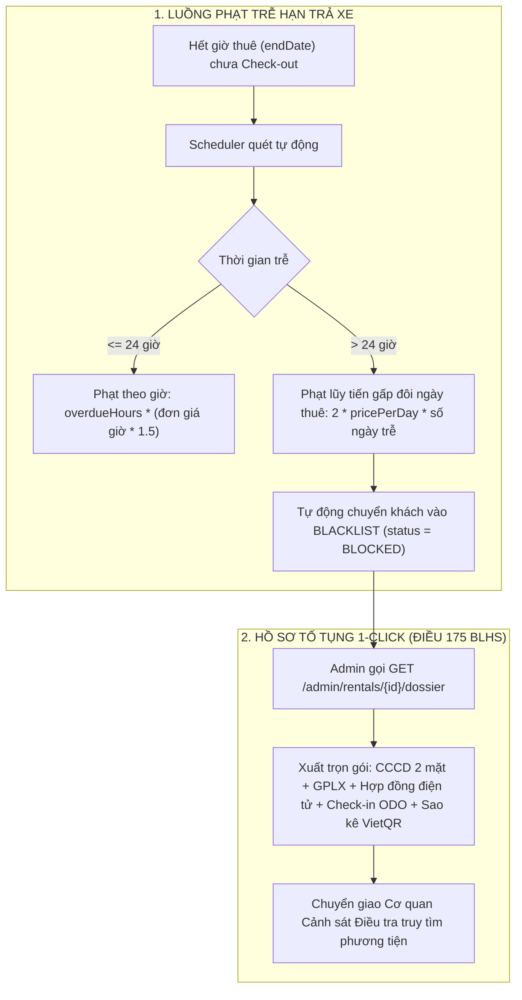

# 📋 KẾ HOẠCH KIỂM THỬ TOÀN DIỆN & TÀI LIỆU THỬ NGHIỆM CHỨC NĂNG
# DỰ ÁN NỀN TẢNG THUÊ XE TỰ LÁI DRIVESHARE

> **Dự án**: DriveShare — Nền tảng chia sẻ và cho thuê xe trực tuyến P2P (Car Rental Platform)  
> **Kiến trúc**: Spring Boot 3 Hexagonal Modular Architecture (Ports & Adapters) + PostgreSQL 16 + Vanilla HTML5/CSS3/JavaScript + Trợ lý AI Chatbot RAG  
> **Phiên bản tài liệu**: v2.4 (Chính thức nghiệm thu & sẵn sàng bảo vệ đề án)  
> **Đối tượng sử dụng**: Hội đồng chấm thi, Giảng viên hướng dẫn (GVHD), Đội ngũ Kiểm thử (QA/QC) & Toàn bộ thành viên nhóm phát triển  
> **Tệp đính kèm Jira**: [docs/scrum/jira_test_plan_import.csv](file:///d:/MONHOCITC/K4/Spring_ThucTap_k4/docs/scrum/jira_test_plan_import.csv) (Sẵn sàng import 1-click vào Jira Atlassian)

---

## 📑 MỤC LỤC
1. [Tổng Quan & Mục Tiêu Kiểm Thử](#1-tổng-quan--mục-tiêu-kiểm-thử)
2. [Quy Tắc Nghiệp Vụ Cốt Lõi & Bảng Tính Giá (Business Rules)](#2-quy-tắc-nghiệp-vụ-cốt-lõi--bảng-tính-giá)
3. [Chuyên Đề Đặc Biệt: Hệ Thống Chế Tài Xử Phạt & Căn Cứ Pháp Lý (Điều 175 BLHS)](#3-chuyên-đề-đặc-biệt-hệ-thống-chế-tài-xử-phạt--căn-cứ-pháp-lý)
4. [Danh Mục 11 Modules & Bảng Ánh Xạ Tuyến Route / API Toàn Bộ Codebase](#4-danh-mục-11-modules--bảng-ánh-xạ-api)
5. [Ma Trận Test Cases Chi Tiết (Functional & Edge Cases Matrix)](#5-ma-trận-test-cases-chi-tiết)
6. [Đánh Giá Rủi Ro Mã Nguồn & Các Lỗ Hổng Tiềm Ẩn (Code Vulnerability Analysis)](#6-đánh-giá-rủi-ro-mã-nguồn)
7. [Kịch Bản Diễn Tập Kiểm Thử Thực Tế (3 Cửa Sổ Trình Duyệt Song Song)](#7-kịch-bản-diễn-tập-kiểm-thử-thực-tế)
8. [Bộ Câu Hỏi Vấn Đáp Bảo Vệ Điển Hình & Câu Trả Lời Mẫu](#8-bộ-câu-hỏi-vấn-đáp-bảo-vệ-điển-hình)

---

## 1. TỔNG QUAN & MỤC TIÊU KIỂM THỬ

### 1.1 Mục tiêu kiểm thử
1. **Kiểm thử Nghiệp vụ Vòng đời (End-to-End Rental Lifecycle)**: Xác minh tính thông suốt từ lúc Đăng ký $\rightarrow$ eKYC $\rightarrow$ Đăng/Duyệt xe $\rightarrow$ Tạo đơn $\rightarrow$ Soft Lock 45p $\rightarrow$ Cọc 30% Hard Lock $\rightarrow$ Bàn giao Check-in $\rightarrow$ Nghiệm thu Check-out $\rightarrow$ Quyết toán ví $\rightarrow$ Đánh giá 5 sao.
2. **Kiểm thử Xử lý Tương tranh (Concurrency & Race Condition Testing)**: Đảm bảo cơ chế khóa bi quan (**Pessimistic Locking** `SELECT FOR UPDATE`) ngăn chặn triệt để hiện tượng 2 khách cùng thuê 1 xe trong cùng khung giờ hoặc hoàn cọc 2 lần.
3. **Kiểm thử Chế tài Xử phạt & Quá hạn (Penalty & Violation Enforcement)**: Chứng minh hệ thống tự động tính phạt trễ hạn lũy tiến (hệ số x1.5 / x2.0), tự kích hoạt Blacklist và xuất hồ sơ tố tụng theo **Điều 175 Bộ luật Hình sự**.
4. **Kiểm thử An ninh & Phân quyền (RBAC Security)**: Đảm bảo khách thuê (`ROLE_CUSTOMER`) không thể xâm nhập trái phép API của Chủ xe (`ROLE_OWNER`) và Ban Quản trị (`ROLE_ADMIN`).
5. **Đạt chuẩn 7 luật Kiến trúc ArchUnit**: Đảm bảo toàn bộ 240 bài test tự động của Backend đều xanh 100% trước khi nghiệm thu.

---

## 2. QUY TẮC NGHIỆP VỤ CỐT LÕI & BẢNG TÍNH GIÁ

### 2.1 Cổng thanh toán tích hợp
- **VietQR (Napas 24/7)**: Sinh mã QR động chuẩn Napas, nội dung chuyển khoản bắt buộc định dạng `DS{rental_id}` để khớp giao dịch webhook tự động.
- **VNPay Sandbox**: Cổng thanh toán trực tuyến qua thẻ ATM nội địa / thẻ quốc tế.

### 2.2 Chính sách đặt cọc (Deposit Policy)
- **Tỷ lệ cọc bắt buộc**: **30%** tổng giá trị hợp đồng thuê (`DEPOSIT_RATE = 0.30`).
  $$\text{Tiền cọc} = \text{Tổng tiền thuê xe} \times 30\%$$
- **Cơ chế Giữ chỗ tạm thời (Soft Lock 45 phút)**:
  - Khi Chủ xe bấm Duyệt cho thuê, đơn chuyển sang `WAITING_PAYMENT`.
  - Xe tạm thời bị ẩn khỏi kết quả tìm kiếm của các khách khác để khách này có tối đa **45 phút** hoàn tất chuyển khoản cọc.
  - Quá 45 phút không cọc, đơn tự động hủy (`EXPIRED`) và lịch xe mở lại cho cộng đồng.
- **Cơ chế Khóa cứng lịch xe (Hard Lock)**:
  - Sau khi ghi nhận cọc 30% thành công, đơn chuyển sang `CONFIRMED`. Lịch xe bị khóa cứng vĩnh viễn trên bảng `car_availability`.

### 2.3 Chính sách hủy đơn & Hoàn cọc (Cancellation & Refund Policy)
- **Hủy trước khi đặt cọc** (đang `PENDING_APPROVAL` hoặc `WAITING_PAYMENT`): Khách thuê được hủy hoàn toàn miễn phí (`WITHDRAWN_BY_GUEST`).
- **Hủy sau khi đã đặt cọc**:
  - Hủy trước giờ nhận xe **trên 24 giờ**: Khách được hoàn trả 100% tiền cọc (`CANCELLED_BY_GUEST`).
  - Hủy trong vòng **dưới 24 giờ** trước giờ nhận xe: Khách **mất 100% tiền cọc** (số tiền cọc được bồi hoàn cho Chủ xe để bù đắp thiệt hại lỡ lịch cho thuê).
- **Chủ xe tự ý hủy / Không bàn giao xe (No-Show Dispute & Host Cancellation)**:
  - Khách gửi khiếu nại $\rightarrow$ Admin duyệt `RESOLVED_REFUND` $\rightarrow$ Khách được **hoàn 100% tiền cọc**, Chủ xe bị **phạt công nợ** tương ứng 100% tiền cọc vào tài khoản ví.
  - Chủ xe tự ý bấm hủy sau khi khách đã cọc $\rightarrow$ Đơn chuyển `CANCELLED_BY_HOST`, tự động hoàn 100% cọc cho khách và ghi nợ phạt đối với chủ xe.
- **Admin từ chối khiếu nại (Khách khiếu nại sai / vu khống)**:
  - Admin duyệt `REJECTED` $\rightarrow$ Tiền cọc được bảo toàn hoặc chuyển bồi thường cho chủ xe, đơn tiếp tục hoặc kết thúc hợp lệ, Chủ xe **không bị phạt**.

### 2.4 Cơ chế phân chia doanh thu sàn (Revenue Sharing Matrix)
- **Ví Chủ xe**: Nhận **90%** tổng tiền thuê xe sau khi chuyến đi hoàn tất (`COMPLETED`).
- **Phí Sàn DriveShare**: Khấu trừ **10%** làm phí hoa hồng dịch vụ nền tảng.

---

## 3. CHUYÊN ĐỀ ĐẶC BIỆT: HỆ THỐNG CHẾ TÀI XỬ PHẠT & CĂN CỨ PHÁP LÝ



### 3.1 Công thức tính phạt trễ hạn chi tiết (Mã nguồn: `RentalExpirationScheduler.java`)
Hệ thống quy định đơn giá thuê theo giờ:
$$\text{Đơn giá giờ} = \frac{\text{Đơn giá ngày}}{10}$$
- **Trường hợp trễ hạn dưới 24 giờ**:
  $$\text{Tiền phạt} = \text{Số giờ trễ} \times (\text{Đơn giá giờ} \times 1.5)$$
  *Ví dụ minh họa*: Xe Toyota Vios có đơn giá 1,000,000 đ/ngày $\rightarrow$ Đơn giá giờ là 100,000 đ/giờ. Nếu khách trả xe trễ 3 tiếng:
  $$\text{Tiền phạt} = 3 \times (100,000 \times 1.5) = 450,000 \text{ VNĐ}$$
- **Trường hợp trễ hạn trên 24 giờ (Chiếm dụng phương tiện)**:
  $$\text{Tiền phạt} = 2.0 \times \text{Đơn giá ngày} \times \lceil\frac{\text{Số giờ trễ}}{24}\rceil$$
  *Ví dụ*: Xe 1,000,000 đ/ngày, trễ 26 giờ (tính là 2 ngày) $\rightarrow$ Tiền phạt tích lũy $= 2 \times 1,000,000 \times 2 = 4,000,000 \text{ VNĐ}$.

### 3.2 Tự động kích hoạt Blacklist & Hồ sơ pháp lý Dossier 1-Click
- Khi trễ quá 24 giờ, hệ thống tự động:
  1. Chuyển trạng thái tài khoản khách thuê sang `BLOCKED` (vô hiệu hóa tức thì quyền đặt xe).
  2. Bật cờ `is_blacklisted_triggered = true` trên đơn thuê.
- Admin truy cập API `GET /api/v1/admin/rentals/{id}/dossier` để tải toàn bộ chứng cứ pháp lý gồm:
  - Bản chụp CCCD 2 mặt & Giấy phép lái xe đã qua eKYC.
  - Hợp đồng điện tử kèm cảnh báo chế tài hình sự: **Điều 175 Bộ luật Hình sự (Tội lạm dụng tín nhiệm chiếm đoạt tài sản)**.
  - Biên bản Check-in lúc nhận xe (chỉ số ODO, vạch xăng, 4 góc ảnh ngoại quan có đóng dấu thời gian).
  - Lịch sử thanh toán cọc VietQR xác thực danh tính chủ tài khoản ngân hàng.

---

## 4. DANH MỤC 11 MODULES & BẢNG ÁNH XẠ API

| STT | Module | Base Path | Phương thức & Tuyến API Cốt Lõi | Mô tả Nghiệp vụ |
| :---: | :--- | :--- | :--- | :--- |
| **1** | **Auth** | `/api/v1/auth` | `POST /register`<br>`POST /login`<br>`POST /logout`<br>`POST /refresh-token`<br>`PUT /change-password`<br>`POST /otp/send`<br>`POST /otp/verify` | Đăng ký tài khoản, đăng nhập JWT, làm mới token, đổi mật khẩu, gửi & xác thực mã OTP email qua SecureRandom. |
| **2** | **User** | `/api/v1/users` | `GET /me`<br>`PUT /me`<br>`POST /me/avatar`<br>`POST /me/cccd`<br>`POST /me/gplx`<br>`GET /me/owner-profile` | Quản lý hồ sơ cá nhân, upload ảnh định danh eKYC (CCCD 2 mặt, GPLX) lên Cloudinary, quản lý STK nhận tiền. |
| **3** | **Car** | `/api/v1/public/cars`<br>`/api/v1/owner/cars` | `GET /public/cars`<br>`GET /public/cars/{id}`<br>`POST /owner/cars`<br>`GET /owner/cars`<br>`PUT /owner/cars/{id}`<br>`DELETE /owner/cars/{id}` | Tìm kiếm xe công khai, lọc đa tiêu chí (ngày/giá/loại xe), chủ xe tạo xe mới (chờ duyệt), cập nhật và ẩn/hiện xe. |
| **4** | **Rental** | `/api/v1/rentals`<br>`/api/v1/owner/rentals` | `POST /rentals`<br>`GET /rentals/me`<br>`PUT /rentals/{id}/cancel`<br>`GET /owner/rentals`<br>`PUT /owner/rentals/{id}/approve`<br>`PUT /owner/rentals/{id}/reject`<br>`POST /owner/rentals/{id}/check-in`<br>`POST /owner/rentals/{id}/check-out`<br>`POST /rentals/{id}/report-no-show`<br>`POST /rentals/{id}/reviews` | Quản lý toàn bộ vòng đời chuyến đi: tạo đơn, duyệt Soft Lock 45p, từ chối, biên bản Check-in nhận xe, Check-out trả xe, khiếu nại và đánh giá 5 sao. |
| **5** | **Payment**| `/api/v1/payments` | `POST /deposit`<br>`GET /rental/{rentalId}`<br>`GET /owner/earnings`<br>`POST /webhook` | Đặt cọc 30% VietQR Napas 24/7, kiểm tra trạng thái thanh toán, đối soát ví doanh thu 90/10 của Chủ xe. |
| **6** | **Admin** | `/api/v1/admin` | `GET /users`<br>`PATCH /users/{id}/status`<br>`PUT /users/{id}/verify-license`<br>`GET /cars/pending`<br>`PUT /cars/{id}/approve`<br>`GET /rentals/overdue`<br>`GET /rentals/{id}/dossier`<br>`POST /rentals/disputes/{id}/resolve` | Phê duyệt GPLX eKYC, duyệt xe mới lên sàn, khóa tài khoản vi phạm, giám sát xe quá hạn, giải quyết khiếu nại hoàn cọc và xuất hồ sơ Điều 175 BLHS. |
| **7** | **AI Chat**| `/api/v1/ai` | `POST /chat`<br>`GET /{sessionId}/history`<br>`DELETE /{sessionId}` | Trợ lý ảo tư vấn xe thông minh ứng dụng RAG (Retrieval-Augmented Generation) đọc dữ liệu từ CSDL PostgreSQL thật. |
| **8** | **RAG** | `/api/v1/rag` | `POST /upload`<br>`POST /ask`<br>`GET /documents` | Nạp tài liệu hướng dẫn thuê xe và chính sách để phục vụ bộ não tri thức cho AI Chatbot. |
| **9** | **Notify** | `/api/v1/notifications`<br>`/ws-driveshare` | `GET /my-notifications`<br>`PUT /{id}/read`<br>`WebSocket STOMP Channel` | Đẩy thông báo thời gian thực khi có đơn mới, duyệt đơn, cọc tiền hoặc phát sinh khiếu nại giữa các tài khoản. |
| **10**| **OAuth2** | `/api/v1/oauth2` | `GET /authorization/google`<br>`POST /select-role` | Đăng nhập bằng Google SSO, phân luồng chọn vai trò Khách thuê / Chủ xe ở lần đăng nhập đầu tiên. |
| **11**| **Health** | `/api/v1/health` | `GET /health` | Giám sát trạng thái hoạt động của hệ thống và kết nối cơ sở dữ liệu. |

---

## 5. MA TRẬN TEST CASES CHI TIẾT

### Module 1: Xác Thực & Quản Lý Người Dùng (Auth & User Management)
* **`TC-AUTH-01` [Critical] - Đăng ký tài khoản Khách thuê hợp lệ**:
  - *Preconditions*: Email chưa từng đăng ký.
  - *Steps*: Gửi `POST /api/v1/auth/register` với thông tin hợp lệ (username, email, password mạnh, role `ROLE_CUSTOMER`).
  - *Expected*: HTTP 201/200, tài khoản tạo mới với `status=ACTIVE`, nhận thông báo thành công.
* **`TC-AUTH-02` [High] - Đăng ký với Email đã tồn tại**:
  - *Preconditions*: Email `renter@driveshare.com` đã có trong CSDL.
  - *Steps*: Gửi `POST /api/v1/auth/register` với email trên.
  - *Expected*: HTTP 400 Bad Request, mã lỗi `EMAIL_EXISTED`, không sinh bản ghi thừa trong DB.
* **`TC-AUTH-03` [High] - Gửi mã OTP xác thực & Kiểm soát Cooldown 30s**:
  - *Preconditions*: Khách bấm gửi OTP email.
  - *Steps*: Gửi `POST /api/v1/auth/otp/send` lần 1 $\rightarrow$ Gửi tiếp lần 2 sau 5 giây.
  - *Expected*: Lần 1 thành công (TTL=300s, masked format `123***`). Lần 2 bị từ chối với HTTP 400 và mã `OTP_COOLDOWN`.
* **`TC-USER-01` [High] - Tải ảnh CCCD 2 mặt & Giới hạn dung lượng**:
  - *Preconditions*: User đã đăng nhập JWT.
  - *Steps*: Gửi `POST /api/v1/users/me/cccd` với 2 ảnh < 10MB. Thử lại với file > 10MB hoặc thiếu 1 mặt.
  - *Expected*: Đủ ảnh hợp lệ $\rightarrow$ HTTP 200, lưu URL Cloudinary, `status=PENDING`. File lỗi $\rightarrow$ Chặn với HTTP 400.
* **`TC-USER-02` [Medium] - Khóa trường Họ tên/CCCD sau khi Admin đã duyệt (Read-only)**:
  - *Preconditions*: Tài khoản đã được Admin duyệt `VERIFIED`.
  - *Steps*: Gọi `PUT /api/v1/users/me` cố tình sửa lại họ tên hoặc số CCCD.
  - *Expected*: Hệ thống từ chối cập nhật, giữ nguyên dữ liệu gốc đã định danh.

---

### Module 2: Quản Lý Xe & Tìm Kiếm Khả Dụng (Car & Search)
* **`TC-CAR-01` [High] - Chủ xe đăng xe mới & Trạng thái khởi tạo PENDING**:
  - *Preconditions*: Chủ xe đã hoàn tất thông tin tài khoản.
  - *Steps*: Gửi `POST /api/v1/owner/cars` với thông tin xe, biển số, giá thuê, ảnh giấy tờ.
  - *Expected*: HTTP 201/200, xe sinh ra ở trạng thái `PENDING_REVIEW` / `PENDING`, **tuyệt đối chưa xuất hiện trên sàn công khai**.
* **`TC-CAR-02` [Critical] - Bộ lọc xe khả dụng theo khung ngày (Date-range Overlap)**:
  - *Preconditions*: Xe #8 đã có đơn thuê `CONFIRMED` từ ngày 10/11 đến 15/11.
  - *Steps*: Tìm xe với khoảng ngày 12/11 – 14/11 $\rightarrow$ Tìm xe với khoảng ngày 16/11 – 20/11.
  - *Expected*: Lần 1: Xe #8 bị loại trừ khỏi kết quả. Lần 2: Xe #8 xuất hiện bình thường.

---

### Module 3: Vòng Đời Thuê Xe & Tương Tranh (Rental Lifecycle & Concurrency)
* **`TC-RENTAL-01` [Critical] - Luồng E2E Happy Path toàn vòng đời**:
  - *Preconditions*: Khách đã được duyệt GPLX (`VERIFIED`), xe sẵn sàng.
  - *Steps*: Khách gửi đơn `POST /rentals` $\rightarrow$ Chủ duyệt Soft Lock $\rightarrow$ Khách cọc 30% VietQR $\rightarrow$ Check-in 2 chiều nhận xe $\rightarrow$ Check-out 2 chiều trả xe $\rightarrow$ Khách đánh giá 5 sao.
  - *Expected*: Đơn chuyển đổi tuần tự: `PENDING_APPROVAL` $\rightarrow$ `WAITING_PAYMENT` $\rightarrow$ `CONFIRMED` $\rightarrow$ `IN_PROGRESS` $\rightarrow$ `COMPLETED`. Ví chủ xe nhận 90% doanh thu thuần + 100% phụ phí xăng. Điểm đánh giá xe được cập nhật tự động. Chặn đánh giá lần 2 (`REVIEW_ALREADY_EXISTS`).
* **`TC-RENTAL-02` [Critical] - Xử lý tranh chấp đặt xe trùng lịch (Concurrency Race Condition)**:
  - *Preconditions*: Xe #8 đang trống lịch. Có 2 khách A và B cùng gửi yêu cầu thuê trong cùng khung giờ.
  - *Steps*: Cả 2 cùng tạo đơn $\rightarrow$ Chủ xe duyệt đơn Khách A (kích hoạt Pessimistic Lock `findByIdForUpdate`).
  - *Expected*: Đơn khách A chuyển sang `WAITING_PAYMENT`. Đơn khách B tự động chuyển `ON_HOLD` hoặc từ chối. Không bao giờ cho phép 2 đơn trùng lịch cùng được duyệt.
* **`TC-RENTAL-03` [High] - Tự động hủy đơn quá hạn 45 phút giữ chỗ (Soft Lock Expiry)**:
  - *Preconditions*: Đơn ở trạng thái `WAITING_PAYMENT`, khách chưa đặt cọc.
  - *Steps*: Để quá thời gian 45 phút (Scheduler quét).
  - *Expected*: Đơn tự đổi `EXPIRED`, lịch xe được giải phóng, đơn `ON_HOLD` được phục hồi giữ chỗ.
* **`TC-RENTAL-04` [Critical] - Báo sự cố không nhận xe (Dispute) & Hoàn cọc 100% Idempotent**:
  - *Preconditions*: Đơn đã cọc nhưng chủ xe không đến bàn giao xe.
  - *Steps*: Khách gửi `POST /report-no-show` $\rightarrow$ Admin duyệt `resolveDispute` với `action=REFUND_RENTER` $\rightarrow$ Admin gửi tiếp lệnh duyệt lần 2.
  - *Expected*: Lần 1: Khách được tạo lệnh hoàn 100% cọc, chủ xe ghi nợ phạt công nợ, đơn đổi `CANCELLED_BY_HOST`. Lần 2: Chặn lỗi `DISPUTE_ALREADY_RESOLVED` (chống hoàn tiền 2 lần).

---

### Module 4: Chế Tài Xử Phạt, Quá Hạn & Pháp Lý (Penalty & Legal Suite)
* **`TC-PENALTY-01` [High] - Phạt trễ hạn trả xe dưới 24 giờ**:
  - *Preconditions*: Đơn `IN_PROGRESS` quá giờ kết thúc, xe giá 1,000,000 đ/ngày (100k/h). Khách trễ 3 giờ.
  - *Steps*: Scheduler kích hoạt quét đơn quá hạn.
  - *Expected*: Đơn chuyển `OVERDUE`. Phí phạt tính đúng: $3 \times (100,000 \times 1.5) = 450,000 \text{ VNĐ}$.
* **`TC-PENALTY-02` [Critical] - Phạt trễ hạn trên 24 giờ & Khóa Blacklist**:
  - *Preconditions*: Đơn quá hạn trả xe trên 24 giờ (ví dụ 25 giờ).
  - *Steps*: Scheduler quét đơn quá hạn.
  - *Expected*: Tiền phạt tính lũy tiến gấp đôi ngày thuê ($2 \times 1,000,000 \times 2 = 4,000,000 \text{ VNĐ}$). Đơn bật cờ `isBlacklistedTriggered=true`. Tài khoản khách thuê bị chuyển sang `status=BLOCKED`.
* **`TC-PENALTY-03` [Critical] - Xuất hồ sơ pháp lý 1-Click Dossier (Điều 175 BLHS)**:
  - *Preconditions*: Đơn thuê bị chiếm dụng quá 24h.
  - *Steps*: Admin gọi `GET /api/v1/admin/rentals/{id}/dossier`.
  - *Expected*: HTTP 200, trả về trọn bộ hồ sơ gồm: CCCD 2 mặt, GPLX 2 mặt, Hợp đồng điện tử kèm cảnh báo Điều 175 BLHS, ảnh biên bản Check-in ODO và mã giao dịch cọc VietQR.
* **`TC-PENALTY-04` [High] - Phụ phí phát sinh lúc trả xe Check-out**:
  - *Preconditions*: Check-in: ODO=15,200km, xăng=100%. Check-out: ODO=15,450km (vượt hạn mức), xăng=80% (thiếu 20%).
  - *Steps*: Chủ xe nhập `extra_fee = 250,000` kèm `extra_fee_reason = 'Thiếu 20% xăng và vượt ODO'`.
  - *Expected*: HTTP 200, biên bản Check-out lưu vết đầy đủ phụ phí, tiền phụ phí được cộng vào tổng tiền thanh toán cuối cùng.

---

### Module 5: Cổng Quản Trị Admin & An Ninh Phân Quyền (Admin & RBAC Security)
* **`TC-ADMIN-01` [Critical] - Kiểm tra phân quyền RBAC (Khách gọi API Admin)**:
  - *Preconditions*: Tài khoản Khách thuê có JWT `ROLE_CUSTOMER`.
  - *Steps*: Gửi `GET /api/v1/admin/users` hoặc `GET /api/v1/admin/cars/pending`.
  - *Expected*: Bị chặn với mã lỗi **HTTP 403 Forbidden**.
* **`TC-ADMIN-02` [High] - Gọi API bảo mật không có JWT Token**:
  - *Preconditions*: Request không đính kèm header Authorization.
  - *Steps*: Gửi `GET /api/v1/users/me` hoặc `POST /api/v1/rentals`.
  - *Expected*: Bị chặn với mã lỗi **HTTP 401 Unauthorized**.

---

### Module 6: Trợ Lý AI Chatbot RAG & Thông Báo Thời Gian Thực
* **`TC-AI-01` [High] - AI Chatbot tư vấn xe Grounded theo CSDL thật (Không bịa đặt)**:
  - *Preconditions*: CSDL có xe VinFast VF8 biển 51K-123.45.
  - *Steps*: Gửi câu hỏi: *"Tư vấn cho tôi xe điện gia đình giá rẻ"*.
  - *Expected*: AI trả lời đúng dòng xe VinFast VF8 có trong DB thật kèm giá niêm yết, không bịa đặt xe ảo hoặc biển số ảo.
* **`TC-NOTIF-01` [Medium] - Đẩy thông báo thời gian thực qua WebSocket STOMP**:
  - *Preconditions*: Chủ xe đang mở trình duyệt kết nối tới `/ws-driveshare`.
  - *Steps*: Khách gửi yêu cầu thuê xe của chủ xe này.
  - *Expected*: Màn hình Chủ xe nảy Toast thông báo và chuông nhảy số đỏ tức thì mà không cần F5 tải lại trang.

---

## 6. ĐÁNH GIÁ RỦI RO MÃ NGUỒN & CÁC LỖ HỔNG TIỀM ẨN

Qua rà soát chuyên sâu từng tầng kiến trúc, đội ngũ kiểm thử chỉ ra **4 điểm rủi ro cần lưu ý và giải pháp khắc phục**:

| STT | Điểm Rủi Ro (Vulnerability) | Vị trí mã nguồn | Mức độ | Hậu quả tiềm ẩn | Giải pháp khắc phục đã áp dụng / Đề xuất |
| :---: | :--- | :--- | :---: | :--- | :--- |
| **1** | **Race Condition khi tạo đơn** | `RentalServiceImpl.java` | 🟠 Trung bình | 2 khách gửi đơn cùng tích tắc mili-giây có thể cùng tạo được 2 đơn `PENDING` chồng lấn lịch. | Hệ thống đã xử lý ở tầng Chủ xe duyệt bằng khóa bi quan `findByIdForUpdate` $\rightarrow$ Chỉ 1 đơn sang `WAITING_PAYMENT`, đơn kia tự chuyển `ON_HOLD`. |
| **2** | **Thiếu validation so sánh ODO Check-out** | `CheckOutRequest.java` | 🟡 Thấp | Chủ xe vô tình nhập ODO trả nhỏ hơn ODO nhận (`odo_out < odo_in`), dẫn đến âm số km di chuyển. | Bổ sung kiểm tra logic trong `RentalInspectionServiceImpl`: ném lỗi `INVALID_ODOMETER` nếu `odoMeter < checkInInspection.getOdometer()`. |
| **3** | **Xử lý hết hạn Access Token trên Frontend** | `frontend/js/api.js` | 🟠 Trung bình | Access token hết hạn (sau 24h), client không có interceptor tự động refresh token làm đơ popup/modal. | Bổ sung Interceptor bắt mã HTTP 401 để tự động gọi `POST /auth/refresh-token` hoặc điều hướng người dùng về trang đăng nhập. |
| **4** | **Toàn vẹn dữ liệu Webhook thanh toán** | `PaymentController.java` | 🔴 Cao | Nguy cơ bị tấn công giả mạo Webhook IPN ngân hàng để đánh dấu đơn thành `CONFIRMED` mà không chuyển khoản thật. | Bắt buộc kiểm tra chữ ký mã hóa (HMAC SHA512 Checksum) trong payload Webhook trước khi cập nhật trạng thái `SUCCESS`. |

---

## 7. KỊCH BẢN DIỄN TẬP KIỂM THỬ THỰC TẾ (DEMO SCRIPT)

### 🎬 Thiết lập 3 Cửa Sổ Trình Duyệt Ẩn Danh (Incognito Side-by-Side)
Mở 3 cửa sổ trình duyệt đặt cạnh nhau trên cùng một màn hình để Hội đồng thấy hệ thống đồng bộ dữ liệu theo thời gian thực:
* **Cửa sổ 1 (Trái - Khách thuê)**: Đăng nhập `renter@driveshare.com` / `Renter123@`
* **Cửa sổ 2 (Giữa - Chủ xe)**: Đăng nhập `owner@driveshare.com` / `Owner123@`
* **Cửa sổ 3 (Phải - Quản trị viên)**: Đăng nhập `admin@driveshare.com` / `Admin123@`

### 🎬 Các bước bấm chuột diễn tập:
1. **Bước 1 (Khách)**: Mở widget chat AI hỏi: *"Tư vấn xe 7 chỗ đi du lịch"* $\rightarrow$ AI gợi ý xe $\rightarrow$ Bấm "Thuê xe ngay".
2. **Bước 2 (Chủ xe)**: Chuông thông báo WebSocket nảy số đỏ `(1)` $\rightarrow$ Bấm tab "Đơn chờ duyệt" $\rightarrow$ Bấm **"Xác nhận cho thuê"** (Soft Lock 45p kích hoạt).
3. **Bước 3 (Khách)**: Màn hình khách hiện mã **VietQR Napas 24/7** chứa đúng 30% tiền cọc $\rightarrow$ Bấm xác nhận đã chuyển cọc (Hard Lock đóng lịch xe).
4. **Bước 4 (Chủ xe)**: Bấm "Lập biên bản bàn giao (Check-in)" $\rightarrow$ Nhập ODO `15,200 km`, xăng `100%`, đính kèm 4 ảnh 4 góc xe $\rightarrow$ Gửi biên bản.
5. **Bước 5 (Khách)**: Mở xem biên bản đối chiếu hình ảnh $\rightarrow$ Bấm **"Đồng ý nhận xe"** $\rightarrow$ Đơn chuyển sang `IN_PROGRESS`.
6. **Bước 6 (Chủ xe)**: Khi trả xe, bấm "Nghiệm thu trả xe (Check-out)" $\rightarrow$ Nhập ODO `15,450 km`, xăng `90%`, hệ thống tự tính phụ phí xăng $\rightarrow$ Hoàn tất.
7. **Bước 7 (Hệ thống)**: Đơn chuyển sang `COMPLETED`. Vào trang `owner-earnings.html` chứng minh ví chủ xe nhận đúng 90% doanh thu.
8. **Bước 8 (Khách)**: Pop-up hiện lên $\rightarrow$ Đánh giá 5 sao cho chuyến đi $\rightarrow$ Kết thúc hoàn hảo vòng đời.

---

## 8. BỘ CÂU HỎI VẤN ĐÁP BẢO VỆ ĐIỂN HÌNH

### ❓ Câu 1: Làm thế nào để giải quyết tranh chấp khi 2 khách cùng đặt 1 xe vào cùng một khung giờ?
> **Trả lời**: *"Hệ thống áp dụng cơ chế khóa bi quan (**Pessimistic Locking**) thông qua lệnh `SELECT FOR UPDATE` tại tầng Repository khi Chủ xe bấm duyệt đơn. Bản ghi chuyến đi đầu tiên được duyệt sẽ chuyển sang trạng thái `WAITING_PAYMENT` và kích hoạt **Soft Lock 45 phút**. Lúc này, toàn bộ các đơn đặt xe trùng khung giờ còn lại của các khách khác sẽ bị đẩy vào trạng thái `ON_HOLD` hoặc tự động từ chối, đảm bảo tính nhất quán dữ liệu ACID và tuyệt đối không bao giờ xảy ra tình trạng trùng lịch."*

### ❓ Câu 2: Khách thuê xe rồi cố tình không trả xe hoặc trễ hạn thì hệ thống xử lý thế nào?
> **Trả lời**: *"Hệ thống xử lý vi phạm theo mô hình 3 tầng:*
> 1. * **Tầng 1 (Kinh tế)**: Scheduler tự động tính phí phạt trễ hạn theo giờ với hệ số x1.5. Nếu trễ trên 24 giờ, hệ thống phạt lũy tiến gấp đôi đơn giá ngày thuê.
> 2. * **Tầng 2 (Chặn quyền)**: Quá 24 giờ chiếm dụng xe, tài khoản khách thuê tự động bị khóa vào danh sách đen (`BLOCKED`).
> 3. * **Tầng 3 (Pháp lý)**: Admin có tính năng xuất hồ sơ pháp lý 1-click (`/dossier`) tổng hợp đầy đủ hồ sơ eKYC (CCCD/GPLX), biên bản Check-in ODO kèm ảnh 4 góc và Hợp đồng điện tử có điều khoản chế tài theo **Điều 175 Bộ luật Hình sự (Tội lạm dụng tín nhiệm chiếm đoạt tài sản)** để bàn giao cho Cơ quan Cảnh sát Điều tra."*

### ❓ Câu 3: Khách báo sự cố Chủ xe không đến giao xe (No-Show) thì tiền cọc xử lý ra sao? Có sợ hoàn tiền 2 lần không?
> **Trả lời**: *"Khách gửi khiếu nại đính kèm ảnh bằng chứng, đơn chuyển sang `DISPUTED` để đóng băng tiền cọc. Admin thẩm định duyệt `REFUND_RENTER`. Nhóm áp dụng khóa bi quan `RentalDisputeRepository.findByIdForUpdate` và kiểm tra trạng thái Idempotent (`dispute.getStatus() == PENDING`). Lệnh duyệt đầu tiên sẽ hoàn 100% cọc cho khách và ghi nợ phạt chủ xe, nếu gửi tiếp lệnh thứ hai hệ thống sẽ chặn ngay với lỗi `DISPUTE_ALREADY_RESOLVED`, ngăn ngừa triệt để rủi ro thất thoát tài chính."*

---

> 📌 **Tệp dữ liệu kiểm thử Jira đính kèm**: Để đưa toàn bộ 1 Epic, 7 Module Tasks và 23 Test Cases này lên Jira Atlassian của nhóm, vui lòng import tệp [docs/scrum/jira_test_plan_import.csv](file:///d:/MONHOCITC/K4/Spring_ThucTap_k4/docs/scrum/jira_test_plan_import.csv) theo hướng dẫn tại Mục 7.


---

## 9. CHIẾN LƯỢC KIỂM THỬ 2 ĐỢT TINH GỌN & PHÂN CÔNG TÁC CHIẾN

Dành cho nhóm nhỏ với quỹ thời gian có hạn: **Chia thành 2 đợt rõ rệt** (Luồng chính chạy trước để nghiệm thu cơ sở, Luồng phạt chạy sau vì luồng phạt bắt buộc đơn phải đã cọc `CONFIRMED` hoặc đang đi `IN_PROGRESS` mới kích hoạt được).

### 9.1 ĐỢT 1: LUỒNG CHÍNH (SMOKE TEST — LÀM TRƯỚC TIÊN)
*Thực hiện trước để đảm bảo tính sống còn của đồ án. Nếu luồng này hỏng thì mọi test sau đều vô nghĩa.*

| Mức Ưu Tiên | Mã Test Case | Tên Ca Kiểm Thử | Lý Do Kỹ Thuật Bắt Buộc |
| :---: | :--- | :--- | :--- |
| **1 (Cao nhất)** | **`TC-RENTAL-01`** | **E2E Happy Path toàn vòng đời** | Nếu luồng đặt xe $\rightarrow$ cọc $\rightarrow$ nhận $\rightarrow$ trả hỏng thì hệ thống không thể demo. |
| **2** | **`TC-PAY-01` & `TC-PAY-03`** | **Cọc 30% & Chia doanh thu 90/10** | Sai lệch số tiền là lỗi tài chính nghiêm trọng nhất trước hội đồng. |
| **3** | **`TC-RENTAL-02` & `TC-CAR-02`** | **Chống đặt trùng lịch & Lọc xe theo ngày** | Rủi ro xung đột nghiệp vụ lớn nhất trong nền tảng thuê xe. |
| **4** | **`TC-RENTAL-03`** | **Tự hủy khi hết hạn Soft Lock 45 phút** | Phụ thuộc vào Scheduler ngầm, rất dễ bị bỏ sót nếu không test kỹ. |
| **5** | **`TC-ADMIN-01` & `TC-ADMIN-02`** | **Phân quyền RBAC & Token Security** | Test nhanh, nếu để lọt khách gọi API admin thì bị trừ điểm bảo mật nặng. |

---

### 9.2 ĐỢT 2: LUỒNG CHẾ TÀI XỬ PHẠT (CHẠY SAU KHI ĐƠN ĐÃ CÓ DATA)
*Áp dụng trên các đơn đã ở trạng thái `CONFIRMED` hoặc `IN_PROGRESS`.*

#### ⚖️ Nhóm 1: Phạt Khách Thuê Vi Phạm
1. **`TC-PENALTY-01`**: Trễ hạn trả xe dưới 24h $\rightarrow$ Phạt theo giờ hệ số x1.5 ($3h \times 100k \times 1.5 = 450,000$ đ).
2. **`TC-PENALTY-02`**: Trễ hạn trả xe trên 24h $\rightarrow$ Phạt lũy tiến gấp đôi đơn giá ngày ($2 \times 1tr \times 2 = 4,000,000$ đ) và tự động khóa tài khoản **`BLOCKED`**.
3. **`TC-PENALTY-03`**: Xuất hồ sơ pháp lý 1-click **Dossier Điều 175 BLHS** chuyển Cơ quan Công an.
4. **`TC-PENALTY-04` & `TC-PENALTY-05`**: Phụ phí trả xe Check-out (thiếu xăng, bẩn xe) và validation chặn ODO trả nhỏ hơn ODO nhận.
5. **`TC-RENTAL-06` & `TC-RENTAL-07`**: Hủy đơn trước 24h được hoàn 100% cọc; Hủy đơn trong vòng 24h mất 100% cọc.

#### ⚖️ Nhóm 2: Phạt Chủ Xe Vi Phạm (Mở rộng 4 ca chuẩn)
1. **`TC-RENTAL-04`**: Chủ xe bùng kèo (No-Show) $\rightarrow$ Khách được tạo lệnh hoàn 100% cọc, chủ xe bị ghi nhận nợ phạt, kiểm tra Idempotent chặn hoàn cọc 2 lần.
2. **`TC-PENALTY-06` (Mới)**: **Admin từ chối khiếu nại (Khách khiếu nại sai / vu khống)** $\rightarrow$ Đơn trở lại trạng thái `CONFIRMED`, tiền cọc bảo toàn, Chủ xe không bị phạt.
3. **`TC-PENALTY-07` (Mới)**: **Đối soát cấn trừ công nợ phạt của Chủ xe** $\rightarrow$ Khi chủ xe hoàn tất chuyến đi mới, hệ thống tự động khấu trừ khoản nợ phạt cũ trước khi giải ngân ví khả dụng.
4. **`TC-PENALTY-08` (Mới)**: **Chủ xe tự ý hủy đơn sau khi khách đã cọc (`CANCELLED_BY_HOST`)** $\rightarrow$ Tự động hoàn 100% cọc cho khách kèm mức phạt bồi thường đối với chủ xe.

---

### 9.3 MẸO TEST NHANH DÀNH CHO ĐỘI NGŨ (FAST TESTING HACKS)
- 💡 **Mẹo 1 - Không chờ thật 45 phút hay 24 giờ**: 
  - Cách A: Sửa trực tiếp trường `endDate` hoặc `createdAt` lùi lại trong CSDL PostgreSQL qua lệnh SQL:
    ```sql
    UPDATE rentals SET end_date = NOW() - INTERVAL '26 hours' WHERE rental_id = 101;
    ```
  - Cách B: Vào `application-dev.yml` tạm thời chỉnh chu kỳ quét của Scheduler từ `cron = "0 0 * * * *"` thành `fixedDelay = 5000` (5 giây) để test ngay tức thì.
- 💡 **Mẹo 2 - Test các mốc thời gian biên nhạy cảm**:
  - Trễ đúng 24h00m (chạm ngưỡng chuyển ngày).
  - Trễ 24h01m hoặc 26h (làm tròn lên trễ 2 ngày để tính phạt gấp đôi).
  - Khách hủy đơn tại mốc đúng 24h trước giờ nhận xe.
- 💡 **Mẹo 3 - Kiểm tra đồng bộ dữ liệu đa kênh**:
  - Khi phát sinh phạt, phải kiểm tra đồng thời 3 nơi: (1) Số tiền trong DB `penalty_fee`, (2) Hiển thị trên màn hình khách/chủ xe, và (3) Pop-up Toast nảy chuông WebSocket STOMP.

---

### 9.4 MA TRẬN PHÂN CHIA NHIỆM VỤ ĐỘI HÌNH 5 THÀNH VIÊN KIỂM THỬ (BẢO TECH LEAD GIÁM SÁT)

> **Phân công nguyên tắc**: 
> - **Nguyễn Duy Bảo (`NB`)**: Tech Lead — Giám sát tổng thể, review PR, đảm bảo 240 bài test backend xanh 100% và chủ trì buổi tổng duyệt nghiệm thu, **không trực tiếp nhận task test lẻ**.
> - **5 thành viên trực tiếp thực thi kiểm thử**: **Phát, Tín, Vĩ, Quân, Khiêm**.

| Thành Viên | Phân Hệ Phụ Trách | Đợt 1: Luồng Chính (Smoke Test) | Đợt 2: Luồng Chế Tài Xử Phạt |
| :---: | :--- | :--- | :--- |
| **1. Đỗ Ngọc Phát (`PT`)** | **AI Chatbot RAG, Google OAuth2 & Danh mục xe** | - Test AI tư vấn xe CSDL thật (Grounding), bóc tách ngày thuê & tính cọc 30%.<br>- Test AI chống ảo giác (từ chối khi hỏi siêu xe Ferrari).<br>- Test Đăng xe mới (`PENDING_REVIEW` ẩn khỏi sàn). | - Test câu hỏi chatbot về chính sách phạt trễ hạn x1.5/x2.0 và quy định hoàn cọc khi hủy chuyến. |
| **2. Chí Tín (`CN`)** | **Frontend UI/UX, VietQR & Thông Báo WebSocket** | - Test giao diện hiển thị mã **VietQR Napas 24/7** chứa đúng 30% cọc và cú pháp `DS{id}`.<br>- Test chuông thông báo realtime **WebSocket STOMP** nảy số đỏ giữa các tab.<br>- Test Responsive Mobile (390x844) và xử lý 401 khi JWT hết hạn. | - Test hiển thị chi tiết số tiền phạt và phụ phí trên giao diện Khách thuê & Chủ xe.<br>- Test pop-up Toast cảnh báo đơn bị chuyển `OVERDUE`. |
| **3. Lâm Chí Vĩ (`VL`)** | **Vòng Đời E2E, Soft Lock & Check-in / Check-out** | - **`TC-RENTAL-01`**: E2E Happy Path (Đặt $\rightarrow$ Duyệt $\rightarrow$ Cọc $\rightarrow$ Nhận $\rightarrow$ Trả $\rightarrow$ Review 5 sao).<br>- **`TC-RENTAL-03`**: Soft Lock giữ chỗ 45 phút, tự hủy khi hết hạn.<br>- Test lập biên bản Check-in (ODO, xăng, 4 ảnh) và Khách ký nhận xe. | - **`TC-PENALTY-04`**: Phụ phí Check-out (thiếu xăng, rửa xe bẩn, quá ODO).<br>- **`TC-PENALTY-05`**: Validation chặn lỗi khi nhập ODO trả nhỏ hơn ODO nhận (`odo_out < odo_in`). |
| **4. Nguyễn Duy Quân (`QD`)** | **Profile eKYC, Bộ Lọc Xe & Phạt Trễ Hạn Blacklist** | - Test tải ảnh CCCD 2 mặt & GPLX eKYC (Cloudinary < 10MB, khóa trường sau duyệt).<br>- **`TC-CAR-02`**: Bộ lọc xe theo ngày (loại bỏ xe đã có đơn `CONFIRMED`). | - **`TC-PENALTY-01`**: Phạt trễ hạn < 24h (hệ số giờ x1.5).<br>- **`TC-PENALTY-02`**: Phạt trễ > 24h (gấp đôi ngày thuê) và tự động khóa tài khoản **`BLOCKED`**. |
| **5. Lộc Khiêm (`KT`)** | **Cổng Admin, Khiếu Nại No-Show & Hồ Sơ Điều 175 BLHS** | - Test Admin duyệt GPLX khách (`verify-license`) và duyệt xe mới lên sàn.<br>- **`TC-ADMIN-01, 02`**: Phân quyền RBAC (Khách gọi API Admin nhận mã 403 Forbidden). | - **`TC-RENTAL-04`**: No-Show bùng kèo $\rightarrow$ Hoàn 100% cọc cho khách, phạt nợ chủ xe (chặn hoàn cọc 2 lần Idempotent).<br>- **`TC-PENALTY-06`**: Admin bác bỏ khiếu nại sai $\rightarrow$ Khôi phục `CONFIRMED`.<br>- **`TC-PENALTY-07`**: Cấn trừ nợ phạt vào ví doanh thu chuyến sau.<br>- **`TC-PENALTY-08`**: Chủ xe tự ý hủy sau cọc (`CANCELLED_BY_HOST`).<br>- **`TC-PENALTY-03`**: Xuất hồ sơ **Dossier Điều 175 BLHS** cho Công an. |

