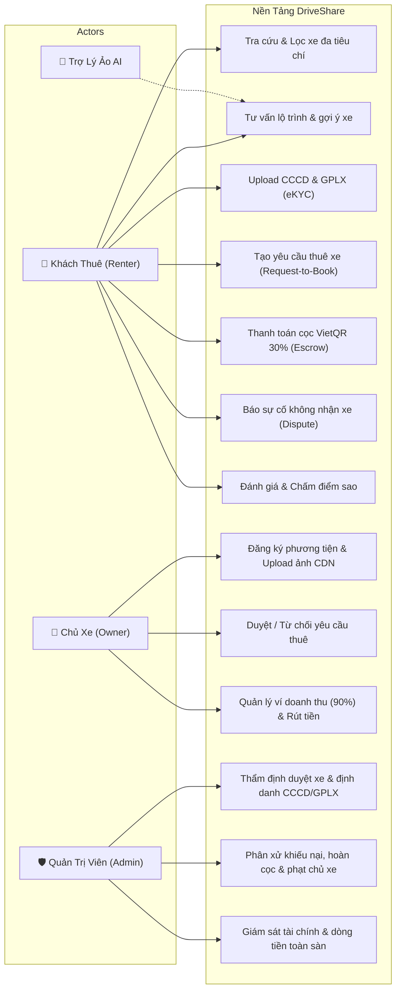
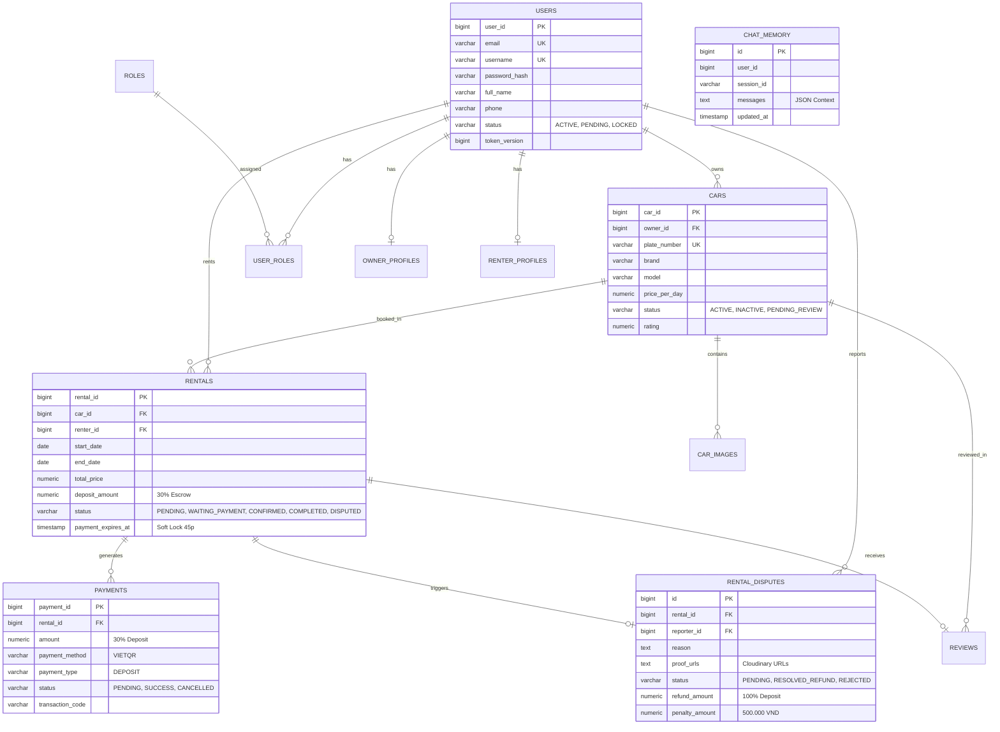

# 🎯 CHIẾN LƯỢC BÁO CÁO 15 PHÚT & BỘ TÀI LIỆU VẤN ĐÁP KỸ THUẬT (DRIVESHARE)

> **Dành cho**: Toàn bộ thành viên nhóm DriveShare (K4 PRO)  
> **Thời gian báo cáo**: 15 phút / nhóm (Thứ tự bốc thăm ngẫu nhiên)  
> **Mục tiêu**: Đạt điểm tối đa (9.5 - 10), trả lời trôi chảy mọi câu hỏi kỹ thuật của Giảng viên.

---

## PHẦN 1: GIẢI NGHĨA THÔNG ĐIỆP CỦA THẦY & CÁC "BẪY" CẦN TRÁNH

### 1. Thầy nói gì và đang muốn kiểm tra điều gì?
1. **"Thứ tự random, mỗi nhóm 15p"**:
   - Thầy muốn tiết kiệm thời gian, loại bỏ các nhóm lóng ngóng, không chuẩn bị trước.
   - Nhóm mình có thể bị gọi **ngay nhóm đầu tiên**. Do đó, mọi thứ (Docker, Backend, Frontend) phải được bật sẵn từ nhà hoặc ngay khi vừa cắm laptop vào máy chiếu.
2. **"Đảm bảo app trên web đã sẵn sàng để chạy được"**:
   - Nghiêm cấm tuyệt đối: Lên bục mới mở IDE, gõ lệnh build, migrate DB hay bị lỗi cổng 8080/3000.
3. **"Demo full luồng chính của app"**:
   - Phải đi một mạch trọn vẹn: **Khách tìm xe / AI tư vấn $\rightarrow$ Đặt xe $\rightarrow$ Chủ xe duyệt $\rightarrow$ Khách cọc 30% VietQR $\rightarrow$ Chủ xe xem ví doanh thu 90% $\rightarrow$ Admin giải quyết tranh chấp**.
4. **"Chuẩn bị sẵn database diagram vs usecase diagram"**:
   - Chiếu ngay sơ đồ khi thầy hỏi, không được ấp úng tìm file.
5. **"Sẽ hỏi TẤT CẢ thành viên về logic và kĩ thuật trong luồng chính"**:
   - Thầy chống "gánh team" (một người làm hết, người khác không biết gì). Thầy sẽ chỉ định từng bạn giải thích đoạn code hoặc logic trong database.
6. **"Viết xong chương 1 tài liệu SRS để được điểm danh"**:
   - Nhóm đã hoàn thành file: [`docs/requirements/SRS_Chuong_1_DriveShare.md`](file:///d:/MONHOCITC/K4/Spring_ThucTap_k4/docs/requirements/SRS_Chuong_1_DriveShare.md). Sẵn sàng in hoặc nộp file PDF ngay cho thầy.

---

## PHẦN 2: PHÂN BỔ 15 PHÚT "CHUẨN KHUNG GIỜ VÀNG"

| Thời gian | Nội dung trình bày | Người phụ trách chính | Thao tác trên màn hình |
| :---: | :--- | :--- | :--- |
| **00:00 - 02:00** (2p) | Giới thiệu nhóm & Chiếu 2 sơ đồ: **Use Case Diagram** & **Database ERD** | Nguyễn Bảo (Tech Lead) | Mở Slide/PDF chiếu sơ đồ, nêu ngắn gọn bài toán P2P Car Rental & Escrow. |
| **02:00 - 08:30** (6.5p) | **Demo Trực Tiếp Luồng Chính (Live Demo End-to-End)** | Chí Tín (thao tác máy) + Bảo (thuyết minh) | Thao tác mượt mà qua các màn hình (Kịch bản chi tiết ở Phần 3). |
| **08:30 - 10:00** (1.5p) | Tóm tắt kết quả kiểm thử tự động (186 unit tests, 100% Pass live script) | Lộc Khiêm | Chiếu báo cáo test hoặc terminal pass 186 tests. |
| **10:00 - 15:00** (5p) | **Thầy đặt câu hỏi & Từng thành viên vấn đáp kỹ thuật** | Cả 5 thành viên (ai hỏi người đó trả lời) | Mở đúng file code của mình để chứng minh (Xem Phần 5). |

---

## PHẦN 3: KỊCH BẢN DEMO FULL LUỒNG CHÍNH (TỪNG BƯỚC KHÔNG VẤP)

> 💡 **Mẹo vàng:** Trình duyệt mở sẵn các tab:
> - Tab 1: `http://localhost:3000/index.html` (Khách vãng lai)
> - Tab 2: `http://localhost:3000/login.html` (Màn hình đăng nhập có 3 nút Demo 1-click)
> - Tab 3: Slide chứa sơ đồ Use Case & Database ERD

### 🟢 Bước 1: Khách vãng lai & Trợ lý ảo AI (1 phút)
1. Đứng tại `http://localhost:3000/index.html`.
2. Trình diễn bộ lọc: Chọn hãng `VinFast`, chọn `7 chỗ` $\rightarrow$ Danh sách xe lọc ngay lập tức.
3. Bấm vào icon **AI Chatbot** ở góc phải dưới:
   - Gõ: *"Tư vấn cho tôi xe 7 chỗ đi du lịch Vũng Tàu"*
   - AI trả lời tức thì, phân tích nhu cầu và gợi ý 3 mẫu xe khả dụng trong database.

### 🟢 Bước 2: Đăng nhập Khách thuê & Đặt xe (1.5 phút)
1. Mở `login.html`, bấm nút Demo màu xanh **"Renter"** $\rightarrow$ Hệ thống tự điền `renter@driveshare.com` và đăng nhập 1-chạm.
2. Chọn xe **Ford Ranger Wildtrak** (hoặc **VinFast VF8**), bấm **"Đặt xe"**.
3. Chọn ngày thuê (sau hôm nay vài ngày) $\rightarrow$ Bấm **"Gửi yêu cầu thuê xe"** $\rightarrow$ Toast xanh báo tạo đơn thành công, trạng thái: `PENDING_APPROVAL`.

### 🟢 Bước 3: Chủ xe phê duyệt đơn (Host Screening) (1 phút)
1. Mở cửa sổ Incognito hoặc đăng xuất, bấm nút Demo màu cam **"Owner"** (`owner@driveshare.com`).
2. Vào `owner-cars.html`:
   - Chỉ cho thầy thấy: Cần gạt số chuyển đổi trạng thái xe (Hoạt động / Tạm ẩn).
   - Chuyển sang tab **"Yêu cầu thuê"** $\rightarrow$ Thấy ngay đơn thuê của Renter vừa tạo.
3. Chủ xe bấm nút **"Phê duyệt"** $\rightarrow$ Đơn chuyển sang `WAITING_PAYMENT` (Kích hoạt Soft Lock 45 phút mở cổng thanh toán).

### 🟢 Bước 4: Thanh toán cọc VietQR 30% (Escrow Deposit) (1.5 phút)
1. Quay lại tài khoản Renter hoặc mở trực tiếp `payment.html?rental_id=<mã_đơn>`.
2. Màn hình hiển thị:
   - Thông tin chuyến đi, tổng tiền, tiền cọc 30% chính xác (ví dụ: 570.000 đ).
   - Mã **VietQR Napas 247** động kèm thông tin ngân hàng thụ hưởng (MB Bank).
   - Đồng hồ đếm ngược 15 phút.
3. Bấm nút **"Tôi đã chuyển khoản thành công"** $\rightarrow$ Hệ thống đối soát và chuyển ngay sang **"Thanh Toán Cọc Hoàn Tất! Trạng thái: CONFIRMED"**.

### 🟢 Bước 5: Doanh thu Chủ xe & Quyết toán (1 phút)
1. Đăng nhập lại Owner, vào trang `owner-earnings.html`.
2. Chỉ cho thầy thấy:
   - Ví thu nhập thực nhận: Sàn tự động trích lại 10% hoa hồng và chuyển 90% giá trị hợp đồng vào ví khả dụng của chủ xe.
   - Bảng lịch sử quyết toán từng mã đơn, chi tiết tiền cọc đang giữ và nút **"Xem Biên Lai"**.

### 🟢 Bước 6: Xử lý sự cố tranh chấp & Phạt chủ xe (Admin) (Nếu thầy yêu cầu demo thêm) (0.5 phút)
1. Đăng nhập Demo **Admin** (`admin@driveshare.com`), vào `admin.html`.
2. Vào tab **"Xử lý khiếu nại sự cố (Disputes)"**:
   - Thấy danh sách sự cố khách báo không nhận được xe do lỗi chủ xe.
   - Bấm **"Hoàn 100% tiền cọc cho khách"** $\rightarrow$ Hệ thống dùng khóa bi quan (`Pessimistic Lock`) hoàn tiền cọc, chuyển đơn sang `CANCELLED_BY_HOST` và ghi nhận khoản phạt 500.000 đ cho chủ xe.

---

## PHẦN 4: HAI SƠ ĐỒ BẮT BUỘC (USE CASE & DATABASE DIAGRAM)

### 1. Sơ Đồ Use Case Tổng Thể Hệ Thống (Use Case Diagram)

---

### 2. Sơ Đồ Thực Thể Cơ Sở Dữ Liệu Thực Tế (Database ERD Diagram)

---

## PHẦN 5: BỘ CÂU HỎI VẤN ĐÁP KỸ THUẬT THEO TỪNG THÀNH VIÊN

### 👤 1. NGUYỄN DUY BẢO (Tech Lead / Database Architect)
- **Câu hỏi của Thầy:** *"Kiến trúc dự án em tổ chức thế nào? Cơ chế phòng chống tranh chấp đồng thời (Concurrency / Double Refund) xử lý ra sao?"*
- **Trả lời chuẩn điểm 10:**
  1. *Kiến trúc:* Dự án tuân theo **Spring Boot Layered Modular Architecture** (Controller mỏng $\rightarrow$ Service xử lý nghiệp vụ $\rightarrow$ Spring Data JPA Repository). Toàn bộ response bọc chuẩn trong `ApiResponse<T>`.
  2. *Chống Double Refund:* Sử dụng **Pessimistic Locking (`@Lock(LockModeType.PESSIMISTIC_WRITE)`)** trên bảng `rental_disputes` (`SELECT ... FOR UPDATE`). Khi Admin bấm nút giải quyết tranh chấp, dòng bản ghi bị khóa ở mức database. Nếu có request thứ 2 gửi đến đồng thời, hệ thống phát hiện trạng thái đã khác `PENDING` và lập tức từ chối với mã lỗi `DISPUTE_ALREADY_RESOLVED`, tuyệt đối không thể hoàn tiền hay phạt 2 lần.

---

### 👤 2. LÂM CHÍ VĨ (Backend Developer — Auth & Security)
- **Câu hỏi của Thầy:** *"Cơ chế xác thực phân quyền làm như thế nào? Khi user đổi mật khẩu thì các phiên đăng nhập cũ trên thiết bị khác có bị vô hiệu hóa không?"*
- **Trả lời chuẩn điểm 10:**
  1. *Xác thực:* Dùng **Spring Security 6 Stateless** với **JWT (`jjwt 0.12.6`)**. Tạo cặp Access Token (sống 24 giờ) và Refresh Token (sống 7 ngày). Bộ lọc `JwtAuthenticationFilter` chặn mọi request, giải mã claim `userId` và `roles` gán vào `SecurityContextHolder`.
  2. *Vô hiệu hóa phiên cũ:* Trong bảng `users` có cột `token_version` (mặc định 0). Khi người dùng đổi mật khẩu thành công (`PUT /api/v1/auth/change-password`), hệ thống tự động tăng `token_version = token_version + 1`. Các JWT cũ mang `tokenVersion` cũ khi gửi lên sẽ bị `JwtTokenProvider` so khớp và từ chối ngay với lỗi `401 UNAUTHENTICATED`.

---

### 👤 3. DUY QUÂN (Backend Developer — Profile & Upload Media)
- **Câu hỏi của Thầy:** *"Ảnh và giấy tờ người dùng tải lên được lưu ở đâu? Validate file dung lượng lớn và file độc hại như thế nào?"*
- **Trả lời chuẩn điểm 10:**
  1. *Lưu trữ:* Tích hợp dịch vụ đám mây **Cloudinary Storage**. Sau khi upload thành công, Cloudinary trả về link CDN HTTPS an toàn, backend chỉ lưu URL vào database (bảng `renter_profiles` và `owner_profiles`), không lưu file nặng trực tiếp làm phình database.
  2. *Validation an toàn:* Trong `UserProfileServiceImpl`, hệ thống kiểm tra:
     - Dung lượng: Tối đa 5MB cho ảnh avatar/CCCD/GPLX (cấu hình `MultipartFile.getSize()`).
     - Định dạng MIME type: Chỉ chấp nhận `image/jpeg`, `image/png`, `image/webp`. Nếu cố tình gửi file thực thi `.exe`, `.sh` hoặc file lạ, hệ thống lập tức chặn và trả lỗi `INVALID_FILE_FORMAT`.
     - Quy tắc CCCD: Bắt buộc gửi đủ 2 mặt (`frontImage` và `backImage`), nếu thiếu 1 mặt sẽ bị trả lỗi `MISSING_CCCD_SIDE`.

---

### 👤 4. LỘC KHIÊM (Backend Developer — Admin & Rental Disputes)
- **Câu hỏi của Thầy:** *"Luồng xử lý tranh chấp khiếu nại (Dispute) diễn ra như thế nào? Tiền cọc được hoàn trả ra sao?"*
- **Trả lời chuẩn điểm 10:**
  1. *Phát sinh sự cố:* Đến giờ hẹn mà chủ xe không giao xe hoặc tắt máy, khách thuê bấm báo sự cố qua API `POST /api/v1/rentals/{id}/report-no-show` kèm lý do và ảnh/video bằng chứng. Đơn chuyển sang trạng thái `DISPUTED`.
  2. *Thẩm định Admin:* Admin vào tab Khiếu nại xem xét bằng chứng. Nếu lỗi thuộc về chủ xe, Admin chọn `REFUND_RENTER`:
     - Hệ thống hoàn trả **100% tiền cọc (570.000 đ)** cho khách thuê từ tài khoản Escrow của sàn.
     - Chuyển trạng thái đơn thuê sang `CANCELLED_BY_HOST`.
     - Ghi nhận khoản nợ phạt **500.000 VNĐ** đối với chủ xe vi phạm vào hệ thống, khấu trừ vào các chuyến sau.

---

### 👤 5. CHÍ TÍN (Frontend Lead — UI/UX & Integration)
- **Câu hỏi của Thầy:** *"Frontend quản lý đăng nhập và vai trò người dùng như thế nào? Mã VietQR thanh toán cọc được sinh ra từ đâu?"*
- **Trả lời chuẩn điểm 10:**
  1. *Quản lý phiên:* Lưu `access_token`, `refresh_token` và object `user_info` trong `localStorage`. Hàm `checkAuth(requiredRole)` được gọi đầu mỗi trang: nếu chưa đăng nhập thì redirect về `login.html`, nếu sai quyền (ví dụ Renter vào Admin) thì thông báo lỗi và đẩy về trang chủ.
  2. *VietQR:* Frontend gọi API `POST /api/v1/rentals/{id}/payment` với `payment_method = 'VIETQR'`. Backend tự động tính đúng 30% giá trị hợp đồng và sinh URL mã QR chuẩn Napas 247 theo cú pháp chuẩn của VietQR (`img.vietqr.io/image/MB-...`). Frontend hiển thị mã QR kèm đồng hồ đếm ngược 15 phút và cơ chế polling kiểm tra thanh toán tự động.

---

## PHẦN 6: CHECKLIST 5 PHÚT TRƯỚC GIỜ BÁO CÁO

- [ ] **1. Docker Database:** Chạy sẵn `docker-compose up -d` (Container `driveshare-postgres` port 5432 xanh).
- [ ] **2. Backend:** Chạy sẵn `.\mvnw.cmd spring-boot:run` (Port 8080 đang nhận request).
- [ ] **3. Frontend:** Chạy sẵn `python -m http.server 3000` (Port 3000 đang hoạt động).
- [ ] **4. Trình duyệt:** Mở sẵn các tab:
  - Tab 1: `http://localhost:3000/index.html`
  - Tab 2: `http://localhost:3000/login.html`
  - Tab 3: Slide chứa Sơ đồ Use Case & Database ERD.
- [ ] **5. Tài liệu nộp:** File [`docs/requirements/SRS_Chuong_1_DriveShare.md`](file:///d:/MONHOCITC/K4/Spring_ThucTap_k4/docs/requirements/SRS_Chuong_1_DriveShare.md) đã sẵn sàng nộp cho thầy để lấy điểm danh.
