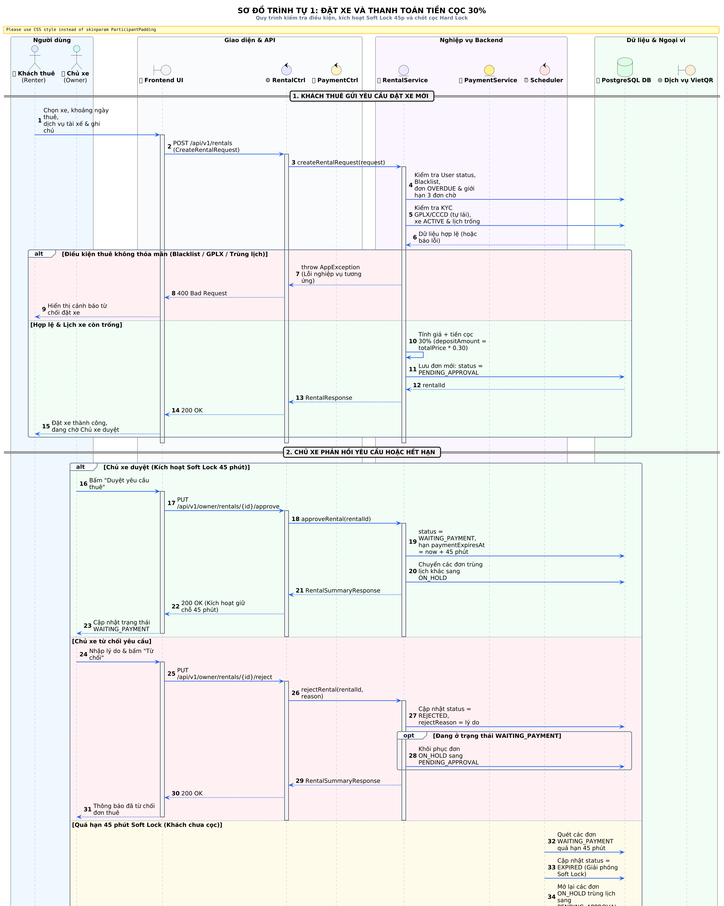
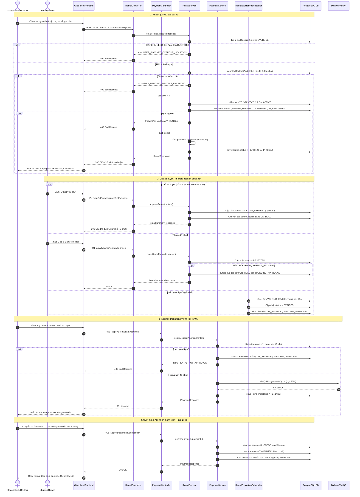
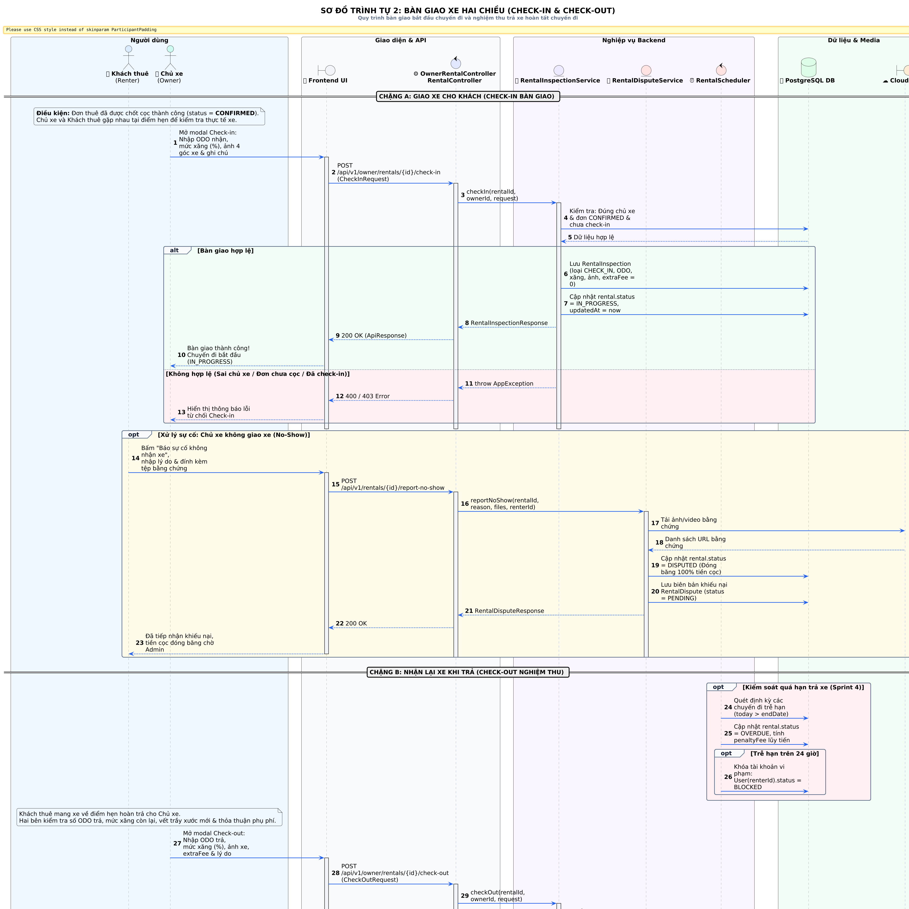
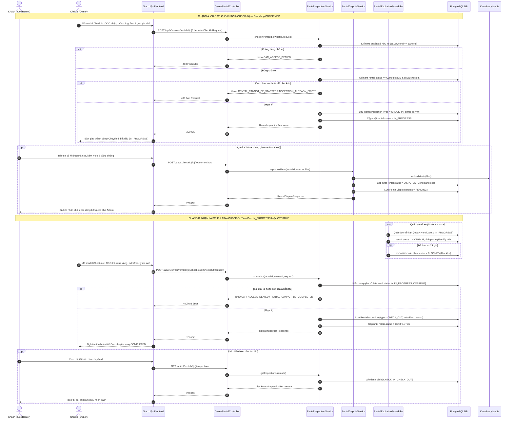

# THIẾT KẾ SƠ ĐỒ TRÌNH TỰ UML (SEQUENCE DIAGRAM) — NỀN TẢNG DRIVESHARE

Tài liệu đặc tả và thiết kế 02 Sơ đồ Trình tự UML (Sequence Diagram) chuẩn hóa cho hệ thống chia sẻ xe **DriveShare**, đối chiếu trực tiếp giữa mã nguồn backend Spring Boot 3 (`backend/src/main/java/com/driveshare/`) và tài liệu dự án (`docs/flow_diagrams.md`).

---

## 1. Tóm Tắt Phạm Vi & Giả Định Thiết Kế

1. **Phạm vi khảo sát mã nguồn**: Thiết kế dựa trên triển khai thực tế tại các module cốt lõi `rental`, `payment`, `car`, `user` và hệ thống tác vụ định kỳ `RentalExpirationScheduler`.
2. **Kiến trúc phân tầng thực tế**: Ứng dụng triển khai kiến trúc Spring Boot Modular Monolith trên một cơ sở dữ liệu PostgreSQL duy nhất (không chia 3 database vật lý riêng biệt như một số sơ đồ tài liệu cũ phác thảo).
3. **Cơ chế thanh toán VietQR**: Hệ thống sinh URL mã VietQR chuẩn qua `VietQrUtils` (`img.vietqr.io`), việc xác nhận hoàn tất thanh toán cọc được thực hiện thông qua endpoint `/api/v1/payments/{paymentId}/confirm` (chưa có webhook callback tự động từ phía ngân hàng).
4. **Quy trình bàn giao xe (Sprint 3 Inspection)**: Nghiệp vụ Check-in và Check-out do **Chủ xe (Car Owner)** thực hiện trực tiếp trên hệ thống; Khách thuê có quyền tra cứu đối chiếu biên bản hoặc khiếu nại sự cố không nhận xe (`report-no-show`).
5. **Cơ chế khóa lịch (Locking Policy)**: Áp dụng cơ chế Soft Lock 45 phút (`WAITING_PAYMENT`) khi Chủ xe duyệt đơn (tạm hoãn đơn trùng sang `ON_HOLD`), và Hard Lock (`CONFIRMED`) khi Khách hoàn tất thanh toán cọc 30% (tự động từ chối các đơn trùng sang `REJECTED`).

---

## 2. Bảng Thành Phần (Participants) & Trách Nhiệm

| Participant | Vai trò / Thành phần thực tế | Trách nhiệm chính |
|---|---|---|
| **Renter** | `Khách thuê xe` (Actor) | Gửi yêu cầu đặt xe, thanh toán tiền cọc 30%, nhận/trả xe thực tế, gửi khiếu nại nếu gặp sự cố. |
| **Owner** | `Chủ xe` (Actor) | Duyệt / từ chối yêu cầu thuê, thực hiện bàn giao xe (Check-in) và nghiệm thu nhận lại xe (Check-out). |
| **UI** | `Frontend (HTML5/JS/Bootstrap)` | Thu thập dữ liệu từ người dùng, gọi REST API kèm Bearer JWT Token, hiển thị VietQR và biên bản. |
| **RentalCtrl** | `RentalController` / `OwnerRentalController` | Tiếp nhận HTTP Request, giải mã token xác thực `@AuthenticationPrincipal`, kiểm tra quyền hạn (`RBAC`). |
| **PaymentCtrl** | `PaymentController` | Tiếp nhận yêu cầu khởi tạo thanh toán cọc, xác nhận giao dịch cọc và cập nhật trạng thái thanh toán. |
| **RentalSvc** | `RentalService` / `OwnerRentalService` | Kiểm tra điều kiện thuê (blacklist, KYC, trùng lịch), tính tiền cọc 30%, xử lý Soft Lock 45p và Auto-rejection. |
| **PaymentSvc** | `PaymentService` / `PaymentServiceImpl` | Quản lý vòng đời thanh toán cọc, kiểm tra hết hạn giữ chỗ 45 phút, liên kết trạng thái thanh toán và đơn thuê. |
| **InspectSvc** | `RentalInspectionService` | Kiểm tra điều kiện bàn giao/nghiệm thu, ghi nhận số ODO, mức nhiên liệu, ảnh hiện trạng, tính phụ phí phát sinh. |
| **DisputeSvc** | `RentalDisputeService` | Tiếp nhận và xử lý khiếu nại chủ xe không đến bàn giao xe, đóng băng tiền cọc, chuyển đơn sang `DISPUTED`. |
| **Scheduler** | `RentalExpirationScheduler` | Quét nền định kỳ giải phóng Soft Lock 45 phút, hủy đơn quá hạn và phát hiện đơn trễ hạn chuyển sang `OVERDUE`. |
| **DB** | `PostgreSQL (JPA Repositories)` | Lưu trữ các bảng `rentals`, `payments`, `rental_inspections`, `cars`, `users`, `renter_profiles`. |
| **VietQR** | `VietQrUtils / VietQR.io API` | Dịch vụ sinh chuỗi URL hiển thị mã QR thanh toán chuẩn ngân hàng kèm thông tin chuyển khoản. |

---

## 3. Sơ Đồ 1 — Đặt Xe và Thanh Toán Tiền Cọc

### 3.1 Mô tả nghiệp vụ
Bao quát toàn bộ luồng từ khi Khách thuê tìm và gửi yêu cầu đặt xe, hệ thống kiểm tra điều kiện tài khoản (Blacklist/Overdue), hạn mức 3 đơn chờ, xác minh bằng lái GPLX/CCCD, kiểm tra trùng lịch xe, tính toán tiền cọc 30%. Sau đó Chủ xe duyệt (kích hoạt Soft Lock 45 phút) hoặc từ chối hoặc hết hạn. Tiếp theo Khách thuê khởi tạo thanh toán VietQR và xác nhận cọc, kích hoạt Hard Lock và tự động từ chối các đơn cạnh tranh.

### 3.2 Hình ảnh Sơ đồ (Đã kết xuất PNG & SVG)
- **Xem ảnh gốc độ phân giải cao**: [04_sequence_booking_and_deposit.png](diagrams/04_sequence_booking_and_deposit.png) | [Bản Vector SVG](diagrams/04_sequence_booking_and_deposit.svg)



### 3.3 Bản dựng Trực quan Trực tiếp (Mermaid Sequence)


### 3.4 Mã nguồn PlantUML

```plantuml
@startuml
autonumber
skinparam style strictuml
skinparam SequenceMessageAlignment center
skinparam MaxMessageSize 250
skinparam BoxPadding 10
skinparam ParticipantPadding 10

title Sơ đồ Trình tự 1: Đặt Xe và Thanh Toán Tiền Cọc (DriveShare)

actor "Khách thuê\n(Renter)" as Renter
actor "Chủ xe\n(Owner)" as Owner
boundary "Giao diện Web\n(Frontend UI)" as UI
control "RentalController /\nOwnerRentalController" as RentalCtrl
control "PaymentController" as PaymentCtrl
entity "RentalService /\nOwnerRentalService" as RentalSvc
entity "PaymentService" as PaymentSvc
control "RentalExpiration\nScheduler" as Scheduler
database "Cơ sở dữ liệu\n(PostgreSQL)" as DB
boundary "Dịch vụ VietQR\n(img.vietqr.io)" as VietQR

== 1. Khách thuê gửi yêu cầu đặt xe mới ==

Renter -> UI: Chọn xe, khoảng ngày thuê, tùy chọn có tài xế & ghi chú
activate Renter
activate UI
UI -> RentalCtrl: POST /api/v1/rentals\n(CreateRentalRequest, Bearer JWT)
activate RentalCtrl

RentalCtrl -> RentalSvc: createRentalRequest(request)
activate RentalSvc

RentalSvc -> DB: Kiểm tra User.status == BLOCKED hoặc có đơn OVERDUE
activate DB
DB --> RentalSvc: Trạng thái tài khoản Renter
deactivate DB

alt Renter bị BLOCKED hoặc nợ xe OVERDUE
    RentalSvc --> RentalCtrl: throw AppException(USER_BLOCKED_OVERDUE_VIOLATION)
    RentalCtrl --> UI: 400 Bad Request (Tài khoản bị khóa / vi phạm trễ hạn)
    UI --> Renter: Báo lỗi tài khoản không đủ điều kiện thuê
else Tài khoản hợp lệ
    RentalSvc -> DB: countByRenterIdAndStatus(PENDING, PENDING_APPROVAL)
    activate DB
    DB --> RentalSvc: Số lượng đơn chờ hiện tại
    deactivate DB
    
    alt Số đơn chờ >= 3
        RentalSvc --> RentalCtrl: throw AppException(MAX_PENDING_RENTALS_EXCEEDED)
        RentalCtrl --> UI: 400 Bad Request (Vượt quá tối đa 3 đơn chờ duyệt)
        UI --> Renter: Báo lỗi giới hạn số đơn chờ
    else Số đơn chờ < 3
        RentalSvc: Kiểm tra hợp lệ ngày thuê (không ở quá khứ, endDate >= startDate)
        
        opt Thuê tự lái (!withDriver)
            RentalSvc -> DB: Kiểm tra GPLX/CCCD trong RenterProfile
            activate DB
            DB --> RentalSvc: VerificationStatus
            deactivate DB
            alt GPLX hoặc CCCD bị REJECTED
                RentalSvc --> RentalCtrl: throw AppException(KYC_NOT_VERIFIED)
                RentalCtrl --> UI: 400 Bad Request (Giấy tờ bị từ chối)
                UI --> Renter: Yêu cầu cập nhật hồ sơ cá nhân
            end
        end
        
        RentalSvc -> DB: findByCarIdAndDeletedAtIsNull(carId)
        activate DB
        DB --> RentalSvc: Thông tin xe & Chủ xe
        deactivate DB
        
        alt Xe không ACTIVE hoặc tự thuê xe của chính mình
            RentalSvc --> RentalCtrl: throw AppException(CAR_NOT_FOUND / INVALID_REQUEST)
            RentalCtrl --> UI: 400 Bad Request
            UI --> Renter: Thông báo xe không sẵn sàng
        else Xe hợp lệ
            RentalSvc -> DB: hasDateConflict(carId, dates, [WAITING_PAYMENT, APPROVED, CONFIRMED, IN_PROGRESS])
            activate DB
            DB --> RentalSvc: Kết quả kiểm tra lịch
            deactivate DB
            
            alt Xe đã có người giữ chỗ hoặc đang thuê
                RentalSvc --> RentalCtrl: throw AppException(CAR_ALREADY_RENTED)
                RentalCtrl --> UI: 400 Bad Request (Xe đã trùng lịch)
                UI --> Renter: Báo xe bận trong khoảng thời gian đã chọn
            else Lịch xe trống
                RentalSvc: Tính giá thuê (theo ngày hoặc giờ 4h-8h) + phí tài xế\nTính tiền cọc 30%: depositAmount = totalPrice * 0.30
                RentalSvc -> DB: rentalRepository.save(Rental: status = PENDING_APPROVAL)
                activate DB
                DB --> RentalSvc: Bản ghi Rental đã lưu (rentalId)
                deactivate DB
                
                RentalSvc --> RentalCtrl: RentalResponse
                deactivate RentalSvc
                RentalCtrl --> UI: 200 OK (ApiResponse<RentalResponse>)
                deactivate RentalCtrl
                UI --> Renter: Thông báo gửi yêu cầu thành công, chờ Chủ xe duyệt
            end
        end
    end
end
deactivate UI
deactivate Renter

== 2. Chủ xe phản hồi hoặc Hết hạn xử lý ==

alt Chủ xe chấp thuận yêu cầu (CRP-47: Kích hoạt Soft Lock 45 phút)
    Owner -> UI: Bấm "Duyệt yêu cầu thuê"
    activate Owner
    activate UI
    UI -> RentalCtrl: PUT /api/v1/owner/rentals/{id}/approve (Bearer JWT)
    activate RentalCtrl
    RentalCtrl -> RentalSvc: approveRental(rentalId)
    activate RentalSvc
    
    RentalSvc -> DB: Kiểm tra car.ownerId == currentUserId & status == PENDING_APPROVAL
    activate DB
    DB --> RentalSvc: Hợp lệ
    deactivate DB
    
    RentalSvc -> DB: hasDateConflict (Bảo vệ Race-condition)
    activate DB
    DB --> RentalSvc: Không có xung đột
    deactivate DB
    
    RentalSvc -> DB: Cập nhật status = WAITING_PAYMENT,\npaymentExpiresAt = now + 45 phút
    activate DB
    DB --> RentalSvc: OK
    deactivate DB
    
    RentalSvc -> DB: findCompetingRentals(PENDING, PENDING_APPROVAL)\nCập nhật status = ON_HOLD (Tạm hoãn đơn cạnh tranh)
    activate DB
    DB --> RentalSvc: OK
    deactivate DB
    
    RentalSvc --> RentalCtrl: RentalSummaryResponse
    deactivate RentalSvc
    RentalCtrl --> UI: 200 OK (Duyệt thành công, giữ chỗ 45 phút)
    deactivate RentalCtrl
    UI --> Owner: Hiển thị trạng thái WAITING_PAYMENT
    deactivate UI
    deactivate Owner

else Chủ xe từ chối yêu cầu (CRP-48)
    Owner -> UI: Nhập lý do từ chối & Bấm "Từ chối"
    activate Owner
    activate UI
    UI -> RentalCtrl: PUT /api/v1/owner/rentals/{id}/reject (RejectRentalRequest)
    activate RentalCtrl
    RentalCtrl -> RentalSvc: rejectRental(rentalId, request)
    activate RentalSvc
    
    RentalSvc -> DB: Cập nhật status = REJECTED, rejectReason = reason
    activate DB
    DB --> RentalSvc: OK
    deactivate DB
    
    opt Nếu đơn bị từ chối đang ở WAITING_PAYMENT
        RentalSvc -> DB: Giải phóng Soft Lock: khôi phục các đơn ON_HOLD sang PENDING_APPROVAL
        activate DB
        DB --> RentalSvc: OK
        deactivate DB
    end
    
    RentalSvc --> RentalCtrl: RentalSummaryResponse
    deactivate RentalSvc
    RentalCtrl --> UI: 200 OK
    deactivate RentalCtrl
    UI --> Owner: Thông báo đã từ chối yêu cầu
    deactivate UI
    deactivate Owner

else Tác vụ định kỳ quét hết hạn Soft Lock 45 phút
    Scheduler -> DB: findExpiredWaitingPaymentRentals(WAITING_PAYMENT, now)
    activate Scheduler
    activate DB
    DB --> Scheduler: Danh sách đơn quá hạn 45 phút
    deactivate DB
    
    loop Mỗi đơn quá hạn 45 phút
        Scheduler -> DB: Cập nhật status = EXPIRED
        activate DB
        DB --> Scheduler: OK
        deactivate DB
        Scheduler -> DB: Khôi phục các đơn ON_HOLD trùng lịch sang PENDING_APPROVAL
        activate DB
        DB --> Scheduler: OK
        deactivate DB
    end
    deactivate Scheduler
end

== 3. Khách thuê thanh toán đặt cọc 30% qua VietQR (CRP-51 -> CRP-53) ==

Renter -> UI: Vào trang thanh toán đơn thuê đã duyệt
activate Renter
activate UI
UI -> PaymentCtrl: POST /api/v1/rentals/{rentalId}/payment (CreatePaymentRequest)
activate PaymentCtrl

PaymentCtrl -> PaymentSvc: createDepositPayment(rentalId, request, currentUserId)
activate PaymentSvc

PaymentSvc -> DB: Kiểm tra rental.renterId == currentUserId & status in [APPROVED, WAITING_PAYMENT]
activate DB
DB --> PaymentSvc: Thông tin đơn thuê
deactivate DB

alt Đơn đã quá hạn 45 phút giữ chỗ
    PaymentSvc -> DB: Cập nhật status = EXPIRED, khôi phục đơn ON_HOLD sang PENDING_APPROVAL
    activate DB
    DB --> PaymentSvc: OK
    deactivate DB
    PaymentSvc --> PaymentCtrl: throw AppException(RENTAL_NOT_APPROVED, "Hết hạn giữ chỗ 45 phút")
    PaymentCtrl --> UI: 400 Bad Request
    UI --> Renter: Thông báo đơn đã hết hạn giữ chỗ
else Trong thời hạn giữ chỗ
    PaymentSvc -> DB: Kiểm tra Payment hiện có theo rentalId
    activate DB
    DB --> PaymentSvc: existing Payment (nếu có)
    deactivate DB
    
    alt Payment đã SUCCESS trước đó
        PaymentSvc --> PaymentCtrl: throw AppException(PAYMENT_ALREADY_COMPLETED)
        PaymentCtrl --> UI: 400 Bad Request
        UI --> Renter: Báo đơn này đã hoàn tất thanh toán cọc
    else Chưa có giao dịch hoặc giao dịch cũ FAILED
        PaymentSvc: Sinh transactionCode = "DSPAY" + rentalId + "_" + timestamp\nTính số tiền cọc 30% (depositAmount)
        PaymentSvc -> VietQR: VietQrUtils.generateQrUrl(bankId, accountNo, amount, memo)
        activate VietQR
        VietQR --> PaymentSvc: qrCodeUrl (ảnh mã QR)
        deactivate VietQR
        PaymentSvc -> DB: paymentRepository.save(Payment: status = PENDING, amount, qrCodeUrl)
        activate DB
        DB --> PaymentSvc: Bản ghi Payment
        deactivate DB
        PaymentSvc --> PaymentCtrl: PaymentResponse
        PaymentCtrl --> UI: 201 Created (ApiResponse<PaymentResponse>)
        UI --> Renter: Hiển thị mã VietQR, STK, số tiền cọc 30% & đếm ngược
    end
end
deactivate PaymentSvc
deactivate PaymentCtrl
deactivate UI
deactivate Renter

== 4. Khách quét mã và Xác nhận hoàn tất thanh toán ==

Renter -> UI: Chuyển khoản ngân hàng & bấm "Tôi đã chuyển khoản thành công"
activate Renter
activate UI
UI -> PaymentCtrl: POST /api/v1/payments/{paymentId}/confirm (Bearer JWT)
activate PaymentCtrl

PaymentCtrl -> PaymentSvc: confirmPayment(paymentId, currentUserId)
activate PaymentSvc

PaymentSvc -> DB: findById(paymentId) & findById(rentalId)
activate DB
DB --> PaymentSvc: Payment và Rental
deactivate DB

alt Đơn thuê quá hạn 45 phút khi bấm xác nhận
    PaymentSvc -> DB: payment.status = FAILED, rental.status = EXPIRED,\nkhôi phục đơn ON_HOLD sang PENDING_APPROVAL
    activate DB
    DB --> PaymentSvc: OK
    deactivate DB
    PaymentSvc --> PaymentCtrl: throw AppException(RENTAL_NOT_APPROVED)
    PaymentCtrl --> UI: 400 Bad Request (Hết hạn giữ chỗ)
    UI --> Renter: Báo giao dịch không hợp lệ do quá hạn
else Hợp lệ trong hạn 45 phút
    PaymentSvc -> DB: Cập nhật payment.status = SUCCESS, paidAt = now
    activate DB
    DB --> PaymentSvc: OK
    deactivate DB
    
    PaymentSvc -> DB: Cập nhật rental.status = CONFIRMED (Kích hoạt Hard Lock)
    activate DB
    DB --> PaymentSvc: OK
    deactivate DB
    
    PaymentSvc -> DB: Auto-rejection: Quét các đơn trùng lịch ([ON_HOLD, PENDING, PENDING_APPROVAL])\nCập nhật status = REJECTED ("Xe đã được chốt cọc bởi khách hàng khác")
    activate DB
    DB --> PaymentSvc: OK
    deactivate DB
    
    PaymentSvc --> PaymentCtrl: PaymentResponse
    deactivate PaymentSvc
    PaymentCtrl --> UI: 200 OK (Xác nhận cọc thành công)
    deactivate PaymentCtrl
    UI --> Renter: Hiển thị thông báo "Thanh toán cọc hoàn tất! Đơn chuyển sang CONFIRMED"
end
deactivate UI
deactivate Renter

@enduml
```

---

## 4. Sơ Đồ 2 — Bàn Giao Xe Hai Chiều (Check-In & Check-Out)

### 4.1 Mô tả nghiệp vụ
Bao quát hai chặng liên tiếp trong cùng một vòng đời thuê xe theo chuẩn Sprint 3 Inspection:
- **Chặng A: Giao xe cho khách (Check-in)**: Khi đơn ở trạng thái `CONFIRMED`. Chủ xe gặp khách, kiểm tra ODO, mức xăng, chụp 4 góc ảnh, ghi chú và gọi API Check-in. Hệ thống lưu biên bản `CHECK_IN` và chuyển trạng thái đơn sang `IN_PROGRESS`. Khách thuê có quyền khiếu nại sự cố không nhận xe (`report-no-show`) nếu chủ xe vắng mặt, chuyển đơn sang `DISPUTED`.
- **Chặng B: Nhận lại xe khi trả (Check-out)**: Khi khách mang xe về trả (đơn ở `IN_PROGRESS` hoặc `OVERDUE`). Chủ xe kiểm tra ODO trả, mức xăng trả, ảnh hiện trạng, tính phụ phí phát sinh (`extraFee`, `extraFeeReason`) và gọi API Check-out. Hệ thống lưu biên bản `CHECK_OUT` và chuyển trạng thái đơn sang `COMPLETED`.

### 4.2 Hình ảnh Sơ đồ (Đã kết xuất PNG & SVG)
- **Xem ảnh gốc độ phân giải cao**: [05_sequence_two_way_handover.png](diagrams/05_sequence_two_way_handover.png) | [Bản Vector SVG](diagrams/05_sequence_two_way_handover.svg)



### 4.3 Bản dựng Trực quan Trực tiếp (Mermaid Sequence)


### 4.4 Mã nguồn PlantUML

```plantuml
@startuml
autonumber
skinparam style strictuml
skinparam SequenceMessageAlignment center
skinparam MaxMessageSize 250
skinparam BoxPadding 10
skinparam ParticipantPadding 10

title Sơ đồ Trình tự 2: Bàn Giao Xe Hai Chiều (Check-in & Check-out) - DriveShare

actor "Khách thuê\n(Renter)" as Renter
actor "Chủ xe\n(Owner)" as Owner
boundary "Giao diện Web\n(Frontend UI)" as UI
control "OwnerRentalController /\nRentalController" as Controller
entity "RentalInspectionService" as InspectSvc
entity "RentalDisputeService" as DisputeSvc
control "RentalExpiration\nScheduler" as Scheduler
database "Cơ sở dữ liệu\n(PostgreSQL)" as DB
boundary "Dịch vụ Cloudinary\n(Lưu ảnh biên bản/bằng chứng)" as Cloudinary

== CHẶNG A: GIAO XE CHO KHÁCH (CHECK-IN BÀN GIAO) ==

note over Renter, Owner
Điều kiện tiên quyết: Đơn thuê đã được thanh toán cọc thành công (status = CONFIRMED)
Chủ xe và Khách thuê gặp mặt trực tiếp tại điểm giao nhận xe theo lịch hẹn.
end note

Owner -> UI: Mở modal "Check-in Bàn giao", nhập ODO nhận, mức xăng (%), ảnh 4 góc xe, ghi chú hiện trạng
activate Owner
activate UI
UI -> Controller: POST /api/v1/owner/rentals/{id}/check-in\n(CheckInRequest: odoMeter, fuelLevel, images, notes, Bearer JWT)
activate Controller

Controller -> InspectSvc: checkIn(rentalId, ownerId, request)
activate InspectSvc

InspectSvc -> DB: findById(rentalId) & findById(carId)
activate DB
DB --> InspectSvc: Thông tin Rental & Car
deactivate DB

alt Không đúng quyền chủ sở hữu xe (car.ownerId != ownerId)
    InspectSvc --> Controller: throw AppException(CAR_ACCESS_DENIED)
    Controller --> UI: 403 Forbidden (Không có quyền thao tác trên xe này)
    UI --> Owner: Báo lỗi từ chối truy cập
else Đúng chủ xe
    alt Đơn thuê không ở trạng thái CONFIRMED
        InspectSvc --> Controller: throw AppException(RENTAL_CANNOT_BE_STARTED)
        Controller --> UI: 400 Bad Request (Đơn chưa cọc hoặc sai trạng thái)
        UI --> Owner: Báo lỗi đơn không đủ điều kiện giao xe
    else Đơn đang CONFIRMED
        InspectSvc -> DB: existsByRentalIdAndInspectionType(rentalId, CHECK_IN)
        activate DB
        DB --> InspectSvc: Đã tồn tại biên bản chưa?
        deactivate DB
        
        alt Đã có biên bản Check-in trước đó
            InspectSvc --> Controller: throw AppException(INSPECTION_ALREADY_EXISTS)
            Controller --> UI: 400 Bad Request (Biên bản Check-in đã tồn tại)
            UI --> Owner: Báo lỗi không thể Check-in 2 lần
        else Chưa có biên bản Check-in
            InspectSvc -> DB: Lưu RentalInspection (type = CHECK_IN, odoMeter, fuelLevel, images, notes, extraFee = 0, performedBy = ownerId)
            activate DB
            DB --> InspectSvc: Bản ghi RentalInspection (inspectionId)
            deactivate DB
            
            InspectSvc -> DB: Cập nhật rental.status = IN_PROGRESS, updatedAt = now
            activate DB
            DB --> InspectSvc: OK
            deactivate DB
            
            InspectSvc --> Controller: RentalInspectionResponse
            deactivate InspectSvc
            Controller --> UI: 200 OK (ApiResponse<RentalInspectionResponse>)
            deactivate Controller
            UI --> Owner: Thông báo bàn giao thành công. Chuyến đi bắt đầu (IN_PROGRESS)
            deactivate UI
            deactivate Owner
        end
    end
end

opt Nhánh sự cố: Chủ xe không giao xe (No-Show) - Sprint 3 Fix
    Renter -> UI: Bấm "Báo sự cố không nhận xe", nhập lý do & tải tệp bằng chứng
    activate Renter
    activate UI
    UI -> Controller: POST /api/v1/rentals/{id}/report-no-show\n(Multipart: reason, evidenceFiles, Bearer JWT)
    activate Controller
    Controller -> DisputeSvc: reportNoShow(rentalId, reason, evidenceFiles, currentUserId)
    activate DisputeSvc
    
    DisputeSvc -> DB: Kiểm tra rental.renterId == currentUserId & status in [CONFIRMED, IN_PROGRESS]
    activate DB
    DB --> DisputeSvc: Đơn hợp lệ
    deactivate DB
    
    loop Từng tệp bằng chứng
        DisputeSvc -> Cloudinary: uploadMedia(file, "disputes/{rentalId}")
        activate Cloudinary
        Cloudinary --> DisputeSvc: fileUrl
        deactivate Cloudinary
    end
    
    DisputeSvc -> DB: Cập nhật rental.status = DISPUTED (Đóng băng tiền cọc)
    activate DB
    DB --> DisputeSvc: OK
    deactivate DB
    
    DisputeSvc -> DB: Lưu RentalDispute (status = PENDING, reason, evidenceUrls)
    activate DB
    DB --> DisputeSvc: OK
    deactivate DB
    
    DisputeSvc --> Controller: RentalDisputeResponse
    deactivate DisputeSvc
    Controller --> UI: 200 OK (Đã tiếp nhận khiếu nại, đóng băng cọc chờ Admin)
    deactivate Controller
    UI --> Renter: Thông báo gửi khiếu nại thành công, chờ Admin đối soát
    deactivate UI
    deactivate Renter
end

== CHẶNG B: NHẬN LẠI XE KHI TRẢ (CHECK-OUT NGHIỆM THU) ==

opt Nhánh Quá hạn trả xe (Sprint 4 - Issue #49)
    Scheduler -> DB: Quét autoDetectOverdueRentals() (today > rental.endDate & status == IN_PROGRESS)
    activate Scheduler
    activate DB
    DB --> Scheduler: Danh sách đơn quá ngày trả
    deactivate DB
    loop Từng đơn trễ hạn
        Scheduler: Tính overdueHours và penaltyFee lũy tiến
        Scheduler -> DB: Cập nhật rental.status = OVERDUE, overdueHours, penaltyFee
        activate DB
        DB --> Scheduler: OK
        deactivate DB
        opt Trễ hạn >= 24 giờ
            Scheduler -> DB: Cập nhật User(renterId).status = BLOCKED (Đưa vào danh sách đen)
            activate DB
            DB --> Scheduler: OK
            deactivate DB
        end
    end
    deactivate Scheduler
end

note over Renter, Owner
Khách thuê mang xe về điểm hẹn trả cho Chủ xe.
Hai bên kiểm tra số ODO trả, mức xăng còn lại, các vết trầy xước phát sinh và thỏa thuận phụ phí (nếu có).
end note

Owner -> UI: Mở modal "Check-out Nghiệm thu", nhập ODO trả, mức xăng (%), ảnh xe trả, ghi chú, extraFee và extraFeeReason
activate Owner
activate UI
UI -> Controller: POST /api/v1/owner/rentals/{id}/check-out\n(CheckOutRequest: odoMeter, fuelLevel, extraFee, extraFeeReason, images, notes)
activate Controller

Controller -> InspectSvc: checkOut(rentalId, ownerId, request)
activate InspectSvc

InspectSvc -> DB: findById(rentalId) & findById(carId)
activate DB
DB --> InspectSvc: Thông tin Rental & Car
deactivate DB

alt Không đúng chủ sở hữu xe (car.ownerId != ownerId)
    InspectSvc --> Controller: throw AppException(CAR_ACCESS_DENIED)
    Controller --> UI: 403 Forbidden
    UI --> Owner: Báo lỗi từ chối thao tác
else Đúng chủ xe
    alt Đơn thuê không ở trạng thái IN_PROGRESS và không ở OVERDUE
        InspectSvc --> Controller: throw AppException(RENTAL_CANNOT_BE_COMPLETED)
        Controller --> UI: 400 Bad Request (Đơn không ở trạng thái được phép nghiệm thu)
        UI --> Owner: Báo lỗi trạng thái đơn không hợp lệ
    else Đơn đang IN_PROGRESS hoặc OVERDUE
        InspectSvc -> DB: existsByRentalIdAndInspectionType(rentalId, CHECK_OUT)
        activate DB
        DB --> InspectSvc: Đã tồn tại biên bản chưa?
        deactivate DB
        
        alt Đã có biên bản Check-out trước đó
            InspectSvc --> Controller: throw AppException(INSPECTION_ALREADY_EXISTS)
            Controller --> UI: 400 Bad Request (Đơn đã nghiệm thu hoàn tất trước đó)
            UI --> Owner: Báo lỗi không thể Check-out lần 2
        else Chưa có biên bản Check-out
            InspectSvc -> DB: Lưu RentalInspection (type = CHECK_OUT, odoMeter, fuelLevel, images, notes, extraFee, extraFeeReason, performedBy = ownerId)
            activate DB
            DB --> InspectSvc: Bản ghi RentalInspection (inspectionId)
            deactivate DB
            
            InspectSvc -> DB: Cập nhật rental.status = COMPLETED, updatedAt = now
            activate DB
            DB --> InspectSvc: OK
            deactivate DB
            
            InspectSvc --> Controller: RentalInspectionResponse
            deactivate InspectSvc
            Controller --> UI: 200 OK (ApiResponse<RentalInspectionResponse>)
            deactivate Controller
            UI --> Owner: Thông báo nghiệm thu thành công. Đơn chuyển sang COMPLETED
            deactivate UI
            deactivate Owner
        end
    end
end

opt Tra cứu đối chiếu hai biên bản giao nhận (Sprint 3)
    Renter -> UI: Xem chi tiết chuyến đi & lịch sử biên bản
    activate Renter
    activate UI
    UI -> Controller: GET /api/v1/rentals/{id}/inspections (Bearer JWT)
    activate Controller
    Controller -> InspectSvc: getInspections(rentalId, currentUserId)
    activate InspectSvc
    InspectSvc -> DB: findByRentalIdOrderByCreatedAtAsc(rentalId)
    activate DB
    DB --> InspectSvc: Danh sách biên bản [CHECK_IN, CHECK_OUT]
    deactivate DB
    InspectSvc --> Controller: List<RentalInspectionResponse>
    deactivate InspectSvc
    Controller --> UI: 200 OK (Dữ liệu đối chiếu ODO, xăng, ảnh, phụ phí)
    deactivate Controller
    UI --> Renter: Hiển thị giao diện đối chiếu 2 chiều minh bạch
    deactivate UI
    deactivate Renter
end

@enduml
```

---

## 5. Bảng Đối Chiếu Khác Biệt: Tài Liệu vs. Mã Nguồn Thực Tế

| Nội dung / Nghiệp vụ | Mô tả trong tài liệu cũ (`docs/flow_diagrams.md`) | Hiện thực thực tế trong Mã nguồn Backend | Đường dẫn File & Class/Method liên quan |
|---|---|---|---|
| **Trạng thái khởi tạo đơn** | `PENDING` | `PENDING_APPROVAL` (khách gửi đơn chờ chủ xe duyệt hồ sơ) | `RentalServiceImpl.java` (`createRentalRequest`) & `ERentalStatus.java` |
| **Trạng thái sau khi chủ xe duyệt** | `CONFIRMED` (chờ cọc trong 2 giờ) | `WAITING_PAYMENT` (kích hoạt Soft Lock 45 phút; tạm hoãn các đơn trùng sang `ON_HOLD`) | `OwnerRentalServiceImpl.java` (`approveRental`) |
| **Trạng thái sau khi cọc thành công** | `DEPOSIT_PAID` | `CONFIRMED` (kích hoạt Hard Lock, tự động từ chối `REJECTED` các đơn cạnh tranh) | `PaymentServiceImpl.java` (`confirmPayment`) |
| **Thời hạn đặt cọc (Timeout)** | 2 giờ | **45 phút** (Soft Lock) | `OwnerRentalServiceImpl.java` (`SOFT_LOCK_MINUTES = 45`) & `RentalExpirationScheduler.java` |
| **Xác nhận bàn giao xe (Check-in)** | Cả 2 bên cùng bấm xác nhận (Renter & Owner) | **Chỉ Chủ xe** (`hasRole('OWNER')`) gửi biên bản Check-in (`POST /api/v1/owner/rentals/{id}/check-in`). Renter chỉ có quyền đọc đối chiếu hoặc khiếu nại `report-no-show`. | `OwnerRentalController.java` (`checkIn`) & `RentalInspectionServiceImpl.java` |
| **Xác nhận trả xe (Check-out)** | Khách lập biên bản trả xe $\rightarrow$ Chủ xe duyệt | **Chủ xe trực tiếp nghiệm thu** và ghi nhận ODO trả, mức xăng, phụ phí (`POST /api/v1/owner/rentals/{id}/check-out`). Hỗ trợ nghiệm thu cả khi đơn ở `OVERDUE`. | `OwnerRentalController.java` (`checkOut`) & `RentalInspectionServiceImpl.java` |
| **Cơ chế thanh toán** | Giả định có webhook tự động từ ngân hàng | Tạo mã VietQR động qua `VietQrUtils`, client gọi trực tiếp API `confirmPayment` (`POST /api/v1/payments/{paymentId}/confirm`) hoặc `/status`. | `PaymentController.java`, `PaymentServiceImpl.java`, `VietQrUtils.java` |
| **Kiến trúc cơ sở dữ liệu** | 3 CSDL phân tán (`renter_db`, `owner_db`, `admin_db`) | **1 CSDL PostgreSQL duy nhất**, bảng liên kết bằng Foreign Key quan hệ (`rentals`, `payments`, `rental_inspections`, `cars`, `users`). | `backend/src/main/resources/application.yml` & `Rental.java` |

---

## 6. Báo Cáo Tự Rà Soát Chất Lượng UML (Self-Review Checklist)

1. [x] **Tuân thủ chuẩn UML Sequence Diagram**:
   - Sử dụng đúng ký pháp Lifeline, Activation box, Synchronous call (`->`), Return message (`-->`), và các combined fragments (`alt`, `opt`, `loop`).
   - Đặt tên Participant chính xác theo từng tầng kiến trúc (`Actor`, `Boundary UI`, `Controller`, `Service`, `Repository/DB`, `External Service`).
2. [x] **Khớp 100% Enum trạng thái trong mã nguồn**:
   - Khởi tạo: `PENDING_APPROVAL`.
   - Duyệt: `WAITING_PAYMENT` (đơn trùng sang `ON_HOLD`).
   - Cọc thành công: `CONFIRMED` (đơn trùng sang `REJECTED`).
   - Bàn giao xe: `IN_PROGRESS`.
   - Quá hạn trả xe: `OVERDUE`.
   - Hoàn tất trả xe: `COMPLETED`.
   - Tranh chấp/Khiếu nại: `DISPUTED`.
   - Hết hạn giữ chỗ: `EXPIRED`.
3. [x] **Không suy diễn các tính năng chưa triển khai**:
   - Không bịa đặt webhook ngân hàng phức tạp hay hệ thống SMS gateway.
   - Thể hiện rõ việc sinh ảnh VietQR qua `VietQrUtils` và API xác nhận giao dịch `confirmPayment`.
   - Thể hiện đúng thực tế Check-in/Check-out do Chủ xe thực hiện trên hệ thống.
4. [x] **Bao quát đầy đủ các nhánh lỗi và ngoại lệ thực tế**:
   - Kiểm tra tài khoản vi phạm Blacklist / nợ đơn quá hạn (`USER_BLOCKED_OVERDUE_VIOLATION`).
   - Giới hạn tối đa 3 đơn chờ (`MAX_PENDING_RENTALS_EXCEEDED`).
   - Kiểm tra ngày thuê và giấy tờ GPLX/CCCD (`KYC_NOT_VERIFIED`).
   - Trùng lịch xe (`CAR_ALREADY_RENTED`) và trùng đơn đặt của cùng user (`DUPLICATE_RENTAL_REQUEST`).
   - Hết hạn giữ chỗ 45 phút khi đang cọc.
   - Kiểm tra quyền sở hữu xe (`CAR_ACCESS_DENIED`) và trạng thái đơn khi Check-in / Check-out (`RENTAL_CANNOT_BE_STARTED`, `RENTAL_CANNOT_BE_COMPLETED`).
   - Khiếu nại sự cố không nhận xe (`report-no-show`) chuyển sang `DISPUTED`.

