# 🗄️ ĐẶC TẢ CƠ SỞ DỮ LIỆU CHUẨN WORKBENCH / DBEAVER — DRIVESHARE

**Hệ quản trị CSDL**: PostgreSQL 16 (Tương thích chuẩn ANSI SQL & MySQL Workbench)  
**Phiên bản Schema**: `v8.0` (Tích hợp trọn vẹn Flyway Migrations từ `V1` đến `V8`)  
**Mục đích**: Phục vụ Báo cáo Đồ án / Khóa luận tốt nghiệp chuyên ngành Kỹ thuật Phần mềm (K4).  

---

## I. SƠ ĐỒ THỰC THỂ MỐI QUAN HỆ (MERMAID ERD — CROW'S FOOT NOTATION)

Sơ đồ dưới đây được kết xuất chuẩn hóa 100% từ mã nguồn Spring Data JPA Entities (`com.driveshare.modules.*.entity`) và các bản migration Flyway:

```mermaid
erDiagram
    %% =========================================================================
    %% PHÂN HỆ 1: NGƯỜI DÙNG & ĐỊNH DANH (AUTH & E-KYC)
    %% =========================================================================
    USERS ||--o{ USER_ROLES : "has"
    ROLES ||--o{ USER_ROLES : "assigned_to"
    USERS ||--o| RENTER_PROFILES : "extends"
    USERS ||--o| OWNER_PROFILES : "extends"
    USERS ||--o{ NOTIFICATIONS : "receives"
    USERS ||--o{ CHAT_MEMORY : "owns"

    %% =========================================================================
    %% PHÂN HỆ 2: XE & LỊCH XE (CAR MANAGEMENT)
    %% =========================================================================
    USERS ||--o{ CARS : "owns"
    CARS ||--o{ CAR_IMAGES : "has"
    CARS ||--o{ CAR_CALENDAR_BLOCKS : "blocks"

    %% =========================================================================
    %% PHÂN HỆ 3: HỢP ĐỒNG THUÊ XE & ESCROW (RENTAL & PAYMENT)
    %% =========================================================================
    USERS ||--o{ RENTALS : "rents_as_renter"
    CARS ||--o{ RENTALS : "rented_in"
    RENTALS ||--o{ PAYMENTS : "paid_via"
    RENTALS ||--o{ RENTAL_INSPECTIONS : "inspects"
    RENTALS ||--o| RENTAL_DISPUTES : "disputed_in"
    RENTALS ||--o| REVIEWS : "evaluated_in"
    CARS ||--o{ REVIEWS : "rated_for"

    %% =========================================================================
    %% ĐẶC TẢ CHI TIẾT CÁC BẢNG (TABLE ATTRIBUTES)
    %% =========================================================================

    USERS {
        bigint user_id PK "Khóa chính tự tăng"
        varchar username UK "Tên đăng nhập (duy nhất)"
        varchar email UK "Email liên hệ (duy nhất)"
        varchar phone UK "Số điện thoại"
        varchar password_hash "Mật khẩu mã hóa BCrypt"
        varchar full_name "Họ và tên người dùng"
        varchar avatar_url "Đường dẫn ảnh đại diện"
        varchar auth_provider "LOCAL | GOOGLE"
        varchar provider_id "ID Google OAuth2"
        varchar status "PENDING | ACTIVE | BLOCKED"
        varchar bank_verification_status "UNVERIFIED | PENDING | VERIFIED | REJECTED"
        text bank_rejection_reason "Lý do từ chối tài khoản ngân hàng"
        timestamp created_at "Thời điểm tạo"
        timestamp updated_at "Thời điểm cập nhật"
    }

    ROLES {
        bigint role_id PK "Khóa chính quyền"
        varchar role_name UK "ROLE_CUSTOMER | ROLE_CAR_OWNER | ROLE_ADMIN"
    }

    USER_ROLES {
        bigint user_id PK,FK "Tham chiếu users(user_id)"
        bigint role_id PK,FK "Tham chiếu roles(role_id)"
    }

    RENTER_PROFILES {
        bigint user_id PK,FK "1:1 tham chiếu users(user_id)"
        varchar license_number UK "Số Giấy phép lái xe (GPLX)"
        varchar license_full_name "Họ tên trên GPLX"
        date license_dob "Ngày sinh trên GPLX"
        date license_issue_date "Ngày cấp bằng"
        date license_expiry_date "Ngày hết hạn bằng"
        varchar license_front_url "Ảnh mặt trước GPLX"
        varchar license_back_url "Ảnh mặt sau GPLX"
        varchar license_verification_status "PENDING | VERIFIED | REJECTED"
        bigint license_verified_by FK "Admin duyệt GPLX"
        timestamp license_verified_at "Thời điểm duyệt"
        timestamp created_at "Thời điểm tạo hồ sơ"
    }

    OWNER_PROFILES {
        bigint user_id PK,FK "1:1 tham chiếu users(user_id)"
        varchar id_card_number UK "Số CCCD 12 số"
        varchar id_card_front_url "Ảnh mặt trước CCCD"
        varchar id_card_back_url "Ảnh mặt sau CCCD"
        varchar bank_name "Tên ngân hàng thụ hưởng"
        varchar bank_account_number "Số tài khoản ngân hàng"
        varchar bank_account_name "Tên chủ tài khoản ngân hàng"
        varchar verification_status "PENDING | VERIFIED | REJECTED"
        bigint verified_by FK "Admin duyệt CCCD"
        timestamp verified_at "Thời điểm duyệt"
    }

    CARS {
        bigint car_id PK "Khóa chính xe"
        bigint owner_id FK "Chủ sở hữu -> users(user_id)"
        varchar brand "Hãng xe (VinFast, Mazda, Toyota...)"
        varchar model "Dòng xe (VF8, Camry, Mazda 3...)"
        smallint year "Năm sản xuất"
        varchar license_plate UK "Biển số xe (51K-888.99...)"
        smallint seats "Số chỗ ngồi (4, 5, 7 chỗ)"
        varchar transmission "MANUAL | AUTOMATIC"
        varchar fuel_type "GASOLINE | DIESEL | ELECTRIC"
        numeric price_per_day "Đơn giá thuê/ngày (VND)"
        text address "Địa chỉ nhận xe"
        numeric latitude "Tọa độ vĩ độ GPS"
        numeric longitude "Tọa độ kinh độ GPS"
        varchar status "PENDING_APPROVAL | APPROVED | REJECTED | UNAVAILABLE"
        boolean has_driver_service "Hỗ trợ thuê kèm tài xế"
        numeric driver_fee_per_day "Phụ phí tài xế/ngày"
        numeric rating "Điểm đánh giá trung bình (1.00 - 5.00)"
        integer rating_count "Tổng số lượt đánh giá"
        timestamp created_at "Thời điểm tạo"
    }

    CAR_IMAGES {
        bigint image_id PK "Khóa chính ảnh xe"
        bigint car_id FK "Tham chiếu cars(car_id)"
        varchar image_url "Đường dẫn ảnh xe Cloudinary"
        boolean is_thumbnail "Cờ đánh dấu ảnh đại diện chính"
        timestamp created_at "Thời điểm tải ảnh"
    }

    CAR_CALENDAR_BLOCKS {
        bigint block_id PK "Khóa chính lịch bận"
        bigint car_id FK "Tham chiếu cars(car_id)"
        date start_date "Ngày bắt đầu khóa lịch"
        date end_date "Ngày kết thúc khóa lịch"
        varchar reason "Lý do khóa (Bảo dưỡng, Chủ xe đi...)"
        timestamp created_at "Thời điểm tạo"
    }

    RENTALS {
        bigint rental_id PK "Khóa chính hợp đồng thuê"
        bigint renter_id FK "Khách thuê -> users(user_id)"
        bigint car_id FK "Xe thuê -> cars(car_id)"
        date start_date "Ngày bắt đầu chuyến đi"
        date end_date "Ngày dự kiến hoàn trả xe"
        numeric price_per_day "Đơn giá ngày tại thời điểm chốt"
        numeric total_amount "Tổng giá trị hợp đồng (100%)"
        numeric deposit_amount "Tiền cọc giữ chỗ VietQR (30%)"
        numeric remaining_amount "Tiền còn lại thanh toán khi trả (70%)"
        boolean with_driver "Thuê có tài xế riêng"
        numeric driver_fee "Tổng phụ phí tài xế"
        varchar status "PENDING_APPROVAL | CONFIRMED | IN_PROGRESS | OVERDUE | COMPLETED | CANCELLED | EXPIRED"
        timestamp payment_expires_at "Hạn chót cọc 30% (Soft-lock 45 phút)"
        integer overdue_hours "Số giờ trễ hạn trả xe (Sprint 4)"
        numeric penalty_fee "Phụ phí phạt trễ hạn lũy tiến (Sprint 4)"
        timestamp actual_return_time "Thời điểm trả xe thực tế"
        boolean is_blacklisted_triggered "Cờ đã kích hoạt khóa tài khoản Blacklist"
        text reject_reason "Lý do từ chối hoặc cảnh báo vi phạm"
        timestamp created_at "Thời điểm tạo đơn"
    }

    PAYMENTS {
        bigint payment_id PK "Khóa chính giao dịch"
        bigint rental_id FK "Tham chiếu rentals(rental_id)"
        bigint user_id FK "Người thanh toán -> users(user_id)"
        numeric amount "Số tiền giao dịch (VND)"
        varchar payment_type "DEPOSIT_30 | FINAL_70 | REFUND_DEPOSIT | COMPENSATION"
        varchar payment_method "VIETQR_NAPAS247 | CASH"
        varchar transaction_id UK "Mã giao dịch ngân hàng / VietQR code"
        varchar status "PENDING | COMPLETED | FAILED"
        timestamp paid_at "Thời điểm thanh toán thành công"
        text note "Nội dung chuyển khoản"
    }

    RENTAL_INSPECTIONS {
        bigint inspection_id PK "Khóa chính biên bản"
        bigint rental_id FK "Tham chiếu rentals(rental_id)"
        varchar type "CHECK_IN | CHECK_OUT"
        integer odo_reading "Số km công-tơ-mét đồng hồ"
        smallint fuel_percentage "Mức pin/xăng lúc bàn giao (%)"
        text images_json "JSON mảng 4 ảnh góc xe lúc bàn giao"
        text damages_notes "Ghi nhận trầy xước, phụ kiện bàn giao"
        bigint inspector_id FK "Người thực hiện biên bản -> users(user_id)"
        timestamp created_at "Thời điểm lập biên bản"
    }

    RENTAL_DISPUTES {
        bigint dispute_id PK "Khóa chính khiếu nại"
        bigint rental_id FK "Tham chiếu rentals(rental_id)"
        bigint reporter_id FK "Người báo cáo -> users(user_id)"
        varchar dispute_type "OWNER_NO_SHOW | CAR_BREAKDOWN | OVERDUE_TAKEOVER | DAMAGE_DISPUTE"
        text reason "Chi tiết nội dung sự cố"
        text evidence_images_json "Mảng link ảnh bằng chứng"
        numeric compensation_amount "Số tiền hoàn cọc hoặc đền bù"
        varchar status "OPEN | RESOLVED | REJECTED"
        bigint resolved_by FK "Admin phân xử -> users(user_id)"
        text resolution_notes "Biên bản kết luận phân xử"
        timestamp resolved_at "Thời điểm giải quyết xong"
    }

    REVIEWS {
        bigint review_id PK "Khóa chính đánh giá"
        bigint rental_id UK,FK "1:1 tham chiếu rentals(rental_id)"
        bigint car_id FK "Tham chiếu cars(car_id)"
        bigint renter_id FK "Khách thuê -> users(user_id)"
        smallint rating "Số sao đánh giá (1 - 5 sao)"
        text comment "Nhận xét chi tiết chuyến đi"
        timestamp created_at "Thời điểm đánh giá"
    }

    NOTIFICATIONS {
        bigint notification_id PK "Khóa chính thông báo"
        bigint user_id FK "Người nhận -> users(user_id)"
        varchar title "Tiêu đề thông báo"
        text content "Nội dung chi tiết thông báo"
        varchar type "BOOKING_REQUEST | DEPOSIT_SUCCESS | OVERDUE_WARNING | DISPUTE_RESOLVED"
        boolean is_read "Đã xem thông báo"
        timestamp created_at "Thời điểm gửi"
    }

    CHAT_MEMORY {
        bigint memory_id PK "Khóa chính bộ nhớ AI"
        bigint user_id FK "Người dùng -> users(user_id)"
        varchar session_id "Mã phiên làm việc chatbot"
        varchar role "USER | MODEL | SYSTEM"
        text content "Nội dung câu hỏi và trả lời"
        timestamp created_at "Thời điểm trao đổi"
    }
```

---

## II. MA TRẬN KHÓA NGOẠI & TOÀN VẸN DỮ LIỆU (FOREIGN KEY CONSTRAINTS)

| Bảng Nguồn (Child) | Cột Khóa Ngoại (FK) | Bảng Đích (Parent) | Cột Khóa Chính (PK) | Ràng buộc On Delete | Nghiệp vụ liên quan |
| :--- | :--- | :--- | :--- | :--- | :--- |
| `user_roles` | `user_id` | `users` | `user_id` | `CASCADE` | Xóa tài khoản xóa toàn bộ quyền gán |
| `user_roles` | `role_id` | `roles` | `role_id` | `RESTRICT` | Không được xóa role đang có user |
| `renter_profiles`| `user_id` | `users` | `user_id` | `CASCADE` | Quan hệ 1:1 mở rộng hồ sơ GPLX |
| `owner_profiles` | `user_id` | `users` | `user_id` | `CASCADE` | Quan hệ 1:1 mở rộng hồ sơ CCCD & Bank |
| `cars` | `owner_id` | `users` | `user_id` | `RESTRICT` | Xe gắn liền với chủ sở hữu hợp pháp |
| `car_images` | `car_id` | `cars` | `car_id` | `CASCADE` | Xóa xe xóa toàn bộ ảnh xe |
| `car_calendar_blocks` | `car_id` | `cars` | `car_id` | `CASCADE` | Xóa xe xóa toàn bộ lịch khóa |
| `rentals` | `renter_id` | `users` | `user_id` | `RESTRICT` | Bảo vệ lịch sử giao dịch thuê |
| `rentals` | `car_id` | `cars` | `car_id` | `RESTRICT` | Bảo vệ lịch sử phương tiện đã cho thuê |
| `payments` | `rental_id` | `rentals` | `rental_id` | `RESTRICT` | Giao dịch tài chính gắn chặt với hợp đồng |
| `rental_inspections` | `rental_id` | `rentals` | `rental_id` | `RESTRICT` | Biên bản bàn giao gắn với đơn thuê |
| `rental_disputes`| `rental_id` | `rentals` | `rental_id` | `RESTRICT` | Khiếu nại gắn liền với đơn thuê |
| `rental_disputes`| `reporter_id` | `users` | `user_id` | `RESTRICT` | Định danh người gửi khiếu nại |
| `reviews` | `rental_id` | `rentals` | `rental_id` | `RESTRICT` | 1 đơn hoàn tất chỉ được đánh giá 1 lần (1:1) |
| `reviews` | `car_id` | `cars` | `car_id` | `CASCADE` | Lưu lịch sử rating của xe |

---

## III. CHIẾN LƯỢC ĐÁNH CHỈ MỤC (INDEXING STRATEGY TỐI ƯU HIỆU NĂNG)

Để đảm bảo hệ thống phản hồi dưới 100ms khi phục vụ hàng nghìn lượt tìm kiếm và đối soát đơn thuê đồng thời, hệ thống PostgreSQL đánh 6 cụm chỉ mục quan trọng:

1. **`idx_rentals_status_end_date`** trên `rentals(status, end_date)`:  
   *Mục đích*: Tối ưu hóa tuyệt đối cho tiến trình Scheduler quét đơn quá hạn chạy định kỳ hàng giờ mà không phải full-table scan.
2. **`idx_rentals_car_dates`** trên `rentals(car_id, start_date, end_date, status)`:  
   *Mục đích*: Chống đặt trùng lịch xe đồng thời (Overbooking Prevention), phục vụ truy vấn Soft-lock và Hard-lock tức thì.
3. **`idx_cars_search`** trên `cars(status, brand, price_per_day, seats)`:  
   *Mục đích*: Tăng tốc độ truy vấn bộ lọc tìm xe tại trang chủ khách hàng.
4. **`idx_payments_rental_type`** trên `payments(rental_id, payment_type, status)`:  
   *Mục đích*: Kiểm tra nhanh trạng thái thanh toán cọc 30% và quyết toán 70% của hợp đồng.
5. **`idx_chat_memory_user_session`** trên `chat_memory(user_id, session_id, created_at)`:  
   *Mục đích*: Nạp lịch sử hội thoại cho AI Gemini Chatbot chỉ trong vài mili-giây.
6. **`idx_user_email_phone`** trên `users(email, phone)`:  
   *Mục đích*: Đăng nhập JWT và xác thực nhanh tức thì.
