# 📐 ĐẶC TẢ SƠ ĐỒ USE CASE TOÀN DIỆN (UML 2.5) — DRIVESHARE

**Dự án**: DriveShare — Nền tảng chia sẻ và cho thuê xe trực tuyến P2P  
**Ngôn ngữ mô hình**: UML 2.5 chuẩn quốc tế  
**Phiên bản**: `v4.0` (Tích hợp Sprint 4: Shopee Trip Tracker, Overdue & Blacklist, Legal Dossier Điều 175 BLHS)  
**Phục vụ**: Báo cáo Đồ án tốt nghiệp / Khóa luận chuyên ngành Kỹ thuật Phần mềm (K4)  

---

## I. SƠ ĐỒ USE CASE TỔNG THỂ HỆ THỐNG (SYSTEM USE CASE DIAGRAM)

```mermaid
flowchart TB
    %% =========================================================================
    %% TÁC NHÂN HỆ THỐNG (ACTORS)
    %% =========================================================================
    Renter(("🧑 Khách Thuê<br/>(Renter)"))
    Owner(("🚗 Chủ Xe<br/>(Car Owner)"))
    Admin(("🛡️ Quản Trị Viên<br/>(Admin)"))
    AI(("🤖 Trợ Lý Ảo<br/>(Gemini LLM)"))
    VietQR(("💳 VietQR Gateway<br/>(Napas 247)"))
    Cron(("⏱️ System Scheduler<br/>(Hệ thống tự động)"))

    %% =========================================================================
    %% PHÂN HỆ 1: XÁC THỰC & ĐỊNH DANH (AUTH & E-KYC)
    %% =========================================================================
    subgraph SUB_AUTH ["PHÂN HỆ 1: XÁC THỰC & HỒ SƠ E-KYC"]
        UC01(["UC01: Đăng ký & Đăng nhập (Local / Google OAuth2)"])
        UC02(["UC02: Quản lý Hồ sơ & Tải CCCD / GPLX"])
        UC03(["UC03: Đổi mật khẩu & Khôi phục tài khoản"])
        UC04(["UC04: Thẩm định & Duyệt hồ sơ eKYC (CCCD/GPLX/Bank)"])
    end

    %% =========================================================================
    %% PHÂN HỆ 2: PHƯƠNG TIỆN & TRỢ LÝ AI (CAR & AI ADVISOR)
    %% =========================================================================
    subgraph SUB_CAR ["PHÂN HỆ 2: QUẢN LÝ PHƯƠNG TIỆN & TÌM KIẾM"]
        UC05(["UC05: Đăng ký xe mới & Upload giấy tờ Cavet/Bảo hiểm"])
        UC06(["UC06: Khóa lịch xe bận (Calendar Block) & Chỉnh giá"])
        UC07(["UC07: Phê duyệt / Từ chối xe mới đăng"])
        UC08(["UC08: Tìm kiếm xe & Lọc đa tiêu chí"])
        UC09(["UC09: Chat tư vấn lộ trình & Gợi ý xe bằng AI"])
    end

    %% =========================================================================
    %% PHÂN HỆ 3: ĐẶT XE, KHÓA LỊCH & THANH TOÁN CỌC (BOOKING & ESCROW)
    %% =========================================================================
    subgraph SUB_BOOKING ["PHÂN HỆ 3: ĐẶT XE & THANH TOÁN KÝ QUỸ (ESCROW)"]
        UC10(["UC10: Gửi yêu cầu đặt thuê xe"])
        UC11(["UC11: Khóa lịch chống trùng lặp (Pessimistic Lock)"])
        UC12(["UC12: Duyệt / Từ chối yêu cầu thuê (Soft-lock 45p)"])
        UC13(["UC13: Thanh toán tiền cọc 30% qua VietQR"])
        UC14(["UC14: Tự động giải phóng Soft-lock quá hạn 45p"])
    end

    %% =========================================================================
    %% PHÂN HỆ 4: BÀN GIAO, HÀNH TRÌNH SHOPEE & QUÁ HẠN (OPERATION & TRACKER)
    %% =========================================================================
    subgraph SUB_JOURNEY ["PHÂN HỆ 4: BÀN GIAO & THEO DÕI HÀNH TRÌNH"]
        UC15(["UC15: Lập biên bản bàn giao xe Check-in (ODO & 4 ảnh)"])
        UC16(["UC16: Theo dõi hành trình chuyến đi (Shopee Stepper 5 bước)"])
        UC17(["UC17: Tự động phát hiện đơn quá hạn & Tính phạt 150%"])
        UC18(["UC18: Lập biên bản trả xe Check-out & Quyết toán 70%"])
        UC19(["UC19: Đánh giá 2 chiều & Khép kín hoàn tất đơn"])
    end

    %% =========================================================================
    %% PHÂN HỆ 5: AN TOÀN, PHÁP LÝ & TRANH CHẤP (GOVERNANCE & DOSSIER)
    %% =========================================================================
    subgraph SUB_LEGAL ["PHÂN HỆ 5: AN TOÀN PHÁP LÝ & PHÂN XỬ TRANH CHẤP"]
        UC20(["UC20: Báo cáo sự cố bùng hẹn / không nhận được xe"])
        UC21(["UC21: Phân xử khiếu nại, hoàn cọc 100% & phạt chủ xe 500k"])
        UC22(["UC22: Xuất Hồ sơ Pháp lý Vi phạm 1-Click (Dossier Điều 175)"])
        UC23(["UC23: Kích hoạt Blacklist tự động khóa tài khoản vi phạm"])
        UC24(["UC24: Giám sát doanh thu nền tảng & Báo cáo dòng tiền"])
    end

    %% =========================================================================
    %% LIÊN KẾT TÁC NHÂN - USE CASE (ACTOR ASSOCIATIONS)
    %% =========================================================================

    %% Khách thuê (Renter)
    Renter --> UC01
    Renter --> UC02
    Renter --> UC03
    Renter --> UC08
    Renter --> UC09
    Renter --> UC10
    Renter --> UC13
    Renter --> UC15
    Renter --> UC16
    Renter --> UC18
    Renter --> UC19
    Renter --> UC20

    %% Chủ xe (Car Owner)
    Owner --> UC01
    Owner --> UC02
    Owner --> UC05
    Owner --> UC06
    Owner --> UC12
    Owner --> UC15
    Owner --> UC16
    Owner --> UC18
    Owner --> UC19
    Owner --> UC20

    %% Quản trị viên (Admin)
    Admin --> UC01
    Admin --> UC04
    Admin --> UC07
    Admin --> UC21
    Admin --> UC22
    Admin --> UC23
    Admin --> UC24

    %% Trợ lý AI (Gemini)
    AI --> UC09

    %% Cổng thanh toán VietQR
    VietQR --> UC13

    %% Tiến trình tự động (System Cron)
    Cron --> UC14
    Cron --> UC17
    Cron --> UC23

    %% =========================================================================
    %% QUAN HỆ INCLUDE & EXTEND (UML RELATIONSHIPS)
    %% =========================================================================
    UC10 -.->|"<<include>>"| UC11
    UC12 -.->|"<<include>>"| UC11
    UC13 -.->|"<<include>>"| UC10
    UC18 -.->|"<<include>>"| UC15
    UC19 -.->|"<<include>>"| UC18

    UC15 -.->|"<<extend>>"| UC20
    UC17 -.->|"<<extend>>"| UC22
    UC17 -.->|"<<extend>>"| UC23
    UC21 -.->|"<<extend>>"| UC20

    %% =========================================================================
    %% STYLING ĐỒ HOẠ
    %% =========================================================================
    classDef actorStyle fill:#0f766e,color:#ffffff,stroke:#0d5e56,stroke-width:2px;
    classDef sysActorStyle fill:#1e293b,color:#38bdf8,stroke:#0f172a,stroke-width:2px;
    classDef ucStyle fill:#ffffff,stroke:#0284c7,stroke-width:1.5px,color:#0f172a;
    classDef legalUc fill:#fff1f2,stroke:#e11d48,stroke-width:2px,color:#9f1239;

    class Renter,Owner,Admin actorStyle;
    class AI,VietQR,Cron sysActorStyle;
    class UC01,UC02,UC03,UC04,UC05,UC06,UC07,UC08,UC09,UC10,UC11,UC12,UC13,UC14,UC15,UC16,UC18,UC19,UC24 ucStyle;
    class UC17,UC20,UC21,UC22,UC23 legalUc;
```

---

## II. MA TRẬN PHÂN QUYỀN VAI TRÒ (RBAC ACCESS CONTROL MATRIX)

| Mã Use Case | Tên Chức Năng | Khách Thuê (CUSTOMER) | Chủ Xe (CAR_OWNER) | Quản Trị (ADMIN) | Hệ Thống Tự Động (CRON) |
| :---: | :--- | :---: | :---: | :---: | :---: |
| **UC01** | Đăng ký & Đăng nhập | ✔ | ✔ | ✔ | — |
| **UC02** | Upload & Xác thực eKYC (CCCD/GPLX) | ✔ | ✔ | — | — |
| **UC04** | Thẩm định giấy tờ & Duyệt tài khoản Bank | — | — | ✔ | — |
| **UC05** | Đăng xe mới & Giấy tờ đăng kiểm | — | ✔ | — | — |
| **UC06** | Khóa lịch xe bận (Calendar Block) | — | ✔ | — | — |
| **UC07** | Duyệt / Từ chối xe | — | — | ✔ | — |
| **UC08** | Tìm kiếm xe & Lọc đa tiêu chí | ✔ | ✔ | ✔ | — |
| **UC09** | Tư vấn xe bằng AI Chatbot | ✔ | ✔ | ✔ | ✔ (Gemini LLM) |
| **UC10** | Đặt xe (Tạo hợp đồng thuê) | ✔ | — | — | — |
| **UC12** | Phê duyệt yêu cầu thuê xe | — | ✔ | — | — |
| **UC13** | Thanh toán cọc 30% VietQR | ✔ | — | — | ✔ (Napas 247) |
| **UC14** | Tự động hủy Soft-lock quá 45 phút | — | — | — | ✔ (Scheduler) |
| **UC15** | Bàn giao Check-in (ODO & 4 ảnh) | ✔ | ✔ | — | — |
| **UC16** | Theo dõi hành trình Shopee Stepper | ✔ | ✔ | — | — |
| **UC17** | Quét đơn quá hạn & Tính phạt 150% | — | — | — | ✔ (Scheduler) |
| **UC18** | Trả xe Check-out & Quyết toán 70% | ✔ | ✔ | — | — |
| **UC19** | Đánh giá sao 5★ & Chuyển COMPLETED | ✔ | ✔ | — | — |
| **UC20** | Báo cáo sự cố bùng hẹn / tranh chấp | ✔ | ✔ | — | — |
| **UC21** | Phân xử khiếu nại & Hoàn cọc 100% | — | — | ✔ | — |
| **UC22** | Xuất Hồ sơ Pháp lý Vi phạm 1-Click (Dossier) | — | — | ✔ | — |
| **UC23** | Khóa tài khoản Blacklist vi phạm 24h | — | — | ✔ | ✔ (Scheduler) |
| **UC24** | Báo cáo doanh thu & Dòng tiền ký quỹ | — | — | ✔ | — |

---

## III. BẢNG ĐẶC TẢ CHI TIẾT CÁC USE CASE THEN CHỐT (SPECIFICATION DETAIL)

### 1. Đặc tả UC10: Gửi Yêu Cầu Đặt Thuê Xe
- **Tác nhân chính**: Khách thuê (Renter).
- **Tiền điều kiện (Pre-conditions)**: Khách thuê đã đăng nhập, tài khoản không nằm trong Blacklist (`status != BLOCKED`), GPLX đã được duyệt (`license_status = VERIFIED`).
- **Luồng sự kiện chính (Main Flow)**:
  1. Khách chọn xe, chọn ngày bắt đầu (`startDate`) và ngày kết thúc (`endDate`).
  2. Hệ thống kiểm tra xung đột lịch xe bằng kỹ thuật **Pessimistic Lock** (`<<include>> UC11`).
  3. Nếu xe sẵn sàng, hệ thống tạo bản ghi `RENTALS` ở trạng thái `PENDING_APPROVAL`.
  4. Thông báo đẩy gửi đến Chủ xe để phê duyệt.
- **Hậu điều kiện (Post-conditions)**: Đơn thuê được tạo, giữ lịch ở mức Soft-lock.

---

### 2. Đặc tả UC16: Theo Dõi Hành Trình Chuyến Đi (Shopee Stepper 5 Bước)
- **Tác nhân chính**: Khách thuê & Chủ xe.
- **Tiền điều kiện**: Đơn thuê đã được tạo thành công trên hệ thống.
- **Luồng sự kiện chính**:
  1. Người dùng bấm nút `[📍 Theo dõi hành trình]` trên thẻ đơn thuê.
  2. Modal Shopee mở ra hiển thị:
     - Dây Stepper 5 bước: `[1. Đặt xe]` $\rightarrow$ `[2. Cọc 30%]` $\rightarrow$ `[3. Giao xe]` $\rightarrow$ `[4. Đang đi / Quá hạn]` $\rightarrow$ `[5. Hoàn tất]`.
     - Đồng hồ đếm ngược thời gian thực (Đang đi: Còn XX giờ YY phút; Quá hạn: Nhấp nháy đỏ báo động).
     - Biên bản giao nhận điện tử: ODO, vạch pin/xăng, 4 ảnh xe.
     - Bảng quyết toán tài chính: Tổng tiền, tiền đã cọc 30%, số tiền còn lại khi trả xe và phụ phí trễ hạn.
  3. Cảnh báo chế tài Điều 175 BLHS và quyền định vị GPS của Chủ xe.
- **Hậu điều kiện**: Cung cấp góc nhìn minh bạch, giảm thiểu tranh chấp giữa hai bên.

---

### 3. Đặc tả UC22: Xuất Hồ Sơ Pháp Lý Vi Phạm 1-Click (Dossier)
- **Tác nhân chính**: Quản trị viên (Admin).
- **Tiền điều kiện**: Đơn thuê rơi vào trạng thái `OVERDUE` quá hạn trả xe hoặc khách thuê cố tình tắt liên lạc.
- **Luồng sự kiện chính**:
  1. Admin mở danh sách quản trị đơn quá hạn (`/api/v1/admin/rentals/overdue`).
  2. Bấm nút `[📄 Xuất Hồ Sơ Pháp Lý 1-Click]`.
  3. Backend tổng hợp gói dữ liệu `ViolationDossierResponse`:
     - Định danh khách: CCCD 2 mặt, bằng lái GPLX, số điện thoại, địa chỉ cư trú.
     - Thông tin xe & Chủ xe: Số khung, số máy, biển số, cavet xe, bảo hiểm.
     - Hợp đồng điện tử, lịch sử giao dịch cọc 30% VietQR, ảnh ODO bàn giao.
     - Số giờ chiếm dụng trái phép và tiền phạt lũy tiến.
  4. Xuất file tài liệu chuẩn phục vụ nộp Cơ quan Cảnh sát điều tra theo Điều 175 Bộ luật Hình sự.
- **Hậu điều kiện**: Chủ xe và nền tảng được bảo vệ tối đa về mặt pháp lý.
