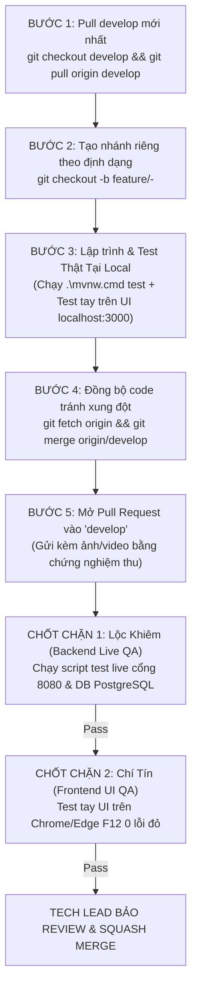

# KẾ HOẠCH CHI TIẾT PHÂN CHIA NHIỆM VỤ SPRINT 3 & QUY CHUẨN LÀM VIỆC NHÓM
> **Dự án**: DriveShare - Nền tảng chia sẻ và cho thuê xe trực tuyến  
> **Phiên bản áp dụng**: Sprint 3 Fix & Bổ sung tính năng trọng yếu  
> **Người phê duyệt**: Tech Lead Nguyễn Duy Bảo (`@em123ngao-arch`)  

---

## PHẦN 1: QUY CHUẨN LÀM VIỆC NHÓM & QUY TRÌNH GIT 5 BƯỚC CHUẨN HÓA

Để tránh tuyệt đối tình trạng: *"Code xong trên máy cá nhân, dùng AI vibe-coding nộp code báo xong nhưng lên hệ thống thật thì bấm không chạy, lỗi giao diện, sập database"*, toàn bộ 5 thành viên phải tuân thủ nghiêm ngặt quy trình dưới đây.



### 1. Quy Trình 5 Bước Làm Việc Của Thành Viên
1. **Bước 1 - Lấy mã nguồn mới nhất:**
   ```powershell
   git checkout develop
   git pull origin develop
   ```
2. **Bước 2 - Tạo nhánh tính năng riêng:**
   * Cú pháp nhánh: `feature/<tên-nhiệm-vụ>` (Ví dụ: `feature/dispute-modal-and-admin-bank-ui`).
   ```powershell
   git checkout -b feature/<tên-nhiệm-vụ>
   ```
3. **Bước 3 - Lập trình & Kiểm thử nội bộ (Bắt buộc Test Thật):**
   * Backend: Phải chạy lệnh `cd backend; .\mvnw.cmd test` (bắt buộc pass 158/158 tests hiện tại).
   * Frontend: Chạy server `python -m http.server 3000` và mở `http://localhost:3000` bấm test trực tiếp.
4. **Bước 4 - Kéo code mới nhất từ develop về nhánh để giải quyết xung đột (Conflict):**
   ```powershell
   git fetch origin
   git merge origin/develop
   ```
   *(Nếu có xung đột, tự xử lý trên máy mình, đảm bảo không xóa đè code của đồng đội).*
5. **Bước 5 - Đẩy code và Mở Pull Request vào nhánh `develop`:**
   ```powershell
   git push origin feature/<tên-nhiệm-vụ>
   ```
   * Vào GitHub repository, chọn base: `develop` <- compare: `feature/<tên-nhiệm-vụ>`.
   * Điền nội dung PR theo **Biểu mẫu nghiệm thu** (Phần 4).

### 2. "Luật 3 Không" Nghiêm Ngặt
* ❌ **KHÔNG dùng dữ liệu ảo (`mock data` / `localStorage`) để tự dối là tính năng đã chạy:** Mọi thao tác phải lưu thật vào PostgreSQL và tải ảnh/video thật lên Cloudinary.
* ❌ **KHÔNG nộp PR nếu chưa test tay trên giao diện web:** Code viết ra bấm vào phải đổi trạng thái, phải có thông báo toast, không bị đơ hoặc lỗi F12 Console.
* ❌ **KHÔNG phá vỡ hệ thống hiện có:** Giữ nguyên 158 bài tests đang pass, giữ đúng chuẩn format `ApiResponse<T>`.

---

## PHẦN 2: CƠ CHẾ 2 CHỐT CHẶN KIỂM SOÁT CHẤT LƯỢNG (TWO-LAYER QUALITY GATE)

Tech Lead Bảo không phải là người đi dọn lỗi test tay cho từng bạn. Nhóm thiết lập cơ chế 2 Chốt chặn độc lập:

### 🛡️ Chốt 1: LỘC KHIÊM (`@khiemtan1712-oss`) - Backend Live & Database QA
* **Nhiệm vụ:** Kiểm duyệt toàn bộ phần "chìm" của hệ thống (API, Database, Cloudinary).
* **Quyền hạn:** Khiêm có quyền **Reject (Từ chối)** PR của Vĩ và Quân nếu:
  1. File migration SQL chạy bị lỗi trên PostgreSQL thật.
  2. Dùng file test script `verify_sprint3_live.ps1` gọi API thật cổng 8080 mà trả về HTTP 400/500 hoặc lưu sai database.
  3. Upload ảnh/video mà không lưu lên được Cloudinary.

### 🛡️ Chốt 2: CHÍ TÍN (`@CTnn1001`) - Frontend UI/UX & End-User QA
* **Nhiệm vụ:** Kiểm duyệt toàn bộ phần "nổi" của hệ thống (Giao diện người dùng, Thao tác bấm, Luồng khách hàng).
* **Quyền hạn:** Tín có quyền **Reject (Từ chối)** PR của bất kỳ ai (kể cả phần tích hợp) nếu:
  1. Click vào nút hoặc vùng upload bị lỗi double-click, nuốt sự kiện, không bật được file picker.
  2. Mở F12 Console thấy có bất kỳ dòng chữ màu đỏ nào (`Uncaught TypeError`, `undefined`, `404 Not Found`).
  3. F12 Network không gửi được request `FormData` mã 200 OK lên Server.
  4. Giao diện sau khi bấm không phản hồi trạng thái mới cho người dùng.

---

## PHẦN 3: PHÂN CHIA CHI TIẾT 5 GÓI NHIỆM VỤ ĐỘC LẬP

---

### GÓI 1: LỘC KHIÊM (`@khiemtan1712-oss`)
**Vai trò:** DevOps, Database Architect & Backend Live Integration QA  
**Nhánh Git:** `feature/V7-db-migration-live-qa`  
**Các file phụ trách:**
- `backend/src/main/resources/db/migration/V7__incident_dispute_and_owner_bank_verification.sql`
- `backend/src/main/java/com/driveshare/common/service/CloudinaryService.java`
- `backend/scripts/verify_sprint3_live.ps1`

#### Chi Tiết Công Việc:
1. **Viết Migration V7:**
   - Tạo bảng `rental_disputes`:
     * `id` (BIGSERIAL PRIMARY KEY)
     * `rental_id` (BIGINT REFERENCES rentals(id))
     * `reporter_id` (BIGINT REFERENCES users(id))
     * `reason` (TEXT NOT NULL)
     * `proof_urls` (TEXT - lưu danh sách JSON link ảnh/video Cloudinary)
     * `status` (VARCHAR(30) DEFAULT 'PENDING') -- PENDING, RESOLVED_REFUND, REJECTED
     * `refund_amount` (DECIMAL(12,2) DEFAULT 0)
     * `penalty_amount` (DECIMAL(12,2) DEFAULT 0)
     * `admin_note` (TEXT)
     * `created_at`, `resolved_at` (TIMESTAMP)
   - Thêm cột vào bảng `users`:
     * `bank_verification_status` (VARCHAR(30) DEFAULT 'UNVERIFIED') -- UNVERIFIED, VERIFIED, REJECTED
     * `bank_rejection_reason` (TEXT)
   - Bổ sung Enum `RentalStatus`: `DISPUTED`, `CANCELLED_BY_HOST`.
2. **Nâng cấp Cloudinary Service:**
   - Cập nhật method `uploadFile()` hoặc tạo `uploadMedia(MultipartFile file, String folder)`:
     * Nhận diện file ảnh hoặc video (mp4, mov, dung lượng tối đa 50MB).
     * Set `resource_type: "auto"` hoặc `"video"` để Cloudinary lưu video chuẩn xác.
3. **Xây dựng Script Test Tự Động Live API (`scripts/verify_sprint3_live.ps1`):**
   - Viết kịch bản tự động gọi cổng 8080:
     * Tạo tài khoản Owner -> Kiểm tra `bank_verification_status == UNVERIFIED`.
     * Gọi API đăng xe -> Phải nhận HTTP 403.
     * Gọi API báo sự cố `POST /api/v1/rentals/{id}/report-no-show` đính kèm file ảnh/video -> Phải nhận HTTP 200 và kiểm tra trong DB `status == DISPUTED`.

#### Tiêu Chí Hoàn Thành (Definition of Done):
- [ ] Chạy `.\mvnw.cmd compile` và `.\mvnw.cmd test` pass 100%.
- [ ] DB tự động áp dụng `V7` mà không cần drop table.
- [ ] Script `verify_sprint3_live.ps1` chạy độc lập từ PowerShell cho kết quả xanh toàn bộ.

---

### GÓI 2: CHÍ TÍN (`@CTnn1001`)
**Vai trò:** Frontend Lead & End-to-End User Experience QA  
**Nhánh Git:** `feature/dispute-modal-and-admin-bank-ui`  
**Các file phụ trách:**
- `frontend/js/booking.js`, `frontend/js/profile.js`
- `frontend/js/admin.js`, `frontend/admin.html`
- `frontend/css/portals.css`, `frontend/css/components.css`

#### Chi Tiết Công Việc:
1. **Modal Khiếu Nại Sự Cố Nhận Xe (`booking.js` / `profile.js`):**
   - Tại màn hình Chi tiết chuyến đi của Khách hàng, khi chuyến đi ở trạng thái chờ nhận xe (`CONFIRMED` / `DEPOSIT_PAID`):
     * Hiển thị nút cảnh báo màu cam/đỏ: **"Báo cáo chủ xe không giao xe"**.
     * Bấm vào mở Modal pop-up đẹp, chuẩn UI:
       - Trường nhập lý do chi tiết (tối thiểu 10 ký tự).
       - Dropzone kéo thả/chọn tối đa 3 ảnh và 1 video clip bằng chứng tại điểm hẹn.
       - **Bắt buộc:** Thêm `onclick="event.stopPropagation()"` vào `<input type="file">` để chống lỗi click đúp dropzone!
       - Nút "Gửi khiếu nại & Yêu cầu hoàn cọc".
   - Gọi API `POST /api/v1/rentals/{id}/report-no-show` dạng `FormData`.
   - Khi gửi thành công: Hiển thị badge trạng thái **"ĐANG KHIẾU NẠI (CHỜ ADMIN XỬ LÝ)"** và ẩn nút hủy thông thường.
2. **Giao Diện Admin Duyệt Tài Khoản Ngân Hàng (`admin.html` / `admin.js`):**
   - Tại Tab Quản lý Chủ xe (Owner Verification):
     * Tách làm 2 cột/khu vực kiểm duyệt độc lập:
       - **Khu vực 1: Định danh CCCD** (Ảnh 2 mặt CCCD, Tên, Ngày sinh) -> Nút [Duyệt CCCD] / [Từ chối CCCD].
       - **Khu vực 2: Tài khoản Ngân hàng** (Tên ngân hàng, Số tài khoản, Tên chủ thẻ) -> Nút [Duyệt STK] / [Từ chối STK].
     * Gọi API của Duy Quân: `PUT /api/v1/admin/users/{id}/verify-bank`.
3. **Quy Trình Test Bắt Buộc Của Tín Trước Khi Báo Xong:**
   - Mở Chrome và Edge, truy cập `http://localhost:3000`.
   - Test click thử 10 lần vào vùng upload ảnh xem có lần nào bị tắt file picker không.
   - Nhìn tab F12 Console: Đảm bảo 0 lỗi đỏ.
   - Nhìn tab F12 Network: Đảm bảo request gửi đi là `FormData` mã 200 OK, tải lại trang (F5) dữ liệu vẫn lưu đúng từ backend.

#### Tiêu Chí Hoàn Thành (Definition of Done):
- [ ] Giao diện Modal khiếu nại và Tab duyệt STK hiển thị đẹp, chuẩn Bootstrap 5, không vỡ layout.
- [ ] Thao tác mượt mà, upload ảnh/video không bị nuốt sự kiện.
- [ ] F12 Console sạch sẽ, không có lỗi JavaScript.

---

### GÓI 3: LÂM CHÍ VĨ (`@technology-web`)
**Vai trò:** Backend Rental Core Developer  
**Nhánh Git:** `feature/rental-no-show-dispute-be`  
**Các file phụ trách:**
- `backend/src/main/java/com/driveshare/modules/rental/` (RentalController, RentalService, RentalServiceImpl)
- `backend/src/main/java/com/driveshare/modules/rental/dto/` (RentalDisputeRequest, RentalDisputeResponse)
- `backend/src/main/java/com/driveshare/common/entity/RentalDispute.java`
- `backend/src/test/java/com/driveshare/modules/rental/RentalServiceTest.java`

#### Chi Tiết Công Việc:
1. **Tạo Entity & DTO:**
   - Map entity `RentalDispute` với bảng `rental_disputes` do Khiêm tạo.
   - Tạo DTO `RentalDisputeRequest` (`String reason`, `List<MultipartFile> evidenceFiles`).
2. **Endpoint Khách Báo Sự Cố:**
   - `POST /api/v1/rentals/{id}/report-no-show`
   - Nghiệp vụ:
     * Kiểm tra user đăng nhập phải chính là Renter của rental đó.
     * Kiểm tra trạng thái đơn đặt: Phải là `CONFIRMED` hoặc `PAID`.
     * Gọi `cloudinaryService.uploadMedia()` để lấy danh sách URL bằng chứng.
     * Lưu bản ghi `RentalDispute` với trạng thái `PENDING`.
     * Đổi `rental.status` thành `DISPUTED`.
3. **Endpoint Admin Giải Quyết Tranh Chấp:**
   - `POST /api/v1/admin/rentals/disputes/{disputeId}/resolve`
   - Nghiệp vụ:
     * Nhận payload: `action` (REFUND_RENTER / REJECT), `adminNote`.
     * Nếu `REFUND_RENTER`:
       - Đổi trạng thái `rental.status` thành `CANCELLED_BY_HOST`.
       - Tính số tiền hoàn cọc 100% cho khách hàng.
       - Ghi nhận phạt chủ xe (phạt cọc hoặc trừ điểm uy tín chủ xe).
4. **Viết Unit Test & MockMvc:**
   - Viết test kiểm tra: Đúng giờ nhận xe mới cho khiếu nại, người lạ không được khiếu nại đơn của người khác, Admin giải quyết hoàn cọc chính xác.

#### Tiêu Chí Hoàn Thành (Definition of Done):
- [ ] Viết tối thiểu 5 Unit Tests MockMvc pass 100%.
- [ ] Chạy kiểm thử thành công qua script test live của Khiêm.
- [ ] Phản hồi API luôn đóng gói trong `ApiResponse<T>`.

---

### GÓI 4: DUY QUÂN (`@nguyenduyquan0609-cyber`)
**Vai trò:** Backend Admin & Financial Security Developer  
**Nhánh Git:** `feature/admin-bank-verification-guard`  
**Các file phụ trách:**
- `backend/src/main/java/com/driveshare/modules/admin/` (AdminUserController, AdminUserService)
- `backend/src/main/java/com/driveshare/modules/car/service/CarServiceImpl.java`
- `backend/src/main/java/com/driveshare/common/enums/BankVerificationStatus.java`
- `backend/src/main/java/com/driveshare/common/exception/ErrorCode.java`

#### Chi Tiết Công Việc:
1. **Enum & ErrorCode:**
   - Thêm enum `BankVerificationStatus`: `UNVERIFIED`, `VERIFIED`, `REJECTED`.
   - Bổ sung `ErrorCode`: `OWNER_BANK_NOT_VERIFIED` (403, "Chủ xe chưa được duyệt thông tin tài khoản ngân hàng, không thể tạo xe mới").
2. **Endpoint Admin Duyệt Tài Khoản Ngân Hàng:**
   - `PUT /api/v1/admin/users/{id}/verify-bank`:
     * Nhận payload: `status` (VERIFIED / REJECTED), `rejectionReason` (nếu REJECTED).
     * Cập nhật `user.bank_verification_status` và lưu lý do nếu từ chối.
3. **Chốt Chặn Nghiệp Vụ Tại CarService:**
   - Trong `CarServiceImpl.createCar()`:
     * Kiểm tra chủ xe:
       ```java
       if (owner.getBankVerificationStatus() != BankVerificationStatus.VERIFIED) {
           throw new AppException(ErrorCode.OWNER_BANK_NOT_VERIFIED);
       }
       ```
     * Ngăn chặn tuyệt đối tình trạng chủ xe chưa xác minh tài khoản ngân hàng mà đã đưa xe lên sàn nhận tiền cọc của khách!
4. **Viết Unit Test:**
   - Test case: Chủ xe chưa verify bank -> gọi tạo xe -> ném ra 403 `OWNER_BANK_NOT_VERIFIED`.
   - Test case: Admin duyệt bank thành công -> chủ xe tạo xe bình thường.

#### Tiêu Chí Hoàn Thành (Definition of Done):
- [ ] Viết tối thiểu 4 Unit Tests bảo vệ luồng tạo xe.
- [ ] Pass toàn bộ 158 bài tests gốc của hệ thống.
- [ ] Script kiểm thử live của Khiêm chạy qua không gặp lỗi.

---

### GÓI 5: ĐỖ NGỌC PHÁT (`@dongocphat007-ctrl`)
**Vai trò:** AI Chatbot Assistant Engineer  
**Nhánh Git:** `feature/ai-chat-handover-support`  
**Các file phụ trách:**
- `backend/src/main/resources/prompts/car-advisor-system.txt`
- `backend/src/test/java/com/driveshare/modules/ai/AiChatServiceTest.java`

#### Chi Tiết Công Việc:
1. **Cập nhật System Prompt:**
   - Mở `backend/src/main/resources/prompts/car-advisor-system.txt`, thêm phần **7. QUY TRÌNH HỖ TRỢ KHẨN CẤP KHI GẶP SỰ CỐ BÀN GIAO XE**:
     ```text
     Khi khách hàng thông báo: Chủ xe không đến giao xe, chủ xe trễ hẹn, không liên lạc được chủ xe hoặc bị hủy chuyến đột ngột:
     1. Trấn an khách hàng: DriveShare cam kết bảo vệ 100% tiền cọc của bạn.
     2. Hướng dẫn 4 bước hành động ngay lập tức:
        - Bước 1: Gọi điện thoại cho Chủ xe qua SĐT trên đơn thuê ít nhất 2 lần.
        - Bước 2: Chụp ảnh hiện trường có định vị hoặc mốc địa chỉ rõ ràng, quay clip ngắn chứng minh đã có mặt đúng hẹn.
        - Bước 3: Vào mục 'Chi tiết chuyến đi' trên web/app -> Bấm nút 'Báo cáo chủ xe không giao xe' và tải ảnh/clip lên để hệ thống đóng băng tiền cọc chuyển sang trạng thái Tranh Chấp.
        - Bước 4: Nếu cần xe thay thế gấp hoặc hỗ trợ cứu hộ, gọi Hotline khẩn cấp DriveShare: 1900-6868 (Phím 1).
     ```
2. **Viết Test Case Kiểm Thử Prompt:**
   - Viết Unit Test giả lập câu hỏi khẩn cấp từ người dùng:
     * *"Tôi đang đứng đợi ở điểm hẹn 20 phút rồi mà chủ xe không tới, gọi điện thuê bao thì làm sao?"*
     * Kiểm tra nội dung trả về bắt buộc phải có từ khóa: "Hotline 1900-6868", "chụp ảnh/video bằng chứng", "Báo cáo sự cố/hoàn cọc".

#### Tiêu Chí Hoàn Thành (Definition of Done):
- [ ] Prompt được định dạng chuẩn, không gây lỗi cú pháp UTF-8.
- [ ] Pass 100% các bài test của module AI.
- [ ] Chatbot trả lời thông minh, đúng quy trình xử lý sự cố.

---

## PHẦN 4: BIỂU MẪU BÌNH LUẬN BÁO CÁO NGHIỆM THU (MANDATORY PR SIGN-OFF)

Mỗi thành viên khi tạo Pull Request bắt buộc phải dán nội dung này vào phần mô tả của PR. **Không có hình ảnh/video bằng chứng = Từ chối duyệt PR!**

```markdown
### 📋 BÁO CÁO NGHIỆM THU TÍNH NĂNG SPRINT 3

- **Họ và tên:** [Tên thành viên]
- **Mã Task / Issue:** #[Số Issue]
- **Nhánh thực hiện:** `feature/...`

#### 1. Các hạng mục đã hoàn thành
- [x] Đã hoàn thành code theo đúng yêu cầu chi tiết của Issue.
- [x] Đã chạy `.\mvnw.cmd test` và pass 100% (.../... bài test xanh).

#### 2. Minh chứng kiểm thử thực tế (BẮT BUỘC ĐÍNH KÈM ẢNH/LOG)
- **Minh chứng Backend (Khiêm, Vĩ, Quân):**
  - Ảnh chụp màn hình chạy lệnh test PowerShell / Live API:
    [Dán ảnh chụp màn hình tại đây]
  - Link Cloudinary thật đã lưu trữ thành công:
    [Dán link ảnh / video tại đây]
- **Minh chứng Frontend (Tín, Phát):**
  - Ảnh chụp màn hình giao diện thực tế trên `http://localhost:3000`:
    [Dán ảnh giao diện tại đây]
  - Ảnh chụp màn hình F12 Console (0 lỗi đỏ):
    [Dán ảnh F12 Console tại đây]
  - Ảnh chụp màn hình F12 Network (Status 200 OK với Payload FormData thật):
    [Dán ảnh F12 Network tại đây]

#### 3. Chữ ký xác nhận từ 2 Chốt Chặn QA
- [ ] **Lộc Khiêm (`@khiemtan1712-oss`)** - Backend Live QA: Xác nhận API và DB chạy thông suốt trên máy chủ thật.
- [ ] **Chí Tín (`@CTnn1001`)** - Frontend UI QA: Xác nhận giao diện hoạt động chuẩn, không lỗi thao tác.
```

---

## PHẦN 5: KẾ HOẠCH HÀNH ĐỘNG TẠO/CẬP NHẬT ISSUE TRÊN GITHUB

1. **Cập nhật 4 Issue đã có sẵn trên Git:**
   - **Issue #29** -> Gán cho **Lộc Khiêm** (Nội dung Gói 1).
   - **Issue #28** -> Gán cho **Chí Tín** (Nội dung Gói 2).
   - **Issue #25** -> Gán cho **Lâm Chí Vĩ** (Nội dung Gói 3).
   - **Issue #27** -> Gán cho **Đỗ Ngọc Phát** (Nội dung Gói 5).
2. **Tạo 1 Issue mới trên Git:**
   - Tiêu đề: `[Sprint 3 Fix] [BE Admin] Tách Quy Trình Duyệt Chủ Xe 2 Bước (Định Danh CCCD & STK Ngân Hàng)` -> Gán cho **Duy Quân** (Nội dung Gói 4).
3. **Quy tắc phân quyền:**
   - Tech Lead Nguyễn Duy Bảo (`@em123ngao-arch`) là người duy nhất có quyền merge vào nhánh `develop`.
   - Mọi PR bắt buộc phải có ít nhất 2 Approval từ Lộc Khiêm và Chí Tín trước khi Tech Lead bấm merge.
