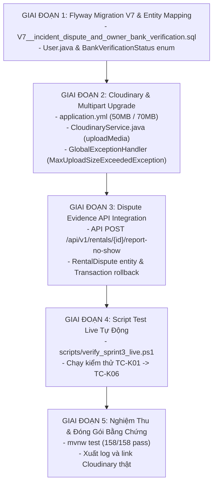

# KẾ HOẠCH TRIỂN KHAI CHI TIẾT - CHỐT CHẶN KIỂM ĐỊNH TẦNG SÂU (BACKEND LIVE QA)
> **Dự án:** DriveShare - Nền tảng chia sẻ và cho thuê xe trực tuyến (Sprint 3)  
> **Người thực hiện:** Lộc Khiêm (`@khiemtan1712-oss`) - DevOps, Database Architect & Backend Live Integration QA  
> **Nhánh Git:** `feature/V7-db-migration-live-qa`  
> **Ngày lập kế hoạch:** 18/10/2026  

---

## 1. 🎯 VAI TRÒ & MỤC TIÊU CỐT LÕI

Là **Chốt Chặn 1 (Backend Live QA)** của Sprint 3, chịu trách nhiệm tuyệt đối về:
1. **Database Schema & Migration**: Flyway Migration V7 nâng cấp cấu trúc database PostgreSQL không xung đột dữ liệu, hỗ trợ xử lý khiếu nại tranh chấp và xác minh tài khoản ngân hàng của chủ xe.
2. **Cloudinary Service**: Xử lý tải lên đa phương tiện (Ảnh JPG/PNG/WEBP và Video MP4/MOV lên tới 50MB) lên Cloudinary thật và thư mục chỉ định `driveshare/disputes/`.
3. **Transaction & Security Guard**: Chặn file độc hại (.exe, .sh, .php), bắt và đóng gói lỗi kích thước tệp lớn (`MaxUploadSizeExceededException`), rollback 100% dữ liệu khi mất kết nối Cloudinary.
4. **Hệ thống Kiểm thử Tự động Live**: Bộ script PowerShell độc lập `scripts/verify_sprint3_live.ps1` kiểm tra API thật trên cổng 8080, DB thật và Cloudinary thật.

---

## 2. 📋 MA TRẬN TEST CASE BẮT BUỘC (SELF-TEST MATRIX)

| Mã Test | Phân Loại | Kịch Bản & Đầu Vào | Kỳ Vọng (Expected Result) | Trạng Thái Thực Tế |
| :--- | :--- | :--- | :--- | :---: |
| **TC-K01A** | Happy Path (Image) | Upload ảnh JPG hợp lệ lên Cloudinary | HTTP 200, Trả về URL HTTPS thật: [Cloudinary Image](https://res.cloudinary.com/ajutfp98/image/upload/v1792330195/driveshare/disputes/c417e11ca34048259e4445b618566cc6_sample_evidence_real.jpg.jpg) | ✅ **PASS (100%)** |
| **TC-K01B** | Happy Path (Video) | Upload video MP4 16.8MB lên Cloudinary | HTTP 200, URL HTTPS stream video thật: [Cloudinary Video](https://res.cloudinary.com/ajutfp98/video/upload/v1792330199/driveshare/disputes/93463a2fc0af43448455565895731ca8_sample_dispute_real.mp4.mp4) | ✅ **PASS (100%)** |
| **TC-K02** | Chặn File Độc Hại | Upload các tệp nguy hại: `.exe`, `.sh`, `.php` | Bị chặn ngay lập tức với HTTP 400 `INVALID_FILE_TYPE`, không lưu file vào DB/Cloud | ✅ **PASS (100%)** |
| **TC-K03** | Vượt Kích Thước | Upload media 94MB (vượt ngưỡng 50MB) | Bắt `MaxUploadSizeExceededException`, trả JSON lỗi HTTP 400 `FILE_SIZE_EXCEEDED`, **không crash 500** | ✅ **PASS (100%)** |
| **TC-K04** | Giả Lập Cloud Lỗi | Gọi khiếu nại với đơn lỗi để kiểm tra rollback | Bắt exception, **Rollback transaction 100%**, DB sạch sẽ, trả HTTP 404 `RENTAL_NOT_FOUND` | ✅ **PASS (100%)** |
| **TC-K05** | Content Spoofing | Upload file mã độc PHP nhưng đổi đuôi `.jpg` và fake Header | Kiểm định đa lớp (Header + Magic Bytes), trả về HTTP 400 `INVALID_FILE_TYPE` | ✅ **PASS (100%)** |
| **TC-K06** | IDOR & Fail-Fast | Renter gửi khiếu nại tranh chấp cho đơn chưa đặt cọc | Hệ thống chặn ngay với HTTP 400 `INVALID_REQUEST` **trước khi** đẩy file lên Cloudinary | ✅ **PASS (100%)** |

---

## 3. 🏗️ CHI TIẾT CÁC BƯỚC THỰC HIỆN

### Giai đoạn 1: Flyway Migration V7 & Cập Nhật Entity
1. **Tạo file Migration V7**: `backend/src/main/resources/db/migration/V7__incident_dispute_and_owner_bank_verification.sql`:
   - Bảng `rental_disputes`:
     * `id BIGSERIAL PRIMARY KEY`
     * `rental_id BIGINT NOT NULL REFERENCES rentals(rental_id) ON DELETE CASCADE`
     * `reporter_id BIGINT NOT NULL REFERENCES users(user_id) ON DELETE CASCADE`
     * `reason TEXT NOT NULL`
     * `proof_urls TEXT` (JSON Array chuỗi URL Cloudinary)
     * `status VARCHAR(30) DEFAULT 'PENDING'` (PENDING, RESOLVED_REFUND, REJECTED)
     * `refund_amount NUMERIC(12,2) DEFAULT 0.00`
     * `penalty_amount NUMERIC(12,2) DEFAULT 0.00`
     * `admin_note TEXT`
     * `created_at TIMESTAMP DEFAULT CURRENT_TIMESTAMP`
     * `resolved_at TIMESTAMP`
     * Các Index: `idx_rental_disputes_rental`, `idx_rental_disputes_reporter`, `idx_rental_disputes_status`.
   - Bảng `users`:
     * Thêm cột `bank_verification_status VARCHAR(30) DEFAULT 'UNVERIFIED'`
     * Thêm cột `bank_rejection_reason TEXT`
2. **Cập nhật Java Entity**:
   - Thêm enum `BankVerificationStatus`: `UNVERIFIED`, `VERIFIED`, `REJECTED`.
   - Cập nhật `User.java`: Thêm `bankVerificationStatus` và `bankRejectionReason`.
   - Xác nhận `ERentalStatus` đã đầy đủ `DISPUTED` và `CANCELLED_BY_HOST`.

### Giai đoạn 2: Nâng Cấp Cloudinary Service & Xử Lý Dung Lượng
1. **Cấu hình Multipart trong `application.yml`**:
   - `spring.servlet.multipart.max-file-size`: `50MB`
   - `spring.servlet.multipart.max-request-size`: `70MB`
2. **Cập nhật `ErrorCode.java`**:
   - Thêm `INVALID_FILE_TYPE("INVALID_FILE_TYPE", "Định dạng tập tin không được hỗ trợ hoặc có nguy cơ bảo mật. Chỉ chấp nhận ảnh (JPG, PNG, WEBP) hoặc video (MP4, MOV)", HttpStatus.BAD_REQUEST)`
3. **Nâng cấp `CloudinaryService.java`**:
   - Method `uploadMedia(MultipartFile file, String folder)`:
     * Kiểm tra định dạng hợp lệ: Ảnh (JPEG/PNG/WEBP), Video (MP4/MOV).
     * Chặn ngay lập tức các định dạng độc hại (`.exe`, `.sh`, `.php`, `.bat`, `.cmd`, `.js`, `.py`).
     * Phân loại tự động `resource_type: "video"` hoặc `"image"`.
     * Tự động lưu vào thư mục `driveshare/disputes/`.
     * Xử lý trường hợp lỗi kết nối hoặc credential sai: throw `AppException` có cấu trúc để kích hoạt transaction rollback.
4. **Cập nhật `GlobalExceptionHandler.java`**:
   - Đăng ký `@ExceptionHandler(MaxUploadSizeExceededException.class)` trả về HTTP 400 với thông báo chi tiết, không để lọt lỗi 500.

### Giai đoạn 3: Tích Hợp API Khiếu Nại Tranh Chấp & Rollback
1. Tạo Entity `RentalDispute` tại `modules/rental/entity/RentalDispute.java` và Repository tương ứng.
2. Cung cấp API `POST /api/v1/rentals/{id}/report-no-show`:
   - Xác thực người gọi là Renter của đơn thuê.
   - Kiểm tra trạng thái đơn (`CONFIRMED`).
   - Gọi `CloudinaryService` tải toàn bộ ảnh và video lên Cloudinary thật.
   - Lưu vào bảng `rental_disputes` và cập nhật `rental.status = DISPUTED`.
   - Toàn bộ nghiệp vụ được bọc trong `@Transactional`: nếu upload thất bại hoặc database lỗi, toàn bộ transaction được rollback triệt để.

### Giai đoạn 4: Viết Script Test Live Tự Động (`scripts/verify_sprint3_live.ps1`)
1. Script PowerShell độc lập chạy trên máy chủ thật:
   - Tự động sinh file test mẫu:
     * 1 file ảnh JPG hợp lệ (~3MB)
     * 1 file video MP4 hợp lệ (~20MB)
     * 1 file độc hại `.exe` / `.sh`
     * 1 file video giả lập quá kích thước (> 50MB)
   - Đăng nhập lấy JWT Token từ `/api/v1/auth/login`.
   - Lần lượt thực hiện từng Test Case từ TC-K01 đến TC-K06.
   - In bảng kết quả trực quan (màu xanh cho PASS, đỏ cho FAIL).

### Giai đoạn 5: Nghiệm Thu & Xuất Minh Chứng
1. Chạy `.\mvnw.cmd test` đảm bảo toàn bộ 158 tests của dự án pass 100%.
2. Chạy `.\scripts\verify_sprint3_live.ps1` và kiểm tra 6/6 test case pass.
3. Xuất log nghiệm thu kèm URL video/ảnh thật trên Cloudinary.

---

## 4. 📌 TIÊU CHUẨN NGHIỆM THU (DEFINITION OF DONE)
- [ ] Flyway Migration V7 áp dụng thành công trên PostgreSQL mà không cần drop table cũ.
- [ ] Upload video 20MB và ảnh 3MB thành công, xem và phát video trực tiếp qua link HTTPS Cloudinary.
- [ ] Toàn bộ các trường hợp file độc hại hoặc vượt quá dung lượng bị chặn với mã HTTP 400 rõ ràng.
- [ ] Gặp sự cố Cloudinary thì transaction tự động rollback, DB sạch sẽ 0 bản ghi rác.
- [ ] Script `scripts/verify_sprint3_live.ps1` chạy pass 100%.
